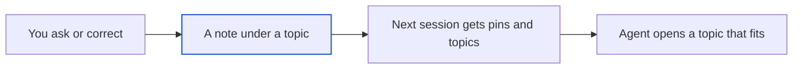

The agent keeps notes about you and your repositories in your account, so a new session doesn't start from zero. Your test command, a publishing rule or how you like replies is learned once, filed under a topic, and used by every session that needs it. You see every note on the **Memory** page in **Settings**, where you can edit, pin or delete them, or turn memory off.

## What does the agent remember?

Each note is one short fact, filed under a topic such as **Tests**, **Publishing** or **Replies**. The agent saves one when:

- You ask it to remember something.
- You correct how it works, or state a preference that should last, such as "Keep status answers to four lines". It pins lasting preferences, so every session has them in full.
- It had to work out a lasting fact about your project that the files don't show, such as the command that runs the tests, a rule about where you publish, or a pitfall in the build.

By default it saves nothing, and most sessions add no note. When it saves, changes or forgets a note, it tells you in one line and names the topic.

It never saves:

- Secrets, keys or passwords. If one of your secret values ends up in a note anyway, it's saved as `[redacted]`, the way the transcript [hides values](/secrets#how-are-values-hidden-in-the-transcript).
- Progress on the task at hand, such as pull request numbers, branch names or what's done so far. Your earlier sessions keep that, and the agent can search them.
- Guesses.
- Anything your repository or its docs already say.

A note is background, not an order. What you say in the session wins over a note, and the agent checks a note against the repository before acting on it. A note that turns out to be wrong gets corrected or forgotten.

## How a new session uses your notes

Every new session starts with your pinned notes in full and the list of your topics, each with a one-line description of what its notes cover. The topics used most, and most recently, come first. The agent opens a topic when its description fits the task, the way it reads a [skill](/skills/overview) whose description fits, and leaves the rest closed.

Before it tells you something isn't saved, or asks you for something an earlier session may have learned, the agent searches your notes and your earlier sessions. Opening or finding a topic counts as a use, so topics you rely on stay near the top.

When notes change, whether the agent changed them in another session or you edited them in **Settings**, each session gets the new list with its next message.

## Notes about you and notes about a repository

Notes live in one of two places:

| Place | What goes there | Which sessions get it |
| --- | --- | --- |
| **Account** | Facts about you, or that hold across your work, such as how you like replies | Every session you own |
| A repository, such as `harbor-sailing/harbor-web` | Facts about that repository's code, build or conventions, such as its test command | Only sessions where that repository is attached |

A session with two repositories attached gets the account's notes and both repositories' notes. To attach a repository, see [Connect GitHub and add repositories](/github/connect#add-a-repository).

## Ask the agent to remember or forget

Say it in plain words, in any session:

| You want | Ask, for example |
| --- | --- |
| Save a fact | "Remember that the end-to-end tests need the seed database." |
| Save something every session should know | "Always remember: I review pull requests myself, so never merge." |
| Change a note | "The tests run with bun now, not npm. Update your note." |
| Forget a note | "Forget what you saved about the staging server." |
| Pin or unpin a note | "Pin the note about reply length." |
| See what it knows | "What do you remember about this repository?" |

The agent edits a note that already covers the subject instead of adding a second one. A correction replaces the old value, and a change over time keeps both, such as "publishes by tag (previously by merge to main)".

## Browse your memory

Open **Account menu → Settings** and pick **Memory** in the list of sections, beside **General**.

At the top, **Remember across sessions** turns memory on or off (see [Turn memory off](#turn-memory-off)). Below it, the page lists your notes in sections: **Account** first, then one section per repository, headed by its name, such as `harbor-sailing/harbor-web`. Each section shows:

- **Pinned notes**, if it has any: each pinned note with a pin icon, and its topic at the right. Click one to open its topic with that note unfolded.
- **Topics**: one row each, with the topic's name, its one-line description and how many notes it holds, such as "3 notes". The first eight show, the ones used most and most recently first. **Show all 12 topics** (with your count) unfolds the rest, and **Show fewer** folds them again.

Type in **Search memory** to find a note or a topic. It matches topic names, descriptions and other names, and the text and detail of every note, in every section. While you search, the pinned notes are hidden, every matching topic shows, and a topic that matched through one of its notes shows that note's text in place of its description. Click the row to open the topic with that note unfolded. If nothing matches, the page says "Nothing matches “…”." with your search.

| What you see | What it means |
| --- | --- |
| "No notes yet. An agent saves one when you ask it to remember something or correct how it works." | You have no notes. |
| **Name only** on a topic | The list of topics is full, so agents see only this topic's name until they open it. |
| "Pinned notes 85% full" or "Topic list 90% full" beside a section's name | The section is close to its room for pinned notes or topic descriptions. It shows only past 80%. |
| "Topic list full, 3 by name only" | That many topics in the section are **Name only**. |
| "Pinned notes over the limit" | The section's pinned notes take more than their room. Unpin a note. |

## Open a topic

Click a topic's row and it opens in place of the list. **‹ Memory** at the top, or <kbd>Esc</kbd>, takes you back to where you were in the list.

The topic's page shows:

- Its name, with the repository it belongs to, if any, and when it was last used, such as "Used 2d ago". A **Name only** topic adds "Agents see only its name until they open it".
- Its description, and "Also called …" with its other names, if it has any.
- **Notes**: every note in the topic. When a topic holds more than agents read at once, the least-used notes fold under **Less used (2)**, with your count. Agents see those only when they ask for every note in the topic.

**Edit** at the top right changes the topic's **Description** ("What it covers, when to read it") and its **Other names, one per line**, then **Save** or **Cancel**. **Save** stays greyed out until the description has some text. The description is what agents read to decide whether to open the topic, so name the commands, services and paths it covers.

**Delete** removes the topic and every note in it, after a confirmation: "Delete the topic “…” and its 3 notes? This cannot be undone."

## Edit, pin or delete a note

Click a note to unfold it. You see its detail, if it has one, then when it was last used and, for a note saved in a session, "from" and that session's title as a link. Under that are three buttons:

| Button | What it does |
| --- | --- |
| **Edit** | Opens the note's text and its **Detail (optional)** box, then **Save** or **Cancel**. The note stays one line: a line break becomes a space. |
| **Pin** / **Unpin** | A pinned note goes in full to every session that gets its section, and shows a pin icon. |
| **Delete** | Removes the note at once, with no confirmation. A topic whose last note you delete goes with it. |

If an agent changed the note while you were editing it, saving shows "This note changed since you opened it; it now reads: “…”. Save again to replace it." **Save** again to keep your version, or **Cancel** to keep the agent's.

Pinning has a limit. If one more pinned note wouldn't fit in the section's room, a message in red asks you to unpin another first.

## Turn memory off

Memory is on for every account. To turn it off, open **Settings → Memory** and switch off **Remember across sessions**. The line under it changes from "Agents keep what you teach them and use it in later sessions." to "Off. Agents start each session without these notes."

While memory is off:

- No session gets your notes. A session already running is told with its next message that its earlier notes no longer apply.
- The agent can't save, open, search or change notes, even when you ask it to.
- Your notes stay. You can still browse, edit, pin and delete them in **Settings**.

Switch it back on, and every session gets your notes again with its next message. The switch belongs to your account, so it applies on every device.

## Who can see your notes?

Your notes are yours alone. The **Memory** page shows only your own, and only sessions you own get them. Someone who shares a session with you doesn't get your notes in it, and your notes never reach their sessions.

A session's transcript is a different matter. People you [share a session](/sharing) with watch every command and reply, so in that session they can read the notes the agent opens and the notes it saves or changes there. Keep that in mind before you share a session in which the agent works with memory.

If you used Alpha as a guest and later sign in to an account from the same browser, your notes move to that account with the rest of your guest work (see [Using Alpha without an account](/account/your-account#using-alpha-without-an-account)).

## Limits

| What | Limit |
| --- | --- |
| A note | One line of up to 300 characters |
| A note's detail | Up to 4,000 characters |
| A topic's description | One line of up to 150 characters |
| A topic's other names | Up to 8, each up to 40 characters |
| Notes | 300 for the account, and 300 for each repository. Once one is full, a note there has to be forgotten before another is saved. |
| Topics | 60 for the account, and 60 for each repository |
| Pinned notes | 3 KB for the account, and 3 KB for each repository |
| Topic descriptions sent to a new session | 3 KB for the account, and 3 KB for each repository. Topics past it go as **Name only**. |

## Next steps

<CardGroup cols={2}>
  <Card title="Your account and settings" icon="gear" href="/account/your-account#change-your-settings">
    The rest of the Settings page: new messages, theme and your work.
  </Card>
  <Card title="Skills" icon="wand-magic-sparkles" href="/skills/overview">
    Saved instructions every session can use, for whole ways of working rather than single facts.
  </Card>
  <Card title="Prompt Alpha well" icon="comments" href="/get-started/prompting">
    What to put in a first message, and what you no longer need to repeat.
  </Card>
  <Card title="Share a session" icon="share-nodes" href="/sharing">
    What viewers can see, including the transcript where the agent uses memory.
  </Card>
</CardGroup>
