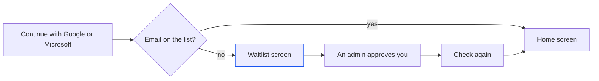

import { appUrl } from '/snippets/limits.mdx';

Your Alpha account holds your sessions, global secrets, connections and preferences, and it follows you to any browser you sign in from. This page covers signing in to Alpha, the waitlist, the account menu and the **Settings** page. To have the agent run on your own ChatGPT or Claude plan, which is a separate sign-in, see [Usage, costs and your own plan](/account/usage-and-costs).

## Sign in to Alpha

Alpha signs you in with an account you already have. The sign-in screen shows **Continue with Google** and **Continue with Microsoft**. Each button goes straight to that provider's own account chooser and comes back to Alpha. Microsoft accepts work, school and personal accounts. There is no Alpha password to create or remember.

{/* screenshot to capture: /images/account/signin-screen.png — Pick the account you use for work. Alpha never asks for a password of its own. */}

A sign-in lasts 30 days from the moment you sign in. After that, Alpha shows the sign-in screen again. Within those 30 days, reloading the page opens Alpha at once, and signing in or out in one tab updates your other tabs too.

<Note>
If you see only one of the two buttons, the other isn't turned on for your Alpha. If you see "Sign-in isn't available at this address." instead of any button, you've opened Alpha at an address its sign-in providers don't accept. Open it at its usual address, such as {appUrl}.
</Note>

## If you're on the waitlist

Your Alpha can be limited to a list of approved email addresses. If you sign in with an address that isn't on the list yet, Alpha still creates your account, then holds it on the waitlist screen until an admin approves it. Nothing else opens in the meantime.

The screen reads "Request received" and "You're on the waitlist", shows the account you signed in with, and says the team has been told you're here.

{/* screenshot to capture: /images/account/waitlist-screen.png — Once an admin approves you, Check again takes you straight in. */}

| What you do | What happens |
| --- | --- |
| Press **Check again** | Alpha opens if you've been approved. Otherwise it says "Still waiting for approval. Try again in a little while.", or "Couldn't reach Alpha. Check your connection and try again." if the check didn't get through. |
| Refresh the page | Same as **Check again**. |
| Click **Sign out** after "Wrong account?" | You return to the sign-in screen to try a different account. |

## What happens on your first visit

The first time the [home screen](/sessions/home-screen) opens in a tab, a short intro plays: the Lyzr mark draws itself and "Alpha" is written across the screen. Any click or key skips it, and a key you press still reaches the [composer](/chat/composer), so you can start typing straight away. It doesn't play again in that tab, and it never plays if your system is set to reduce motion.

Next, Alpha asks one question, "What best describes your work?", and offers a list of roles from **Product management** to **Other**.

{/* screenshot to capture: /images/account/work-question-dialog.png — Asked once per account. Skip is a fine answer. */}

Pick one and press **Continue**, or press **Skip**. Either way, the question doesn't come back on any device. Closing the dialog counts as skipping. You can change the answer later in [Settings](#change-your-settings).

## Find everything in the account menu

Click your name (or your email, if your account has no name) at the bottom of the sidebar to open the account menu. In guest mode the badge reads **Guest**. Each row opens the page or dialog that owns it.

{/* screenshot to capture: /images/account/sidebar-account-menu.png — One menu for everything that belongs to your account rather than to a session. */}

| Row | What it opens | Learn more |
| --- | --- | --- |
| **Usage** | Your spend, by session and by model | [Usage, costs and your own plan](/account/usage-and-costs) |
| **Settings** | Your preferences, at `/settings` | [Below](#change-your-settings) |
| **Global secrets** | Keys and values every session you own can read | [Secrets](/secrets) |
| **Setups** | Your ready-made machines, and the ones shared with you | [Setups](/sessions/setups) |
| **Sign in with ChatGPT/Claude** | "Use your own plan": a row each for ChatGPT and Claude, showing "Signed in" or "Not signed in" | [Usage, costs and your own plan](/account/usage-and-costs) |
| **Send feedback** | A "Report a bug" dialog with a screenshot of what you see. Draw on it, describe what happened, pick **Bug**, **Improvement** or **Feature request**, then **Submit feedback** | — |
| **Sign out** | Signs you out of Alpha in this browser | [Below](#sign-out) |

The connected-accounts row reads **Sign in with ChatGPT** when your Alpha doesn't run Claude Code, and a dot on its icon means one of those plans is signed in. **Send feedback** shows only when your Alpha collects feedback, and only to signed-in accounts.

### Sign out

Open the account menu and choose **Sign out**. The page reloads to the sign-in screen, and your other tabs sign out with it. Your sessions keep running without you, so a turn in progress carries on and you can pick it up after signing in again.

<Warning>
Signing out clears every unsent draft in the composers of this browser, on the home screen and in each session. Send or copy anything you want to keep first.
</Warning>

## Change your settings

The **Settings** page holds two preferences. Both are saved to your account, so they follow you to every device and browser.

<Frame caption="Settings holds two rows: New messages and your answer to the work question.">
  
</Frame>

| Setting | Choices | What it changes |
| --- | --- | --- |
| **New messages** | **Queue** (default): "Send after the agent finishes". **Steer**: "Send into the running turn without stopping it". | What <kbd>Enter</kbd> does when you send a message mid-turn. <kbd>⌘</kbd> <kbd>Enter</kbd> always sends the other way (Ctrl on Windows and Linux). |
| **What best describes your work?** | One of the roles from the first visit. It reads **Not set** until you pick one. | Your answer to the onboarding question. |

To choose between queueing and steering for a particular message, see [Queue, steer or stop](/chat/queue-and-steer). Choices that belong to one session, such as the agent, model, effort and permissions, are set in the composer, not here.

## Using Alpha without an account

Some Alphas run in guest mode. There is no sign-in screen: each browser gets its own guest identity, the account badge reads **Guest**, and there is no **Sign out** row. Sharing a session with specific people isn't available, because there are no account emails to share with.

If that Alpha later switches to accounts, the first time you sign in from the same browser your guest work moves to your account in one step. That covers your sessions and their published apps, your global secrets (including keys you pasted for integrations), your GitHub connection and your Claude sign-in. Your ChatGPT sign-in doesn't move, so sign in to it again from **Sign in with ChatGPT/Claude**. Setups you saved as a guest don't move either, and stop showing in your list.

## Sign-in messages

When a Google or Microsoft sign-in doesn't complete, Alpha brings you back to the sign-in screen with the reason in red above the buttons. On an Alpha that signs you in with Google directly, the reason appears instead on a plain page under "Couldn't sign in with Google.", with a **Back to Alpha** link.

| Message | What it means | What to do |
| --- | --- | --- |
| "sign-in was cancelled" | You backed out on the Google or Microsoft page. | Press the button again. |
| "sign-in didn't complete — try again" | The provider returned an error. | Try again. If it repeats, ask your admin. |
| "this sign-in link expired or was already used — try again" | The sign-in took too long, or you reused an old tab. | Start again from the sign-in screen. |
| "this sign-in doesn't match the one started here — try again" | The sign-in was started in another tab or browser. | Start again in this tab. |
| "Google hasn't verified this account's email address" | Google can't vouch for the address. | Verify the address with Google, or use another account. |
| "Microsoft couldn't confirm that &lt;email&gt; belongs to this account" | Microsoft didn't confirm the address. | Use another account, or ask your admin. |
| "Google didn't share an email address for this account" (or "Microsoft didn't…") | The provider sent no address, and Alpha needs one. | Use an account with an email address. |
| "this Alpha server is invite-only — &lt;email&gt; isn't on its allowed list" | Your address isn't approved, and this Alpha has no waitlist. You see it on the direct Google sign-in page. | Ask an admin to add you, or sign in with an approved address. |
| "the sign-in service can't be reached right now — try again in a moment" | The sign-in service is down. | Wait a moment and try again. |
| "sign-in is unavailable right now — try again in a moment" | Alpha couldn't start or check the sign-in. | Wait a moment and try again. |
| "Can't reach the Alpha server." with **Retry** | Alpha's server didn't answer when the page loaded, and this browser has no remembered sign-in to open on. | Alpha keeps retrying by itself, waiting a little longer each time. Press **Retry**, or check your connection. |

For problems after you're signed in, see [Troubleshooting and FAQ](/reference/troubleshooting).

## Next steps

<CardGroup cols={2}>
  <Card title="Usage, costs and your own plan" icon="chart-column" href="/account/usage-and-costs">
    See what each session spent, and run the agent on your ChatGPT or Claude plan.
  </Card>
  <Card title="The home screen" icon="house" href="/sessions/home-screen">
    Where you land after signing in, and where every session starts.
  </Card>
  <Card title="Secrets" icon="key" href="/secrets">
    Add API keys once as global secrets, and every session you own can use them.
  </Card>
  <Card title="Queue, steer or stop" icon="forward" href="/chat/queue-and-steer">
    When to pick each, whatever your New messages setting says.
  </Card>
</CardGroup>
