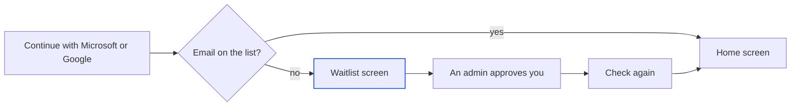

import { appUrl, feedbackFiles } from '/snippets/limits.mdx';

Your Alpha account holds your sessions, secrets, connections and preferences, and it follows you to any browser you sign in from. This page covers signing in to Alpha, the waitlist, the account menu, reporting a bug, the **Settings** page and the light and dark themes. To have the agent run on your own ChatGPT or Claude plan, which is a separate sign-in, see [Usage, costs and your own plan](/account/usage-and-costs).

## Sign in to Alpha

Alpha signs you in with an account you already have. The sign-in screen shows the Lyzr mark with "Alpha" written beside it, the line "A forward-deployed engineer that builds, runs and ships your apps and agents.", and two buttons: **Continue with Microsoft**, then **Continue with Google**. "by Lyzr" sits at the bottom of the screen. Each button goes straight to that provider's own account chooser and comes back to Alpha. Microsoft accepts work, school and personal accounts. There is no Alpha password to create or remember.

{/* screenshot to capture: /images/account/signin-screen.png — The sign-in screen in the light theme: the written Alpha lockup, the tagline, Continue with Microsoft above Continue with Google, and by Lyzr at the bottom. */}

A sign-in lasts 30 days from the moment you sign in. After that, Alpha shows the sign-in screen again. Within those 30 days, reloading the page opens Alpha at once, and signing in or out in one tab updates your other tabs too. When your sign-in ends, because it expired or you signed out in another tab, an open Alpha page switches to the sign-in screen by itself, without you sending anything.

<Note>
If you see only one of the two buttons, the other isn't turned on for your Alpha. If you see "Sign-in isn't available at this address." instead of any button, you've opened Alpha at an address its sign-in providers don't accept. Open it at its usual address, such as {appUrl}.
</Note>

## If you're on the waitlist

Your Alpha can be limited to a list of approved email addresses. If you sign in with an address that isn't on the list yet, Alpha still creates your account, then holds it on the waitlist screen until an admin approves it. Nothing else opens in the meantime.

Under the line "An agent workbench with real machines.", the screen reads "Request received" and "You're on the waitlist", says the team has been told you're here, and shows the account you signed in with.

{/* screenshot to capture: /images/account/waitlist-screen.png — Once an admin approves you, Check again takes you straight in. */}

| What you do | What happens |
| --- | --- |
| Press **Check again** | Alpha opens if you've been approved. Otherwise it says "Still waiting for approval. Try again in a little while.", or "Couldn't reach Alpha. Check your connection and try again." if the check didn't get through. |
| Refresh the page | Same as **Check again**. |
| Click **Sign out** after "Wrong account?" | You return to the sign-in screen to try a different account. |

## What happens on your first visit

The first time you sign in, Alpha asks one question, "What best describes your work?", with the hint "Pick the closest one. You can change it any time in Settings." The list of roles runs from **Product management** to **Other**.

<Frame caption="On your first visit, Alpha asks what best describes your work. You can skip it.">
  
</Frame>

Pick one and press **Continue**, or press **Skip**. Either way, the question doesn't come back on any device. Closing the dialog counts as skipping. You can change the answer later in [Settings](#change-your-settings).

## Find everything in the account menu

Click your name (or your email, if your account has no name) at the bottom of the sidebar to open the account menu. In guest mode the badge reads **Guest**. Each row opens the page or dialog that owns it.

{/* screenshot to capture: /images/account/sidebar-account-menu.png — The account menu open above the account badge: Usage, Settings, Secrets, Setups, Sign in with ChatGPT/Claude, a divider, then Send feedback and Sign out. */}

| Row | What it opens | Learn more |
| --- | --- | --- |
| **Usage** | Your spend, by session and by model, at `/usage` | [Usage, costs and your own plan](/account/usage-and-costs) |
| **Settings** | Your preferences and this device's theme, at `/settings` | [Below](#change-your-settings) |
| **Secrets** | The **Secrets** page, at `/secrets`. It lists your **Global** secrets, which every session you own can read, your **Secret sets**, and **From setups shared with you** when someone shares a setup that has a set. The row's number counts your global secrets. | [Secrets](/secrets) and [Secret sets](/secrets#secret-sets) |
| **Setups** | The **Setups** page, at `/setups`: your ready-made machines, and the ones shared with you | [Setups](/sessions/setups) |
| **Sign in with ChatGPT/Claude** | "Use your own plan": a row each for ChatGPT and Claude, showing "Signed in" or "Not signed in" | [Usage, costs and your own plan](/account/usage-and-costs) |
| **Send feedback** | The **Report a bug** panel, docked at the bottom of the screen | [Below](#report-a-bug-or-suggest-an-improvement) |
| **Sign out** | Signs you out of Alpha in this browser | [Below](#sign-out) |

The connected-accounts row reads **Sign in with ChatGPT** when your Alpha doesn't run Claude Code, and a dot on its icon means one of those plans is signed in. A line separates **Send feedback** and **Sign out** from the rows above.

### Sign out

Open the account menu and choose **Sign out**. The page reloads to the sign-in screen, and your other tabs sign out with it. Your sessions keep running without you, so a turn in progress carries on and you can pick it up after signing in again.

<Warning>
Signing out clears every unsent draft in the composers of this browser, on the home screen and in each session. Send or copy anything you want to keep first.
</Warning>

## Report a bug or suggest an improvement

The report panel sends a description, and any screenshots or files you attach, to the team that runs Alpha. Open it in either of two places:

- **Account menu → Send feedback**.
- The bug icon (**Report a bug**) at the right of the workspace header, just before the files button. When the workspace is hidden, the same icon sits in the session header.

The panel docks at the bottom centre of the screen. It doesn't dim or block Alpha, so you can keep using the page, or take a screenshot of your own, while it's open. Drag it anywhere on screen.

<Steps>
  <Step title="Pick what kind of report it is">
    At the bottom of the panel, pick **Bug**, **Improvement** or **Feature request**. The heading follows your pick: "Report a bug", "Suggest an improvement" or "Request a feature".
  </Step>
  <Step title="Describe it">
    Type into the box that reads "What went wrong, and what did you expect?". A description is the only thing a report needs.
  </Step>
  <Step title="Attach screenshots or files, if you like">
    Under the description:

    - **Take screenshot** ("Capture this tab, then drag to select an area") asks your browser to share this tab. The panel hides while it takes one picture. Then drag to keep an area, or click to keep the whole page; <kbd>Esc</kbd> cancels and brings the report back. The crop is attached as `Screenshot.png`.
    - The paperclip (**Attach files**) picks files from your computer. You can also drop files on the panel, or paste them with <kbd>⌘</kbd> <kbd>V</kbd> (Ctrl on Windows and Linux).

    Images show as thumbnails and other files as chips with their names. Hover one and click its × to remove it. A report takes up to [{feedbackFiles}](/reference/limits); going over shows a message in red and adds nothing.
  </Step>
  <Step title="Send it">
    Click **Send report**. The button reads "Sending" while it goes, and the panel closes once the report is in. If it fails, the error shows above the buttons and your report stays as it was, so you can send it again.
  </Step>
</Steps>

**Minimize** (at the top right of the panel) shrinks it to a pill that reads "Press ⌘⇧4 on Mac, select the area and drag the screenshot here". Drop a file on the pill and the panel opens again with the file attached. Click the pill to expand it, or hover it for **Expand** and **Close**. Closing the panel keeps what you wrote and attached until you send it.

<Note>
If you don't see **Send feedback** in the account menu or the bug icon in the workspace header, reporting isn't turned on for your Alpha. It shows only to signed-in accounts.
</Note>

## Change your settings

The **Settings** page, headed "Your account · this device", holds three groups. **New messages** and your work are saved to your account, so they follow you to every device and browser. **Theme** is kept on this device only.

<Frame caption="Settings has three groups: Chat, Appearance and About you.">
  
</Frame>

| Group | Setting | Choices | What it changes |
| --- | --- | --- | --- |
| **Chat** | **New messages** | **Queue** (default): "Waits its turn: the agent finishes what it's doing, then picks this up next." **Steer**: "Goes to the agent right away and redirects it mid-task, no restart." | What <kbd>Enter</kbd> does when you send a message while the agent is still working. <kbd>⌘</kbd> <kbd>Enter</kbd> always sends the other way (Ctrl on Windows and Linux). |
| **Appearance** | **Theme** | **System** (default), **Light** or **Dark** | Alpha's colours on this device. **System** follows your computer's light or dark mode. See [Light and dark](#light-and-dark). |
| **About you** | **What best describes your work?** | One of the roles from the first visit. It reads **Not set** until you pick one. | Your answer to the first-visit question. |

To choose between queueing and steering for a particular message, see [Queue, steer or stop](/chat/queue-and-steer). Choices that belong to one session, such as the agent, model and effort, are set in the composer, not here.

## Light and dark

Alpha comes in a light theme and a dark theme. Until you choose, it follows your computer: light when your computer is set to light, dark when it's set to dark, and it switches when your computer does.

| Where | What it does |
| --- | --- |
| The switch at the top right of the [home screen](/sessions/home-screen) | One click flips between light and dark. It shows a moon in the light theme (**Dark mode**) and a sun in the dark one (**Light mode**). Flipping back to the theme your computer uses returns you to **System**, so Alpha follows your computer again. |
| **Settings → Appearance → Theme** | Pick **System**, **Light** or **Dark**. |

Your choice is kept in this browser on this device, not on your account, so a phone and a laptop can each have their own. It applies to every Alpha tab in that browser.

## Using Alpha without an account

Some Alphas run in guest mode. There is no sign-in screen: each browser gets its own guest identity, the account badge reads **Guest**, and there is no **Sign out** row. Sharing a session with specific people isn't available, because there are no account emails to share with.

If that Alpha later switches to accounts, the first time you sign in from the same browser your guest work moves to your account in one step. That covers your sessions and their published apps, your global secrets (including keys you pasted for integrations), your GitHub connection and your Claude sign-in. Your ChatGPT sign-in doesn't move, so sign in to it again from **Sign in with ChatGPT/Claude**. Setups you saved as a guest don't move either, and stop showing in your list.

## Sign-in messages

When a Google or Microsoft sign-in doesn't complete, Alpha brings you back to the sign-in screen with the reason in red above the buttons. On an Alpha that signs you in with Google directly, the reason appears instead on a plain page under "Couldn't sign in with Google.", with a **Back to Alpha** link.

| Message | What it means | What to do |
| --- | --- | --- |
| "sign-in was cancelled" | You backed out on the Google or Microsoft page. | Press the button again. |
| "sign-in didn't complete — try again" | The provider returned an error. | Try again. If it repeats, ask your admin. |
| "this sign-in link expired or was already used — try again" | The sign-in took too long, or you reused an old tab. | Start again from the sign-in screen. |
| "this sign-in doesn't match the one started here — try again" | The sign-in was started in another tab or browser. | Start again in this tab. |
| "Google hasn't verified this account's email address" | Google can't vouch for the address. | Verify the address with Google, or use another account. |
| "Microsoft couldn't confirm that &lt;email&gt; belongs to this account" | Microsoft didn't confirm the address. | Use another account, or ask your admin. |
| "Google didn't share an email address for this account" (or "Microsoft didn't…") | The provider sent no address, and Alpha needs one. | Use an account with an email address. |
| "this Alpha server is invite-only — &lt;email&gt; isn't on its allowed list" | Your address isn't approved, and this Alpha has no waitlist. You see it on the direct Google sign-in page. | Ask an admin to add you, or sign in with an approved address. |
| "the sign-in service can't be reached right now — try again in a moment" | The sign-in service is down. | Wait a moment and try again. |
| "sign-in is unavailable right now — try again in a moment" | Alpha couldn't start or check the sign-in. | Wait a moment and try again. |
| "Sign-in isn't available at this address." | You opened Alpha at an address its sign-in providers don't accept, so no button is shown. | Open Alpha at its usual address, such as {appUrl}. |
| "Can't reach the Alpha server." with **Retry** | Alpha didn't answer when the page loaded. | Alpha keeps retrying by itself. Press **Retry**, or check your connection. |

For problems after you're signed in, see [Troubleshooting and FAQ](/reference/troubleshooting).

## Next steps

<CardGroup cols={2}>
  <Card title="Usage, costs and your own plan" icon="chart-column" href="/account/usage-and-costs">
    See what each session spent, and run the agent on your ChatGPT or Claude plan.
  </Card>
  <Card title="The home screen" icon="house" href="/sessions/home-screen">
    Where you land after signing in, where every session starts, and the light and dark switch.
  </Card>
  <Card title="Secrets" icon="key" href="/secrets">
    Add API keys once as global secrets or in a secret set, and the agent gets them as environment variables.
  </Card>
  <Card title="Queue, steer or stop" icon="forward" href="/chat/queue-and-steer">
    When to pick each, whatever your New messages setting says.
  </Card>
</CardGroup>
