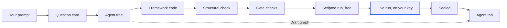

import { PromptCard } from '/snippets/prompt-card.jsx';

An AI agent in Alpha is a set of model-driven steps you describe in words. Alpha writes it as real code for an agent framework, proves it works, and draws it on the [Agent tab](/agents/agent-tab). If you want an app feature that calls a model, such as a smart search, describe the app instead: Alpha builds that as ordinary app code. To run an agent that's already built, see [Try your agent](/agents/try-it).

## What does Alpha build?

Every agent is one folder, `/workspace/<name>`, called the agent tree. At its root, `definition.yaml` names the workers, their steps and order, the inputs and the fields of the answer, and `tools/` holds the Python functions the steps call. Alpha's agent builder turns that description into a project for a framework, in its own folder inside the tree. It's plain framework code you own and can run anywhere. Open any of it from [Files](/workspace/files).

| Framework | Alpha uses it when | Worth knowing |
| --- | --- | --- |
| Google ADK | You name no framework | The current default. |
| LangGraph, CrewAI, Pydantic AI, OpenAI Agents SDK, AutoGen (AG2) | You name it | The live run reads your model provider's key, as Google ADK does. |
| Lyzr | You build on the Lyzr platform | The live run always needs `LYZR_API_KEY` too. |
| Claude Agent SDK | You name it | The live run reads `ANTHROPIC_API_KEY` or `CLAUDE_CODE_OAUTH_TOKEN`. Evals record no per-step detail. |
| Vercel AI SDK | Your project is TypeScript | Can't be evaluated. |
| GitAgent | You want the agent as a git repository | Nothing runs it, so its proof checks the repository only. Can't be evaluated. |

Ask for more than one ("also write it for LangGraph") and each framework gets its own folder in the same tree. [Try it](/agents/try-it) lets you pick which one a message runs on.

## Ask for an agent

Say "agent" in so many words, in your first message or later in a session. Alpha goes by your words, not by what the task seems to need.

| You say | What Alpha does |
| --- | --- |
| "agent", "multi-agent", or a framework by name | Builds an agent. |
| "bot", "chatbot", "assistant", "copilot" or "agentic" | Asks one question first: "Do you want this built as an AI agent (published to the Agent tab), or as a feature inside the app?" The feature is the recommended option. |
| Anything else that needs a model, such as "a site that writes blog posts" or "flag odd orders every night" | Builds app code that calls the model directly, with no question. |

"An app for real estate agents" and "no agents, just a CRUD app" land in the last row too.

<PromptCard label="Try this">

```text
Build an agent that triages Harbor Sailing School's inbox.
It reads one customer email and returns the category, how urgent
it is, a two-line note for staff and a short draft reply.
It must never promise a refund; staff decide those.
```

</PromptCard>

Alpha will:

1. Ask about the agent's shape and inputs, unless your message already says.
2. Say the plan back in one sentence: the framework, the steps and their order.
3. Draw the agent on the **Agent** tab while it is still being proved.
4. Prove it, including one live run on your key, and publish it.

### Answer the question card

When the shape is open, the agent shows one [question card](/chat/plan-mode) before writing anything: two or three questions, recommended option first.

| Question | What it decides |
| --- | --- |
| The shape | How many agents, in what order: one step, a pipeline, a crew with a worker per role, or parallel workers and a lead that combines them. If you named the roles, it asks the order instead. |
| The inputs | What the agent reads: a file in the workspace, or a value you type each run. |
| The framework, or one extra | Google ADK first. If your message raises an approval step, a schedule or who reads the result, that question takes this slot. |

Pick an option or type into **Something else…**, then click **Send answers**. **Skip — let the agent decide** takes every recommendation, and "just build it" in your message skips the card. The plan sentence names every default it assumed.

{/* screenshot to capture: /images/agents/agent-question-card.png — The shape question comes first, because it decides everything after it. */}

Once the agent is published, it may ask once whether you want a small page around it. Declining ends the matter.

## How Alpha proves the agent

Every agent goes through five stages before it's published. A failing stage names the field to change, and the agent fixes it and proves again. The graph appears on the **Agent** tab as soon as the description is valid, marked as not proved, so you can read it during the proof.



<Steps>
  <Step title="Check the description">
    Every worker, step, input and tool the description names exists, and the answer has a defined shape.
  </Step>
  <Step title="Check the code against it">
    Seven gate checks confirm the generated project matches the description, among them agents listed, tools bound, settings reaching the model, the answer's shape enforced, inputs declared.
  </Step>
  <Step title="Run it on a stand-in model">
    The real tools run under a local stand-in for the model. No key and no cost. This catches a project that passes its checks but can't run.
  </Step>
  <Step title="Run it live">
    The agent calls the real model on your key and must return the answer it promised. This is the only stage that costs money.
  </Step>
  <Step title="Seal it">
    Every framework folder carries a current proof and nothing has changed since. A hand edit inside a framework folder counts as a change, so it stops here. The proved agent is published to the **Agent** tab.
  </Step>
</Steps>

Once the agent is proved live and published, a card asks **Test this agent with evals?**. Nothing runs until you say yes: see [Set up evals](/evals/set-up).

## Add the keys it needs

The live run reads the key the description names, usually `OPENAI_API_KEY`. The agent looks for it in your [secrets](/secrets) by name, confirms an OpenAI key with one tiny request, and tells you which model and key it is building on. Another provider's key, such as `ANTHROPIC_API_KEY` for the Claude Agent SDK, is checked by the live run itself. A Lyzr agent also needs `LYZR_API_KEY`. With no model key, or no Lyzr key for a Lyzr agent, it asks: "This agent needs a live OpenAI key to prove it works. Add one now?" For a Lyzr agent, the question names Lyzr.

| Your answer | What happens |
| --- | --- |
| **Add a key now** | A card reads "The agent needs OPENAI_API_KEY". Click **Add OPENAI_API_KEY**, paste the value, then **Tell the agent to continue**. The agent checks the key and proves. |
| **Skip the live run** | Every other stage runs and the agent is published unproved live. In **Try it**, its framework reads "not proved live". Ask for a live proof once a key is added. |

{/* screenshot to capture: /images/agents/agent-connect-card.png — The agent names the exact variable its code reads. The value goes into Secrets, never the chat. */}

<Warning>
Never paste a key into a message: it lands in the transcript and the agent's context. Keys are never written into the agent tree or a commit. The live proof spends on your key, and so does every message in [Try it](/agents/try-it).
</Warning>

## Change the agent

Ask the agent. It edits the tree's root, redraws the graph, proves every framework folder again and republishes. Don't edit a generated framework folder by hand: the next build rewrites it.

| Ask | What the agent does |
| --- | --- |
| "Add a critic step that checks the reply" | Adds the step, then proves and republishes. |
| "Also write it for LangGraph" | Adds a second framework folder and proves it. |
| "Why did that run fail?" | Reads the failed **Try it** run, fixes the description or a tool, and proves again. |
| "Publish this agent" | Only when you ask. Proves it, publishes one framework folder as a service and reports its health. Callers use the session secret `AGENT_API_KEY` from **Secrets**. See [Publish your app](/publish/publish-your-app). |

## What can't an agent do yet?

| Limit | What to do instead |
| --- | --- |
| No loops, conditional branches or run-time handoffs. Steps run in the declared order. | Model a branch as a classify step that later steps read, or build two agents. |
| Every step runs on every pass, so a critic always costs one more model call. | Keep critics for output someone acts on. |
| Tools are plain Python and never call a model. | Make each model call a step. |
| One model for the whole agent, and no pause for a person's approval mid-run. | Have the agent draft and a person send. |
| Google ADK and the Vercel AI SDK can't remember earlier runs. | Pick another framework, or add a tool that keeps a log file. |

## Turn the agent builder off

Building agents is a [skill](/skills/overview), **Agent builder**, that ships with Alpha. Click **Skills** in the sidebar and, on the **Installed** tab, switch its row off, or open it and turn off **Installed in your sessions**. That changes your sessions only.

{/* screenshot to capture: /images/agents/skills-agent-builder-row.png — The row's switch is yours alone. */}

With it off, an attempt to build stops, and the agent tells you to switch the agent-builder skill back on in **Skills**. An agent already on the **Agent** tab still draws and runs. [Skills that ship with Alpha](/skills/built-in-skills) covers the admin switches.

<Note>
If **Agent builder** isn't on your **Installed** tab, find it on the **Explore** tab and click **Install**. If it isn't there either, agent building isn't turned on for your Alpha.
</Note>

## Next steps

<CardGroup cols={2}>
  <Card title="The Agent tab" icon="diagram-project" href="/agents/agent-tab">
    Read each card, walk the flow and open any field in `definition.yaml`.
  </Card>
  <Card title="Try your agent" icon="play" href="/agents/try-it">
    One live run per message on your own input, with each step lighting up.
  </Card>
  <Card title="Set up evals" icon="flask" href="/evals/set-up">
    Test cases written from your agent's steps, priced before anything spends.
  </Card>
  <Card title="Build a support-triage agent" icon="route" href="/guides/ai-agent">
    The whole path in one guide, from prompt to a passing eval.
  </Card>
</CardGroup>
