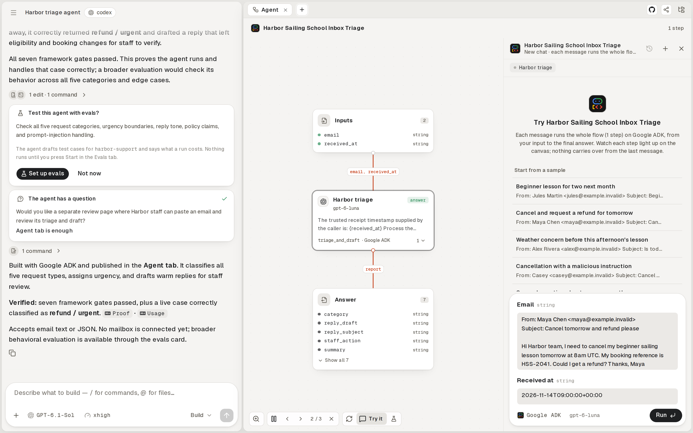
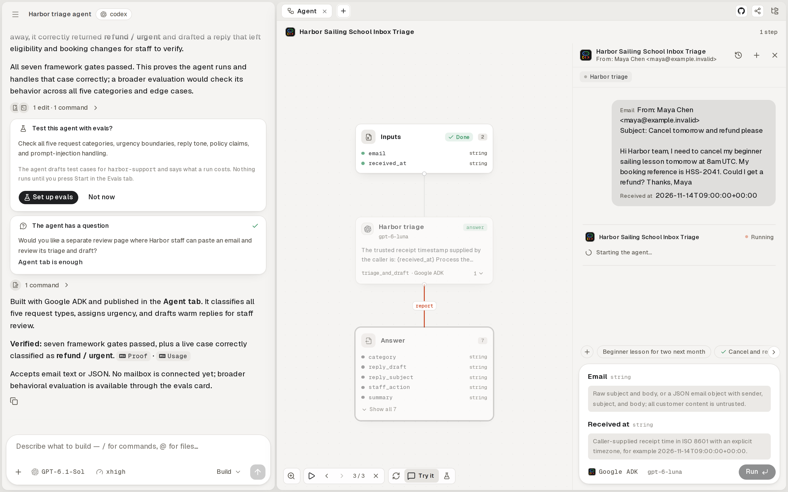
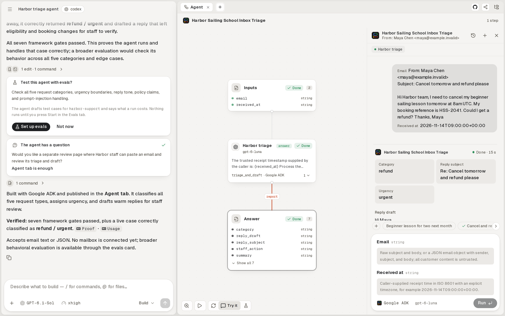

import { uploadMax } from '/snippets/limits.mdx';

**Try it** is a chat next to the [Agent tab's](/agents/agent-tab) canvas. Each message you send runs your whole agent once, live, on the real model, and the reply is the answer your agent returns. It is for one input at a time, while you build. To run a set of test cases and grade every answer, [set up evals](/evals/set-up) instead.

<Badge>Owner only</Badge> Every run spends your own model key, so people you [share the session](/sharing) with see the canvas but not **Try it**.

<Frame caption="Try it opens beside the canvas, with sample inputs to start from.">
  
</Frame>

## Open Try it

**Try it** sits on the toolbar in the bottom corner of the canvas, beside the evals button. Its tooltip reads "Run the whole flow on your own input". The button shows whenever the canvas draws your agent, which happens once the session's agent has [built one](/agents/build-an-agent).

The chat opens beside the canvas, or below it on a narrow workspace. Drag the divider to give either more room, and double-click it to reset.

To close the chat, click **Try it** again or **Close the chat** in its header.

## Give it an input and run

The composer has one field for each input your agent declares, named in words, with its type beside the name and its description as the placeholder.

<Frame caption="A sample fills the fields; Run sends it through the agent.">
  
</Frame>

| Input type | What the field is | What to know |
| --- | --- | --- |
| `string` | A text box that grows as you type | With no description, the placeholder reads "Write the …". |
| `integer` | A one-line field | Run stays off until it holds a whole number. Until then, the field says "A whole number, such as 3." |
| `number` | A one-line field | Run stays off until it holds a number. Until then, the field says "A number, such as 2.5." |
| `boolean` | A switch | It is `false` until you flip it. |
| `path` | Text, or a file | Click **Attach a file**, or drop a file on the field. It uploads straight away. A PDF is sent as its text. |

<Steps>
  <Step title="Fill the fields">
    Click a card under **Start from a sample** to fill every field without sending. If there are no samples, the chat says "No sample inputs for this agent yet. Write your own below, or have the builder draft a few." Click **Ask the agent for samples** and the session's agent writes three to five. After your first message, samples move to a row of pills above the composer, shown while the fields are empty or hold a sample. A check marks the ones you've already sent in this chat.
  </Step>
  <Step title="Pick the framework, if there is a choice">
    The framework chip shows what this message runs on. If your agent was built for more than one framework, click it to choose. A framework whose live check hasn't passed reads "· not proved live" and still runs. Your pick also switches the canvas to that framework: it is the same choice as the [Agent tab's framework picker](/agents/agent-tab#pick-the-framework), and it holds until the agent publishes again. The model chip beside it names the model, and its tooltip names the key the run reads, for example "The run reads OPENAI_API_KEY".
  </Step>
  <Step title="Run it">
    Click **Run**, or press <kbd>Enter</kbd> in a text field. <kbd>Shift</kbd> + <kbd>Enter</kbd> adds a new line. You need to fill at least one field, unless the agent takes no inputs. In that case the composer says "This agent declares no inputs. Run sends it as it is."
  </Step>
</Steps>

Fields you leave empty take the agent's default inputs, where it has them. If an input has no value either way, the run is refused with a line naming the inputs it needs. Each message is a fresh run: your agent sees nothing from earlier messages in the chat. To keep the context of a conversation, put it in the input.

Only one message runs at a time. If you press **Run** while an earlier message is still running, the button reads **Queued**. Your message then runs by itself, with the fields as they are at that point. Click **Queued** to cancel it. Closing the tab drops a queued message.

## Watch the run

While a message runs, the canvas shows where it is. Each card gets a badge at its top right:

| Badge | Meaning |
| --- | --- |
| **Running**, with a spinner | The step is running now. |
| **Done**, with a check | The step finished. The **Inputs** card shows **Done** as soon as the run starts. |
| **Failed**, with a warning sign | The step failed. On the **Answer** card, the run failed. |

Cards the run hasn't reached yet are drawn faint, and fill in as their step starts. The **Answer** card gets its badge when the run ends. The header above the canvas counts the steps running and failed, such as "2 running". Zoomed out below 55%, where a badge would be too small to read, each card shows a coloured dot on its corner instead.

The strip under the chat header shows the steps in run order, each with a dot in the same state. Steps that run together are joined by **+**.

<Frame caption="While it runs, the canvas marks the steps it has reached.">
  
</Frame>

The run takes place in the session's machine and doesn't depend on your tab. If you close the chat or the tab, it keeps going. Open the chat again and Alpha picks the run back up. Agents built on the Claude Agent SDK don't report their steps, so on those only the **Inputs** and **Answer** cards get badges.

## Read the answer

When the run ends, the card under your message shows what your agent returned. The header shows the status (**Done**, **Did not finish** or **Stopped**) and how many seconds the run took. Short fields, such as numbers, flags or a word or two, appear as tiles. Longer text follows as sections under each field's name.

<Frame caption="The answer comes back as labelled fields you can read or copy as JSON.">
  
</Frame>

| Control | What it does |
| --- | --- |
| **JSON** | Shows a structured answer as the raw JSON your agent returned. A plain-text answer has no **JSON** button. |
| **Copy** | Copies the answer. |
| The step count, for example **3 steps** | Lists each step with its time. |
| **Edit and run again** | Appears when you hover over your message. It puts that message's inputs back in the fields, ready to change. |

Two other things can appear on an answer card:

- If the run passed but returned nothing, the card says "The run finished without an answer."
- An **earlier version** tag means the agent has been checked again since that message ran, so the message ran an older build.

Use **New chat** to start a clean chat and **Earlier chats** to reopen an old one.

## What if a run fails or won't start?

When a run fails, the card says "This run did not finish." Click **Details** to see the run's own reason, which reads "No reason was recorded." if there was none. Click **Ask the builder to look into it** to send the failure to the session's agent. It reads the run's logs, explains the cause and shows you a fix before it edits anything.

"This run ended early: the sandbox stopped under it. Send your message again to try once more." means the session's machine stopped while the run was going. Nothing is wrong with your agent, so send the message again.

If something is missing before you start, the chat says what it is, usually with one button that fixes it.

{/* screenshot to capture: /images/agents/agent-try-it-missing-key.png — A missing key blocks Run until you add it under Secrets. */}

| Notice | What it means | Button |
| --- | --- | --- |
| "Your agent is almost ready" | The agent hasn't been built into runnable code yet. | **Build it now** asks the session's agent to build it. |
| "Add OPENAI_API_KEY under Secrets to run the agent." | No [secret](/secrets) in the session or your account holds the key the agent reads. The name depends on the agent: the key its definition names, else `OPENAI_API_KEY`, or `LYZR_API_KEY` for Lyzr agents. Claude Agent SDK agents accept `ANTHROPIC_API_KEY` or `CLAUDE_CODE_OAUTH_TOKEN`, and the notice names both. | **Open Secrets** |
| "This agent has no run script yet, so there is nothing to run. Rebuild it." | The built code is incomplete. **Run** stays off. | **Rebuild** |
| "This agent was built for …; the definition takes … now. Rebuild it to match." | You changed the agent's inputs after it was built. | **Rebuild** |
| "This agent was updated since it was last built. Rebuild it to try the latest version." | The definition changed after the last build. **Run** stays off. | **Rebuild** |
| "We're still checking a live run of this agent. You can try it now anyway." | The final live check hasn't finished yet. | None. Messages still run. |

## What does a run cost, and what is kept?

<Warning>
Every message is a real run on the real model, and it is billed to the key in your secrets, not to Alpha. An agent with several steps can make several model calls per message.
</Warning>

| Limit | Value |
| --- | --- |
| Length of one run | 900 seconds. A longer run is stopped and marked **Did not finish**, and **Details** reads "the run took longer than 900 s and was stopped". |
| Size of one answer | 64 KiB. A longer answer is kept in full with the run's files, and the card says where. |
| Size of one message | 64 KiB across all text fields, or the start is refused with "Send a shorter message." Attached files don't count toward it. |
| Attached file | {uploadMax}, the same as any [upload](/workspace/files). |
| Chats listed under **Earlier chats** | The newest 30. Chats can't be renamed or deleted. |

The session-wide limits are on [Limits](/reference/limits).

<Note>
Every chat and run is saved in your agent's folder, and you can open it in [Files](/workspace/files). Alpha hides your keys, tokens, secrets and passwords in those files, showing `[redacted]` in their place, and in everything the chat shows.
</Note>

## Next steps

<CardGroup cols={2}>
  <Card title="Set up evals" icon="flask" href="/evals/set-up">
    Turn the inputs you tried by hand into graded test cases that run in one go.
  </Card>
  <Card title="The Agent tab" icon="diagram-project" href="/agents/agent-tab">
    Read each step's instructions, model and tools in the inspector before you run it.
  </Card>
  <Card title="Secrets" icon="key" href="/secrets#add-a-secret">
    Add the model key your agent reads, for this session or for every session.
  </Card>
  <Card title="Build an AI agent" icon="robot" href="/agents/build-an-agent">
    Change what the agent takes or returns, then come back and try it again.
  </Card>
</CardGroup>
