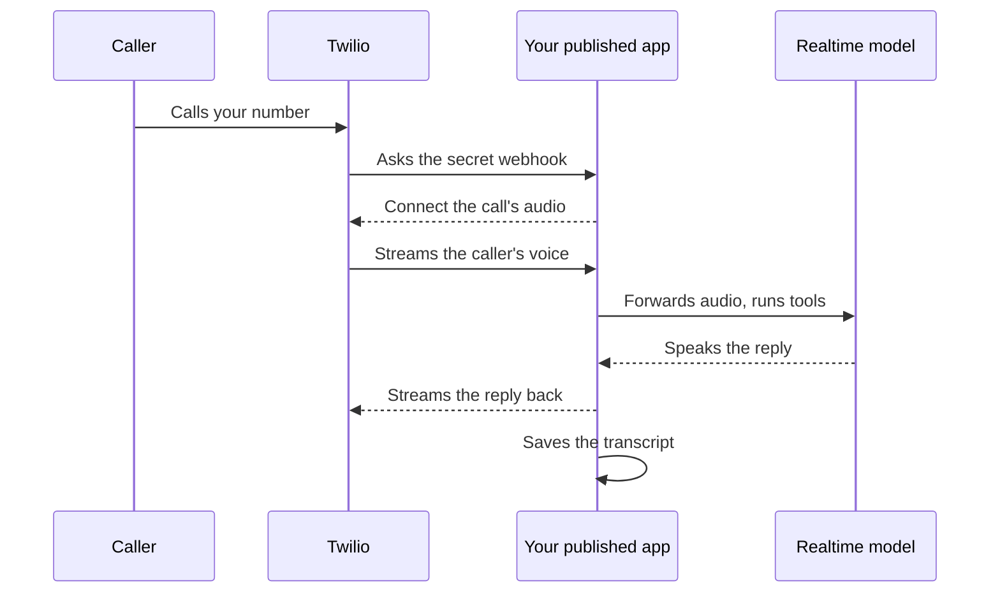

import { idlePark, dictationMax } from '/snippets/limits.mdx';
import { PromptCard } from '/snippets/prompt-card.jsx';

A voice agent is an app people talk to out loud: a receptionist on your site, a talking helper inside your app, or an assistant that answers a phone number. Ask for one in plain words and the **Voice agent** skill takes over. For an agent people type to, see [Build an AI agent](/agents/build-an-agent). To talk to Alpha itself instead of typing, use [dictation](/chat/composer#dictate-a-message).

<PromptCard label="Try this">

```text
Build an AI receptionist for Harbor Sailing School. It answers questions about classes and prices, books a taster session, and hands over to a person for refunds.
```

</PromptCard>

Alpha will:

1. Ask two or three questions in one card: the channel, the job, and the languages and voice.
2. Ask for the model provider's key with a secret request card, and for Twilio with a Connect card if you want phone calls or texts.
3. Build a server that holds the key, a page with a start button and a live transcript, and the tools the agent calls mid-conversation.
4. Test every layer it can reach without a microphone, then tell you two or three things to say to it.

{/* screenshot to capture: /images/agents/voice-agent-preview.png — The receptionist in its own tab: one button to start, a live state, and the conversation written out as it happens. */}

## Choose a channel

The channel decides what you need to have ready. The browser is the default, and it's the one channel you can try in the session straight away. When phone calls are part of the job, the agent builds and tests the browser version while Twilio is still being connected.

| Channel | What you get | What it needs |
| --- | --- | --- |
| Browser | A page with a start button, the agent's state and a running transcript | The model provider's key |
| Inside your app | The same controls added to an app the session already has | The provider's key |
| Phone calls, in or out | A number people call, or calls the app places, plus a calls page | The provider's key, a Twilio connection, a Twilio number you own (the agent asks before buying one), and, for a real number, a [published app](/publish/publish-your-app) |
| SMS alongside calls | Confirmations, links and follow-ups sent after a call | A Twilio connection and your Twilio number |

## Answer the setup card

The agent asks only what your message left open, in one [question card](/chat/plan-mode#answer-the-agents-questions). Anything you skip gets a sensible default, which the agent names in its reply.

| Question | What it settles |
| --- | --- |
| Channel | Browser, inside an app, phone calls in or out, or SMS alongside |
| Job | What the agent does in a conversation, what it looks up or changes (these become its tools), and when it hands over to a person or ends the call |
| Languages and voice | The languages callers speak, and the persona: name, tone and speaking pace |
| Recording | For phone calls only: whether calls are recorded. It is never a silent default: the agent asks unless your message already says, because callers must consent |

Every conversation keeps a transcript whatever you answer: who spoke, what they said, when, and which tools ran. Recording audio is separate and happens only if you say yes.

## Add the key and connect Twilio

The provider's key stays on your app's server. The browser gets a token from it that expires within minutes, so the key never reaches a visitor's device. The agent asks for what it needs with cards in the transcript, so you never paste a key into a message.

{/* screenshot to capture: /images/agents/voice-agent-requests.png — Two requests, two places: the key goes to Secrets, Twilio goes to Integrations. */}

| Card | What to do |
| --- | --- |
| **The agent needs `OPENAI_API_KEY`** | Click **Add OPENAI_API_KEY**, paste the key into **Value** and click **Add secret**. The name is locked because the agent's code reads that exact name, and the secret goes to this session only. Then click **Tell the agent to continue**. See [Secrets](/secrets#what-happens-when-the-agent-needs-a-key). |
| **The agent wants to use Twilio** | Click **Connect Twilio**. Under **Connect with your account credentials**, enter **Account SID : Auth Token** in the form `ACxxxxxxxx:your-auth-token` and click **Connect**. It's stored by the connector service, never in the session. See [Connect an app](/integrations/connect-apps#when-the-agent-asks-you-to-connect). |

The agent doesn't wait for Twilio. It builds and tests the browser version, says what it asked for, and ends its turn. Click **Tell the agent to continue** once you're connected, and it adds the phone side. Your app reaches Twilio through your [connections](/integrations/in-your-app), so it holds no Twilio credentials of its own.

<Note>
If you don't see Twilio in **Integrations**, it isn't turned on for your Alpha. The browser channel works without it.
</Note>

<Warning>
Phone numbers, calls and texts cost money on your Twilio account, and calls reach real people. The agent asks before it buys a number, calls or texts any number you didn't give it for testing, or places an international call. The app it builds says it is an AI assistant at the start of each call where the law expects it, says "this call is recorded" before anything else when recording is on, and stops texting anyone who replies STOP.
</Warning>

## Try it yourself

The machine has no microphone, so you are the one who holds the first conversation. When the build is done, the agent tells you two or three things to say.

<Steps>
  <Step title="Open the app in its own tab">
    The app appears in the [Preview](/workspace/preview). Click the **Open in new tab** icon at the right end of the Preview toolbar, so the browser can ask for your microphone. {/* TODO confirm: the Preview frame's allow list (apps/frontend/src/lib/preview-escape.ts FRAME_ALLOW) has no microphone, so the framed copy should be refused the mic; check in a real session. */}
  </Step>
  <Step title="Start and allow the microphone">
    Click the app's start button and allow the microphone when the browser asks. The state moves between listening, thinking and speaking, and the transcript fills in as you talk.
  </Step>
  <Step title="Interrupt it">
    Talk over the receptionist while it speaks. It stops at once and listens, which is what a realtime model is for.
  </Step>
</Steps>

A real phone number needs a published app. The Preview's address works only while the session's machine is awake, and a machine [goes to sleep](/sessions/machines#when-does-a-machine-go-to-sleep) once no Alpha page of yours has been on screen for {idlePark}. A call to a sleeping machine doesn't wake it, so the Preview's address is good only for a test call while you're there. Publish first, then the agent points the number's voice webhook at the published address through Twilio, or gives you the address to paste into the Twilio console. The webhook's address includes a random secret, which is what keeps strangers off it, so don't share it.



With phone calls, the app also gets a calls page: each call's number, time, duration and how it ended, its transcript, and its recording when recording is on. It shows people's numbers and words, so it sits behind your [app's sign-in](/workspace/app-sign-in). Recordings and transcripts are kept for 30 days unless you tell the agent otherwise, and are deleted together.

{/* screenshot to capture: /images/agents/voice-agent-calls-page.png — Every call keeps its transcript. The player appears only when recording is on. */}

## Pick a runtime

The agent builds on a speech-to-speech realtime model unless you ask otherwise. One model hears and speaks, so replies start within a few hundred milliseconds and callers can interrupt it. Name a provider in your message to choose one.

| Provider | Choose it when | Key it asks for |
| --- | --- | --- |
| OpenAI Realtime (default) | You want the strongest tool use and instruction following. Currently `gpt-realtime-2.1`, or `gpt-realtime-2.1-mini` to save at volume | `OPENAI_API_KEY` |
| Gemini Live | One agent speaks many languages, sessions run long, or you work on Google | `GEMINI_API_KEY` |
| ElevenLabs Agents | You want a voice from ElevenLabs' library or a cloned voice. The agent's prompt, voice and tools stay in code in your project | `ELEVENLABS_API_KEY` |
| A chained pipeline | A language or voice no realtime model covers, such as Indian languages through Sarvam. Slower and harder to interrupt | Each provider's key |

Model names change several times a year. The agent checks the provider's current list before it picks one and keeps the name in one setting, so changing it later is a one-line edit.

## What does it cost, and how does Alpha check it?

Voice is billed per minute of audio by the provider, on your key. Those charges go to your provider account and don't appear on Alpha's [usage dashboard](/account/usage-and-costs), which counts the agent's own work. Twilio bills numbers, calls and texts to your Twilio account.

Before it hands over, the agent tests every layer below the microphone and names any check it couldn't run, with the reason.

| Check | What it proves |
| --- | --- |
| Asks the app's token route for a token | The route returns a short-lived token and never the key |
| Opens a session with that token and sends one text turn | The model answers with audio and a transcript |
| Runs each tool with the arguments the model would send | Lookups and bookings work before anyone speaks |
| Calls the phone webhook, for phone builds | The answer connects the call to the app's audio stream over a secure address |

The hand-over names the provider and model and why it chose them, reminds you that audio is billed per minute on your key, and says what each secret and connection is for.

## Is this the same as dictation?

No. Dictation is the microphone in your [composer](/chat/composer#dictate-a-message): it turns up to {dictationMax} of your speech into a message for Alpha's agent. A voice agent is an app you build, which other people talk to.

## Next steps

<CardGroup cols={2}>
  <Card title="Publish your app" icon="rocket" href="/publish/publish-your-app">
    A phone number needs the published address, which stays up when the session sleeps.
  </Card>
  <Card title="Connect an app" icon="plug" href="/integrations/connect-apps">
    How Connect cards, the request tray and Test connection work for Twilio and the rest.
  </Card>
  <Card title="Add sign-in to your app" icon="user-lock" href="/workspace/app-sign-in">
    Put the calls page behind a login before real calls arrive.
  </Card>
  <Card title="Skills that ship with Alpha" icon="star" href="/skills/built-in-skills">
    Switch the Voice agent skill off, or call it by name with $voice-agent or /voice-agent.
  </Card>
</CardGroup>
