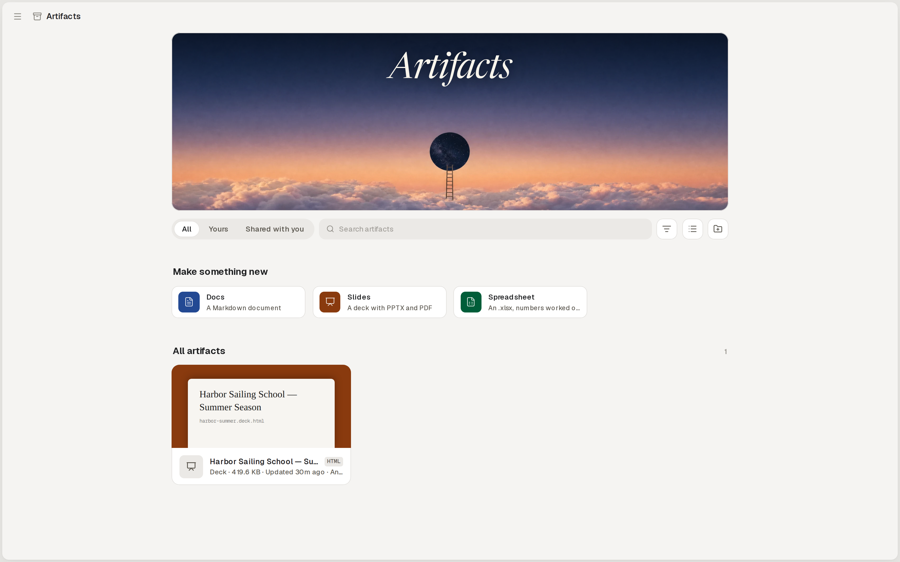
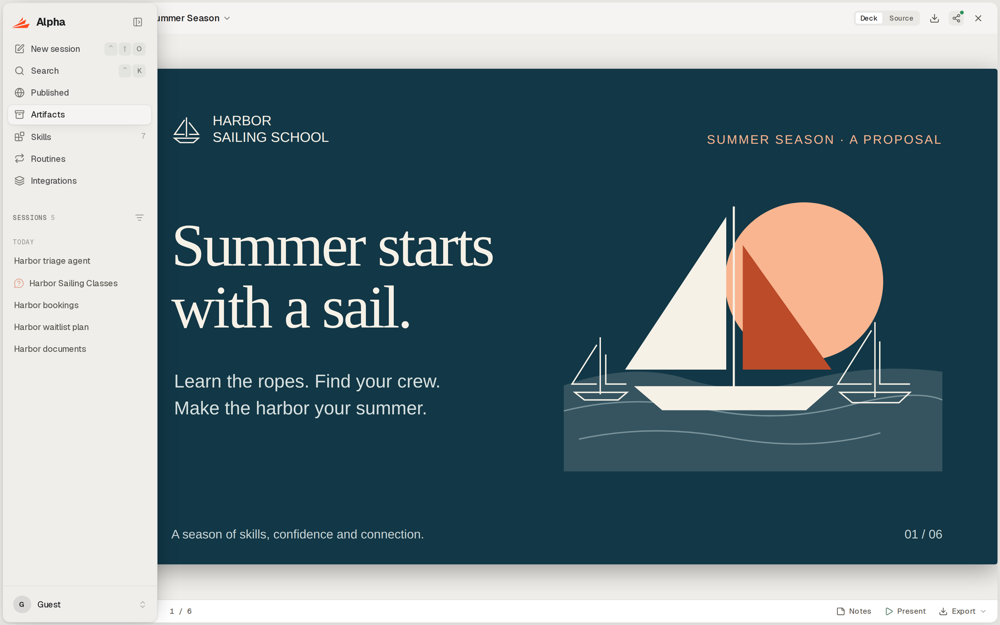

import { artifactMax, artifactsMax, artifactsTotal } from '/snippets/limits.mdx';

An artifact is a file from a session that Alpha keeps for you outside that session: a report, a deck, a PDF, a spreadsheet, an image or a page. It gets its own page and its own link, opens in the same viewers as the workspace whether or not the session's machine is awake, and can be shared without sharing the session.

<Frame caption="Your artifacts and the ones shared with you, in one place.">
  
</Frame>

## When should I use an artifact?

An artifact, a shared session and a published app each give people a link, but each link shows something different.

| | **Artifact** | **[Shared session](/sharing)** | **[Published app](/publish/publish-your-app)** |
| --- | --- | --- | --- |
| What people see | One file, in its viewer | The whole session, live and read-only: the transcript, the files and **Preview** | Your running app |
| Needs the session's machine | No. The file is copied out when it's saved. | Yes, for the files and **Preview** | No |
| Who can open it | Only you, the people you invite, or anyone with the link | Only you, specific people, or anyone with the link | Anyone with the address |
| Use it for | A finished document, deck or picture to hand over | Letting people watch the work | An app people use |

Sharing a session never shares its artifacts, and sharing an artifact never shares its session.

## Publish a file as an artifact

Any file in the workspace can become an artifact, including a file you uploaded. A file is published once. After that you change it through the agent (see [Change an artifact](#change-an-artifact)).

### From the file's tab

When a file's tab is in front, the pill at the top right of the workspace reads **Publish as artifact** instead of **Publish**. Only the session's owner sees it.

<Steps>
  <Step title="Open the file">
    Click the file in the file tree, or a link to it in the transcript. The first time a file tab opens in your browser, a hint under the pill asks "Want to keep this file?" and explains: "Publish it as an artifact: it gets a link of its own to share, and stays after the session ends." Click **Got it** to dismiss it for good.
  </Step>
  <Step title="Click Publish as artifact">
    The pill sends "Publish docs/fleet-report.md as an artifact." to the agent, with your file's path. If the agent is busy, the message waits in the [queue](/chat/queue-and-steer#manage-the-queue), so you can publish several files one after another.
  </Step>
  <Step title="Get the link">
    The agent saves the file and replies with the artifact's link. When the turn ends, the pill becomes the **Artifact** menu.
  </Step>
</Steps>

| The pill reads | It means |
| --- | --- |
| **Publish as artifact** | The file isn't an artifact yet. |
| **Queued** (clock icon) | Your request waits in the queue for the agent's current turn to end. |
| **Publishing…** (spinner) | The agent is working on it. |
| **Artifact** ▾ | The file is an artifact. A green dot means it's shared with someone. |

The **Artifact** menu shows the artifact's title and "Published ·" followed by who can open it: "Only you", "Anyone with the link", or a number of people.

| Menu item | What it does |
| --- | --- |
| **Share…** | Opens the share dialog. See [Share an artifact or a folder](#share-an-artifact-or-a-folder). |
| **Open** | Opens the artifact's page in a new tab. |
| **Download** | Downloads the file. |
| **Delete** | Asks "Delete “fleet-report.md”?" ("Its link stops working for everyone. The file in this session stays.") and deletes the artifact. |

A file the workspace holds only because you tagged an artifact (in the `artifacts` folder) has no pill. It's that artifact already.

### By asking the agent

Say what to keep, in any session. The agent understands "save this as an artifact", "keep this", "publish this file" and "share this file", and "publish the attached image" for an upload.

```text
Save docs/fleet-report.md as an artifact in the Harbor marketing folder, titled "Fleet report 2026".
```

The agent saves the file and gives you its link. An artifact goes into a folder only when you name one, or when the agent groups the files of one piece of work into a new folder; it tells you which folder it used. Naming a folder you don't have yet creates it. If others can open that folder, the agent says who can now open the file. Without a title, an artifact is named after its file.

An artifact starts private. The agent changes its sharing only when you ask in the same session. Asking to "make it public" or "publish it" shares it with anyone who has the link.

<Note>
The transcript doesn't show a card yet when an artifact is saved, shared or deleted, and a save doesn't open the file beside the transcript. The artifact is saved and its link works: open it from the link in the agent's reply or from the **Artifacts** page.
</Note>

## What gets saved with a file?

Alpha copies the file out of the session's machine when it's saved, so the artifact never needs that machine again. Some files bring others with them:

| You publish | Alpha also keeps |
| --- | --- |
| An HTML page | The files it loads from the workspace by a relative path, such as images, stylesheets and scripts |
| A Markdown file | The images it shows by a relative path |
| A [deck](/workspace/decks-and-drawings) | Its pages' images, plus a PowerPoint file and a PDF made when it's saved |
| A LaTeX file | Its PDF, built when it's saved |

Making a deck's exports or a LaTeX PDF takes a while, so the save waits for them. Links to other websites stay links. Everything an artifact holds counts toward its size; see [How big can an artifact be?](#how-big-can-an-artifact-be).

Deleting the session a file came from doesn't delete its artifact. The artifact only loses its "from" link to the session.

## Change an artifact

An artifact keeps the files it was saved with. Editing the file in the session doesn't change the artifact until you ask the agent to update it.

```text
Add this week's bookings to the fleet report and update the artifact.
```

The agent edits the file and updates the artifact by its link. The link, the title, the sharing and the folder all stay the same, so everyone you shared with sees the new version. You can do this from any session: tag the artifact (see [Tag an artifact in a message](#tag-an-artifact-in-a-message)) and say what to change.

Only the owner can update an artifact. To build on someone else's, tag it and ask for your changes: the agent saves the changed copy as a new artifact of yours, and theirs stays as it is. An unchanged copy isn't saved, because it's the same artifact. For a quick private copy without changes, use **Duplicate** on its card.

## Find your artifacts on the Artifacts page

Click **Artifacts** in the sidebar, below **Published**. The page has three tabs:

| Tab | Shows |
| --- | --- |
| **All** | Your artifacts and folders, and those shared with you |
| **Yours** | Only your own |
| **Shared with you** | Artifacts and folders others shared with your email. Ones shared with anyone who has the link aren't listed; open them from their link. |

**Search artifacts** matches titles and file names, and folder titles. The buttons beside the search box:

| Button | What it does |
| --- | --- |
| **Sort and filter** | **Sort by** **Last updated** (the default), **Last opened**, **Created** or **Title**. Filter by **Kind** (**Document**, **Deck**, **Page**, **Spreadsheet**, **Drawing**, **Image** or **Code**), **Sharing** (**Only you**, **Anyone with the link** or **Specific people**), **Updated** (**Today**, **Past week** or **Past month**) and **Pinned** (**Pinned only**). |
| **Show as a list** / **Show as cards** | Switches between cards and a compact list. |
| **New folder** | Creates a folder. See [Organize artifacts in folders](#organize-artifacts-in-folders). |

Below them, **Make something new** offers **Docs** ("A Markdown document"), **Slides** ("A deck with PPTX and PDF") and **Spreadsheet** ("An .xlsx, numbers worked out"). Each starts a new session with a request begun in the composer, such as "Make a slide deck, publish it as an artifact, and make it about ", for you to finish.

Then come the shelves: **Folders**, **Pinned** (your pinned artifacts, kept above the rest), and **All artifacts**, **Yours** or **Shared with you**, each with a count.

### What a card shows

A card shows the artifact's kind in colour with its title, or the picture itself for an image. Under it are the title, the file's extension, and a line of details:

- **Your own**: the kind, the size, when it was updated, who can open it (for example "Anyone with the link", or "2 people via its folder"), how many times others opened it, and "from" the session it came from. Click the session's name to open it with the artifact tagged in the composer.
- **Shared with you**: who shared it, the kind, the size and when it was updated.

Opens count people other than you, once per person per day. Click a card to open the artifact.

### The card menu

Open it with the **⋯** button on a card, or right-click the card.

| Item | What it does |
| --- | --- |
| **Pin** / **Unpin** | Moves your artifact to the **Pinned** shelf, or back. |
| **Rename** | Changes the title, up to 60 characters. |
| **Move to folder** | Picks one of your folders, or **No folder**. **New folder…** creates a folder and moves the artifact into it. |
| **Duplicate** | Makes a private copy, titled with "(copy)", under **Yours**. Works on artifacts shared with you too. |
| **Copy link** | Copies the artifact's link. |
| **Download** | Downloads the file. |
| **Share** | Opens the share dialog. |
| **Delete** | Deletes the artifact after you confirm. |

On an artifact shared with you, the menu has only **Duplicate**, **Copy link** and **Download**.

### Drag a card

Drag one of your cards onto a folder to move it there; a folder that already holds it says "Already in this folder". While you drag, a pill at the bottom of the page reads **Drop here to pin** (or **Drop here to unpin**): drop the card on it to pin or unpin it.

## Open an artifact

Click a card, or open an artifact's link. Signed in to Alpha, the artifact opens inside Alpha beside the sidebar. Signed out, it opens on a page of its own, if its sharing lets you in.

One bar runs across the top of the artifact:

<Frame caption="An artifact opens on its own page, in the same viewer as the workspace.">
  
</Frame>

| Control | What it does |
| --- | --- |
| Title ▾ | The title menu (below) |
| **Preview** / **Source** | For a page, a Markdown file, a deck, a diagram or a LaTeX file: the rendered view or the source. The first button reads **Deck**, **Diagram** or **PDF** for those kinds. |
| **Download** | Downloads the file. |
| Page and zoom controls | For a PDF, an image or an Office file: shows or hides the viewer's bottom bar. It's hidden until you turn it on, and your browser remembers the choice. |
| **Chat** | Signed in only. For your own artifact, opens the session it came from with the file in front and the artifact tagged in the composer. For anyone else's, or one whose session is gone, starts a new session titled "About Fleet report 2026", with the artifact in front, tagged, and "I want to modify this artifact: " begun in the composer. |
| **Share** | Yours only. A green dot means sharing is on. |
| **Close** (×) | Goes back to the folder you opened it from, or to the **Artifacts** page. |

The title menu starts with the kind and who made it ("Deck by you"), the session it came from, when it was updated, and its size, number of files and opens. Then:

| Item | What it does |
| --- | --- |
| **Files** | Lists every file the artifact holds, with its size. Click one to download it. |
| **Export** | Downloads the main file. |
| **Copy as Markdown** | Markdown files only: copies the text. |
| **Rename** | Yours only. |
| **Share** | Yours only. |
| **Refresh** | Loads the artifact again, for example after an update. |
| **Pin** / **Unpin** | Yours only. |
| **Delete artifact** | Yours only. Asks for confirmation first. |

Artifacts open in the same viewers as the workspace: PDFs, Word, Excel and PowerPoint files, images, drawings and diagrams, decks, HTML pages, Markdown, a LaTeX file's PDF, and code. See [File viewers](/workspace/file-viewers). They're read-only here; a deck's owner can still export it. Anyone but you sees your secret values masked as `[redacted]` in text files, as viewers of a shared session do.

On its own page, the bar starts with the Alpha logo and ends with **All artifacts** for the owner, or "shared with you" for anyone else.

### When an artifact won't open

| You see | Why | What to do |
| --- | --- | --- |
| "This artifact was deleted, or it isn't shared with you." | Inside Alpha: the artifact is gone, or your account isn't allowed to open it. **Back to Artifacts** returns to the list. | Ask the owner to share it with the email you sign in with. |
| **Nothing here**: "This link isn't active — it may be wrong, or sharing was turned off." | Signed out: the artifact is private, deleted, or the link is mistyped. Alpha shows these the same way on purpose. | Check the link, or ask the owner to share it. |
| A sign-in screen | The owner shared it with specific people. | Sign in with the invited email. |

Each full-page card has an **Open your own Alpha** button.

## Organize artifacts in folders

A folder groups artifacts and shares them together. Click **New folder** on the **Artifacts** page, type a name and click **Create**. Or ask the agent to save a file into a folder by name.

Put artifacts in a folder with the card menu's **Move to folder**, or by dragging a card onto it. An artifact sits in one folder at most, and folders don't hold other folders.

A folder card shows its title, how many artifacts it holds, and who can open it (or "shared by" and the owner's name). Its **⋯** menu has **Rename**, **Copy link**, **Share** and **Delete folder**; a folder shared with you has only **Copy link**.

Click a folder to open its page: its artifacts as cards, with **Share** (or "shared by" and the owner's name) and **Close** at the top. Artifacts you open from there close back to the folder. To take one out, drag its card onto **Drop here to remove from folder**, or pick **Move to folder → No folder** on the **Artifacts** page.

| Rule | What it means |
| --- | --- |
| Sharing a folder shares everything in it | Everyone the folder is shared with can open every artifact in it, including ones you add later. |
| A shared artifact doesn't reveal its folder | Someone you give one artifact sees only that artifact, never its folder. |
| Deleting a folder keeps its artifacts | "Its artifacts stay, out of any folder; its link stops working." |

<Warning>
Moving an artifact into a shared folder lets everyone the folder is shared with open it, even if the artifact itself is private. Check a folder's sharing before you move something sensitive into it.
</Warning>

## Share an artifact or a folder

Only the owner shares. Click **Share** on the artifact's page, **Share…** in the **Artifact** menu, or **Share** in a card's or folder's menu. The dialog is titled with the artifact's or folder's name, and every change applies at once, with a "Sharing saved" message.

<Steps>
  <Step title="Invite people by email">
    Type an address into **Add people by email, then Enter** and press <kbd>Enter</kbd>. You can invite up to 20 people, and they must use that email to sign in to Alpha. Under **People with access** you're listed as **Owner** and each person as **Viewer**; click **Remove** (×) to take someone off.
  </Step>
  <Step title="Pick the general access">
    Under **General access**, pick **Only people invited** or **Anyone with the link**. Anyone with the link doesn't need an Alpha account. The two don't combine: picking **Anyone with the link** clears the invite list, and inviting someone switches back to **Only people invited**.
  </Step>
  <Step title="Copy the link">
    The line at the bottom says who can open it, for example "Only you and the 2 people invited can open it." or, for a folder, "Anyone with the link can open everything in it." Click **Copy link**. While only you can open it, the button reads **Copy private link**.
  </Step>
</Steps>

When the artifact sits in a shared folder, the dialog adds "Its folder “Harbor marketing” is shared too, so anyone with the link can still open it." with a **Change the folder's sharing** link.

| Message | What to do |
| --- | --- |
| "Not an email address: …" | Fix the address and add it again. |
| "At most 20 people" | Remove someone first, or use **Anyone with the link**. |

On an Alpha without accounts, the email field reads "Inviting people needs accounts — this server runs in guest mode". Share by link instead.

Artifacts shared with your email appear under **Shared with you** on the **Artifacts** page, not in the sidebar's list of shared sessions. Admins of your Alpha can open any artifact by its link.

You can also ask the agent: "share the fleet report with priya@example.com", "make it public" or "make it private".

## Tag an artifact in a message

Type `@artifact:` in the composer, then words from the title or file name, and pick an artifact from the list (your own and those shared with you). Typing `@art` also offers **@artifact:** ("Tag one of your artifacts"). The tag shows as a badge with the artifact's title. Pasting an artifact's link into a message works the same way.

Before the turn starts, Alpha copies the artifact's files into the session's workspace, under `artifacts/` and the artifact's code, and tells the agent whether the artifact is yours or shared with you. Each message that tags it copies it afresh, so the agent always reads the current version. See [Mention files, sessions and skills](/chat/composer#mention-files-sessions-and-skills) for the other mentions.

## Open artifact links in the transcript

When the agent links an artifact, the link shows as a badge with its title. Click it to open it beside the transcript:

- An artifact saved from this session opens its file in the workspace.
- Any other artifact opens as the artifact itself.
- One that was deleted, or isn't shared with you, says "This artifact was deleted, or it isn't shared with you."

## Delete an artifact

Pick **Delete** in a card's menu or the **Artifact** menu, or **Delete artifact** in the title menu, and confirm "Delete “Fleet report 2026”?" ("Its link stops working for everyone."). You can also ask the agent to delete it. The file in the session stays; only the artifact and its link go, and deleting can't be undone.

## How big can an artifact be?

| Limit | Value |
| --- | --- |
| Size of one artifact, with every file it keeps | {artifactMax} |
| Artifacts | {artifactsMax} |
| Total size of your artifacts | {artifactsTotal} |
| Title | 60 characters |

When you reach a limit, the agent says the save was refused. Delete artifacts you no longer need to make room. See [Limits](/reference/limits#artifacts).

## Next steps

<CardGroup cols={2}>
  <Card title="Share a session" icon="share-nodes" href="/sharing">
    Let people watch the whole session live, read-only, instead of one file.
  </Card>
  <Card title="File viewers" icon="file-lines" href="/workspace/file-viewers">
    What each viewer does with PDFs, Office files, images, Markdown and code.
  </Card>
  <Card title="The composer" icon="keyboard" href="/chat/composer">
    Mention files, sessions and artifacts, and attach files to a message.
  </Card>
  <Card title="Limits" icon="gauge" href="/reference/limits">
    Every size and count limit in one table.
  </Card>
</CardGroup>
