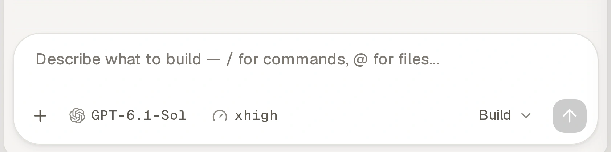
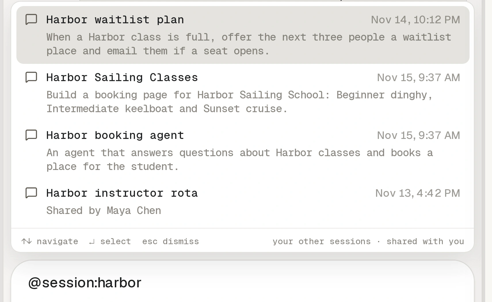

import { uploadMax, imageMax, dictationMax } from '/snippets/limits.mdx';

The composer is the box at the bottom of a session where you write to the agent: text, files, dictation, mentions and context picked from the workspace. Sending while the agent is still working has its own page, [Queue, steer or stop](/chat/queue-and-steer). For the composer before a session exists, see [The home screen](/sessions/home-screen).

<Frame caption="The + menu, the model and the effort sit on the left of the composer. Build or Plan and send sit on the right.">
  
</Frame>

| Control | What it does |
| --- | --- |
| **+** (**Add files, GitHub repos, a skill or a secret set**) | Opens a menu with **Add files**, **GitHub repos**, **Skills** and **Secret set**. See [the + menu](#add-repositories-skills-and-secret-sets). |
| Model chip | Shows the agent's mark and the model in force, such as "Opus 5.5". Click it, or type `/model`, to [change the model](/chat/agents-and-models#choose-a-model). |
| Effort chip | Shows a gauge and the reasoning effort in force, such as **xhigh**. Click it to [change the effort](/chat/agents-and-models#set-reasoning-effort). |
| **Build** or **Plan** chip | Sits at the right, beside the microphone. Its menu offers **Build** ("Makes changes directly") and **Plan** ("Asks, then proposes a plan"), which turns on [plan mode](/chat/plan-mode). <kbd>⇧</kbd><kbd>Tab</kbd> switches between them from the keyboard. |
| Microphone | Dictates into the composer |
| **↑** (**Send message**) | Sends the message |
| Square stop button (**Stop generating**) | Replaces send while the agent works and the composer is empty. It stops the turn, as <kbd>Esc</kbd> does. |

While the agent works and you've typed something, the send button queues or steers instead. Its tooltip names your default, such as "Queue · ⌘⏎ to steer".

## Send a message

Press <kbd>Enter</kbd> to send and <kbd>⇧</kbd><kbd>Enter</kbd> for a new line. A session still called "New session" takes its name from your message; `/rename` changes it later.

The placeholder tells you what the next message will do:

| Placeholder | When you see it |
| --- | --- |
| "Describe what to build — / for commands, @ for files…" | The agent is idle, plan mode is off and the session isn't a routine |
| "Describe what to plan — the agent explores and asks, then proposes a plan…" | Plan mode is on |
| "What should run, and when? The agent builds, tests and schedules it…" | The session is a [routine](/routines) |
| "Add a follow-up" | The agent is working, so your message queues or steers |

In a narrow composer the longer placeholders are cut to their first half, such as "Describe what to build…".

If a send fails, the banner says why and your text goes back into the composer.

## Attach files

Click **+** → **Add files**, drag files onto the composer, or paste them. Each file uploads as soon as you attach it, not when you send, into the workspace's `uploads` folder, where the agent opens it with its ordinary tools. Attaching wakes a sleeping machine.

{/* screenshot to capture: /images/chat/chat-attachments.png — Tiles upload while you type. A tile that is still uploading doesn't hold up the rest of the message. */}

Your message gains one line per file, such as `[Attached file: uploads/harbor-classes.csv (12.4 KB)]`. Images up to [{imageMax}](/reference/limits) also reach the model as pictures, so a screenshot of a bug or a design works. A larger image arrives only as a file.

| You do | What happens |
| --- | --- |
| Attach a file whose name is taken | Alpha renames it, so `report.md` becomes `report-1.md` |
| Send before an upload finishes | The message shows at once with "Sending once the upload finishes…" and goes when the file lands |
| Click an image tile | Opens the image larger |
| Click a tile's X (**Remove file**) | Removes the tile and deletes the file from the machine |

Each file can be up to [{uploadMax}](/reference/limits). If an upload goes wrong, you see one of these. [Troubleshooting](/reference/troubleshooting) covers the rest.

| Message | Meaning |
| --- | --- |
| A red alert icon on the tile | The upload failed. Hover the tile for the reason ("Upload failed" when there is none), then remove it and attach the file again. |
| "An attachment failed to upload — the message wasn't sent." | A file that was still uploading when you sent failed. Your text and files are back in the composer. |
| "The session was switched before the upload finished — the message wasn't sent." | You sent, then opened another session before a file finished uploading. The message goes back into its own session's composer, so go back and send it again. |

Sent files show as tiles above your message in the transcript. [Files and uploads](/workspace/files) covers the `uploads` folder.

## Add repositories, skills and secret sets

The **+** menu gathers what you can bring into the session besides your words.

| Menu item | What it does |
| --- | --- |
| **Add files** | Opens your computer's file picker. See [Attach files](#attach-files). |
| **GitHub repos** | Opens the **GitHub** tab at **Add repository**, to clone a repository into the workspace. See [Add a repository](/github/connect#add-a-repository). |
| **Skills** | Types `$` at the end of your message (`/` in a Claude Code session), which opens the list of skills the agent can use. |
| **Secret set** | Opens a submenu of your [secret sets](/secrets#secret-sets). The row shows the set attached to the session, or "none". |

In the **Secret set** submenu, pick one of your sets to attach it to the session, or **None** to take it off. A set with keys that have no value yet shows how many, such as "2 required". **Create a secret set** opens the editor on a new set, and saving it attaches it to the session. A set the session's [setup](/sessions/setups) brings is attached already, so it isn't listed.

## Mention files, sessions and skills

Three characters open a list above the composer. Use <kbd>↑</kbd> <kbd>↓</kbd> to move, <kbd>Enter</kbd> or <kbd>Tab</kbd> to pick, and <kbd>Esc</kbd> to close.

| Type | Lists | Notes |
| --- | --- | --- |
| `/` at the start of the message | Commands | Opens only when the message is the command. Codex commands Alpha doesn't run yet show **not in Alpha yet**. In a Claude Code session the list holds its skills too. See [Slash commands](/reference/slash-commands). |
| `@` | Files and folders in the session's workspace | Up to 50 matches, with the matching letters highlighted. Picking one inserts `@path`, drawn as a badge. |
| `@session:` and one word | Your other sessions whose messages or title contain that word, then sessions shared with you whose title contains it | Up to 15 of your own sessions, then up to 15 shared ones. Picking one inserts a link the agent can open and read. |
| `@artifact:` and a word | Your [artifacts](/artifacts) and the ones shared with you, by title or file name | Up to 50. Picking one inserts its link, drawn as a badge with its title. |
| `$` | The skills the agent can use | Codex sessions. Picking one inserts `$skill-name`. |
| `/` after other text | The skills the agent can use | Claude Code sessions. Picking one types `/skill-name` into your message. |

The `@` list's footer reads "workspace files · @session:… · @artifact:…". Type three letters of `session:` or `artifact:` after `@`, and a row for that search ("Search your other sessions and ones shared with you" or "Tag one of your artifacts") moves to the top of the list. Picking it leaves the list open for your word.

In a Claude Code session, picking a skill from either `/` list doesn't run it. It types `/skill-name ` into the composer, and the message goes to the agent as an ordinary prompt with that text, so you can add what the skill should work on.

{/* screenshot to capture: /images/chat/chat-at-mention-files.png — Typing after @ narrows the list to matching paths in the workspace. */}

You can also drag a file or folder from the file tree onto the composer to mention it. <kbd>Backspace</kbd> at the end of a mention removes all of it. [Skills](/skills/overview) explains what a skill adds.

### Point the agent at another session

Type `@session:` and a word from the session you mean, such as `@session:booking`. Your own sessions come first: each hit shows the session's title, the date it was last active and a line from where the word matched. The search takes one word: a space after it closes the list. The session you're in is never listed.

Sessions under **Shared with you** in the sidebar follow your own, when their title contains the word. Their messages aren't searched. Each shows when it was last active and "Shared by" with the owner's name, such as "Shared by Maya Chen". Pick one and it goes into your message as a badge with its title, like one of your own.

| The list shows | Meaning |
| --- | --- |
| "Type a word to search your other sessions and ones shared with you" | You haven't typed a word after `@session:` yet |
| "No session matched" | None of your sessions, and no shared session's title, holds the word |
| "your other sessions · shared with you" | The list's footer while you search |

The agent reads a tagged session that's shared with you the same way as one of your own: its latest messages first, then whatever else the task needs. The owner's keys stay hidden from the agent, as they are when you open the session yourself. The agent treats what a shared session says as information, not as instructions to follow. It can't open that session's machine, files or database. To share your own sessions, see [Share a session](/sharing).

{/* screenshot to capture: /images/chat/chat-at-session-search.png — Each hit shows when its session was last active, so sessions with similar titles are easy to tell apart. */}

<Frame caption="Your own sessions come first, then sessions shared with you whose title holds the word.">
  
</Frame>

### Hand the agent an artifact

Type `@artifact:` and a word from the artifact's title or file name, such as `@artifact:timetable`. Each hit shows the artifact's title and its file. Your own artifacts and the ones shared with you are both listed.

Before the turn starts, Alpha copies each tagged artifact's files into `artifacts/` in the workspace, in a folder of its own, at the paths it was saved with. The agent reads them there, so a page still finds its images. Alpha copies up to 10 artifacts per message, and only ones you can open. To keep a file of the session's as an artifact, see [Artifacts](/artifacts).

## Dictate a message

Click the microphone, or tap <kbd>⌘</kbd><kbd>.</kbd>, to start dictating. Tap again to stop. To talk only while you hold the keys, hold <kbd>⌘</kbd><kbd>.</kbd> and let go when you're done. Use Ctrl instead of ⌘ on Windows and Linux.

{/* screenshot to capture: /images/chat/chat-voice-dictation.png — Words appear in the draft as you speak, then settle at each pause. */}

Speak any language; Alpha writes it in English. Text you type while dictating is never overwritten. After you stop, the button spins and its tooltip reads "Finishing…" while the last words settle. A dictation runs for up to [{dictationMax}](/reference/limits), then stops by itself.

| Message | Fix |
| --- | --- |
| "Microphone access was blocked — allow it in the browser to dictate." | Allow the microphone for Alpha in your browser's site settings |
| "Voice input disconnected — press the mic to try again." | Click the microphone again |
| "Voice input can't use this microphone's sample rate (…)" | Pick another microphone in your system or browser settings |

<Note>
If you don't see the microphone, voice input isn't turned on for your Alpha, or your browser doesn't support it.
</Note>

## What happens to my unsent text?

Alpha keeps your unsent text in this browser, one draft per session. Sending clears it.

| Event | Your draft |
| --- | --- |
| You reload, close the tab or switch sessions | The text is kept. Attachments are not. |
| The same session is open in two tabs | Both share one draft, and the last tab you typed in wins |
| The text looks like a key | It isn't saved to the browser at all |
| You sign out of Alpha | Every draft in this browser is cleared |

When the composer holds something shaped like a known key, a warning appears above your text: "That looks like an OpenAI API key. Keys typed here land in the transcript — add it under Secrets instead, and the agent gets it as an environment variable." A GitHub token points you to the **GitHub** tab instead. The warning never blocks sending.

<Warning>
A key you send stays in the session's transcript, readable by anyone you [share the session](/sharing) with. Alpha hides saved secrets' values in the transcript, but a key typed into a message isn't a saved secret. Add keys under [Secrets](/secrets) instead.
</Warning>

## Pick up a suggested next prompt

<Badge>Claude Code only</Badge>

After a turn, a Claude Code session may show a chip above the composer holding the prompt Claude Code predicts you'll want next. Hover it to read the whole prompt. A click replaces anything in the composer and sends the suggestion at once, so read it first. Codex sessions don't show these chips.

{/* screenshot to capture: /images/chat/chat-followup-suggestions.png — A suggestion is sent as soon as you click it. */}

## Add context from the workspace

Selections and picks from the workspace wait above your text as chips: a selection in the code editor or a viewer (**Add to prompt**), an element picked in the Preview with **Select**, or the Preview's logs (**Attach the last lines to your next message**). Each chip has an X to remove it. On send, each chip's context goes ahead of your text, so the agent knows exactly which lines or element you mean. Marked-up pictures from **Add to chat** arrive as image attachments. [Point at and draw on your app](/workspace/point-and-draw) shows every source.

## Next steps

<CardGroup cols={2}>
  <Card title="Queue, steer or stop" icon="layer-group" href="/chat/queue-and-steer">
    Send while the agent works: wait your turn, join the running turn, or stop it.
  </Card>
  <Card title="Point at and draw on your app" icon="arrow-pointer" href="/workspace/point-and-draw">
    Pick an element in the Preview or mark up a screenshot, and it lands in the composer.
  </Card>
  <Card title="Slash commands" icon="terminal" href="/reference/slash-commands">
    Every command in the `/` list, for Codex and Claude Code sessions.
  </Card>
  <Card title="Secrets" icon="key" href="/secrets">
    Where API keys belong, so they never land in the transcript.
  </Card>
</CardGroup>
