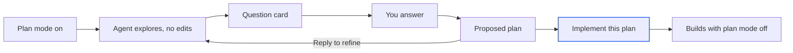

import { PromptCard } from '/snippets/prompt-card.jsx';

Plan mode makes the agent think before it builds. It reads the workspace, asks you a few multiple-choice questions and proposes a plan, and it changes no files until you click **Implement this plan**. Questions themselves aren't limited to plan mode: the agent asks with the same card whenever it needs a decision. To change direction while the agent is already building, [steer or queue](/chat/queue-and-steer) instead.

<Info>
**Use plan mode when** the work is large, vague or hard to undo: a new feature across several files, a schema change, an existing repo you haven't read yet. You see the agent's understanding before a single file changes.
</Info>

<Info>
**Skip it when** the change is small and you already know what you want: a copy fix, a colour, a bug with an obvious cause. Planning adds a round trip that a one-line change doesn't need.
</Info>

<Tip>
Not sure? Plan first. A plan is cheap to change; a finished build is not.
</Tip>

<Frame caption="You read the plan in the Plan tab and build it from there; the chat keeps a short card.">
  
</Frame>

## What happens in plan mode?

The agent explores without editing, asks what it can't work out on its own, then writes the plan. You either reply to refine it or build it. Building switches plan mode off, so the same session goes on to make the changes.



Codex and Claude Code sessions plan the same way on screen. A Claude Code turn ends as soon as the plan is in front of you.

## Switch plan mode on

Plan mode belongs to the session and stays on until you switch it off. A change applies from your next message; a running turn finishes in its own mode.

| Way | What it does |
| --- | --- |
| The **plan** chip in the [composer](/chat/composer) | Opens a **Plan mode** picker with **On** and **Off** (**Off** is the **default**). The chip reads **plan · on** while it's on. |
| <kbd>⇧</kbd><kbd>Tab</kbd> in the composer | Turns plan mode on or off without opening the picker. |
| `/plan` | Opens the same picker. `/plan on` and `/plan off` switch it directly. |
| `/plan` followed by a task | Switches plan mode on and sends the task in one step. |

All four work on the [home screen](/sessions/home-screen) too, for the session your prompt starts. With plan mode on, the composer's placeholder changes: "Describe what to plan — the agent explores and asks, then proposes a plan…" in a session, and "Describe what to plan — the agent explores and asks before proposing a plan…" on the home screen.

<Frame caption="The plan chip's picker on the home screen, with On picked and Off as the default.">
  
</Frame>

<PromptCard label="Try this">

```text
/plan Add a waitlist to Harbor bookings: when a class is full, students can join a waitlist and are offered the next free spot.
```

</PromptCard>

Alpha will:

1. Switch plan mode on for the session and send the task.
2. Read the booking code and the database schema without changing a file.
3. Ask you questions in a card, for example how a freed spot should be offered.
4. Write the plan into the **Plan** tab and stop, waiting for you.

## Answer the agent's questions

The agent asks with a card, never a numbered list, in every mode and in both agents. The card is titled "The agent has a question" or "The agent has questions", and the turn pauses on it with "Waiting for your answer".

Pick an option for each question; one that takes several answers says "Pick any that apply." Where the agent allows it, click **Something else…** and type your own answer. Then click **Send answer**, or **Send answers** for several questions, which counts your answers once you've picked some, as in **Send answers (1/2)**; pressing <kbd>Enter</kbd> in a typed answer sends the card too. Sending with nothing picked shows "Pick an option or type an answer first — or skip." **Skip — let the agent decide** sends no answers, and the agent goes with its own recommendations.

<Frame caption="The last of three questions, with the agent's recommended option marked.">
  
</Frame>

Once the agent has its answer, the card folds to a record of what happened:

| The card shows | What it means |
| --- | --- |
| Your answer, with several joined by · | You answered. Answers to a secret question show as dots. |
| "Left to the agent — it went with …" | You skipped, and the agent took the option it had marked as recommended. |
| "no answer — the agent decided on its own" | You skipped a question that had no recommended option. |
| "The turn ended before this was answered." | The turn stopped or failed while the card was open. |
| "Not answered — the agent went on with its own judgement." | The agent stopped waiting and carried on. |

An open question survives Alpha restarting, so you can still answer it afterwards. Questions from the agent's helpers never reach you: Alpha tells them to carry on with their own judgement, and their work shows in the [transcript](/chat/transcript). People you've [shared the session](/sharing) with see "Waiting for the session's owner to answer."

## Read and refine the plan

The plan streams into the **Plan** tab, the first tab of the [workspace](/workspace/overview), which opens on its own. It stays for the life of the session, plan mode on or off, as the spec the build is checked against. A closed tab comes back with the next plan, or from the workspace's **+** menu.

| Where | What you see |
| --- | --- |
| **Plan** tab | The newest plan at reading size, a copy button ("Copy the plan as markdown") and **Implement this plan**. "No plan yet — with plan mode on, the agent proposes one here." until the first one arrives. |
| **Proposed plan** card in the transcript | The plan's title and first lines, with "Writing the plan…" while it streams. The arrow unfolds the whole plan in place, and a copy button copies it. **Implement this plan** is only in the tab. |
| A shared session | For viewers, the card shows the whole plan from the start, with no way to build it. |

To change the plan, reply in the composer: "Only the advanced classes need a waitlist." The revised plan replaces the old one in the **Plan** tab; earlier versions stay in the transcript. A plan revised after you've started building lands in the tab too.

## Build the plan

When the agent is idle, and the session is still in plan mode or the plan is the latest thing in it, **Implement this plan** appears at the right of the workspace's tab row, beside the plan's copy button. It switches plan mode off and sends "Implement the plan." as your next message, and the button gives way to "Starting the build…". To change the plan first, reply in the composer instead.

| Message | What happened | What to do |
| --- | --- | --- |
| "Plan mode couldn't be switched off, so the plan wasn't sent." | The mode change didn't save, so Alpha held the message back. | Click **Implement this plan** again. |
| "The plan in "…" wasn't sent: the session was left before its build started. Its Plan tab offers Implement again." | You opened another session before the build message went out. | Go back to the session and click **Implement this plan**. |

A plan the agent proposes outside plan mode gets the same button, for as long as nothing has been sent after it. [Queued messages](/chat/queue-and-steer) run in whatever mode the session is in when their turn comes.

## Track progress in the plan dock

While a turn runs, the agent's to-do list floats as one line directly above the composer. It shows a progress ring, the numbered step under way and the count of steps done, such as **2/4**, then "Plan complete" at the end. It's the agent's working checklist, separate from the proposed plan, so it appears in any mode.

The dock opens briefly whenever the list changes, showing only what changed, with added steps marked **new**. Hover to see the whole list; click to pin it open or closed for the rest of the turn. Screen readers announce each step as it starts, as "Now: …". The dock disappears when the turn ends.

<Frame caption="Folded to one line, the plan dock shows the step under way and how many are done.">
  
</Frame>

## Approve actions in older Claude Code sessions

New sessions run with full access, so they never ask permission. You'll only see an approval card in an older Claude Code session that was left on **Ask me** or **Workspace write** (see [the agent and model](/chat/agents-and-models)). The card is titled "Claude wants to use" and the tool's name, shows the command or edit, and the turn waits on it with "Waiting for your approval".

| Button | What happens | The card then shows |
| --- | --- | --- |
| **Allow once** | This one action runs. | "Allowed once" |
| **Always allow** | Offered when Claude suggests a rule. The action runs, and the rule holds for the rest of the session, so similar actions stop asking. | "Always allowed" |
| **Deny** | The action doesn't run, and Claude is told so. | "Denied" |

**Workspace write** cards, which ask before an Alpha command such as publishing or starting a server, offer only **Allow once** and **Deny**. A card left open when the turn ends reads "The turn ended before this was answered — the action was not taken." Viewers see "Waiting for the session's owner to approve."

{/* screenshot to capture: /images/chat/chat-approval-card.png — An approval card in a Claude Code session on Ask me. Nothing runs until you choose. */}

## Next steps

<CardGroup cols={2}>
  <Card title="Queue, steer or stop" icon="arrows-turn-right" href="/chat/queue-and-steer">
    Correct the build mid-turn once the plan is running, without starting over.
  </Card>
  <Card title="Follow the agent's work" icon="list-check" href="/chat/transcript">
    Check each command and edit against the plan as the build streams in.
  </Card>
  <Card title="Choose the agent and model" icon="microchip" href="/chat/agents-and-models">
    Both agents plan, ask and show plans the same way. See what does differ.
  </Card>
  <Card title="Share a session" icon="share-nodes" href="/sharing">
    Let a teammate read the plan live before you build it. Only you can answer its questions.
  </Card>
</CardGroup>
