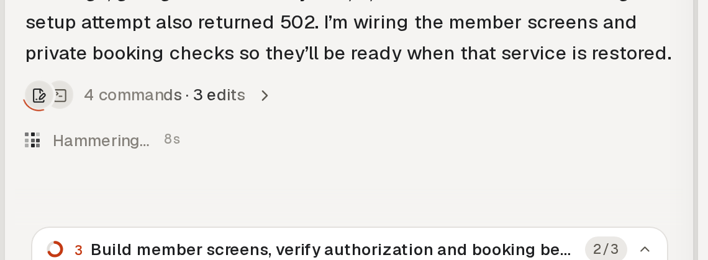

import { PromptCard } from '/snippets/prompt-card.jsx';

The transcript is the running record of a session: your messages, the agent's replies, and every command, edit and thought in between, folded into short lines you can open. Turns keep running in Alpha, not in your tab, so the transcript is complete when you come back. To change what the agent is doing mid-turn, see [Queue, steer or stop](/chat/queue-and-steer); for plans and the agent's questions, see [Plan mode](/chat/plan-mode).

## What does a turn look like?

A turn runs from your message until the agent stops. Everything the agent does between two replies collapses into one line, so even a long turn stays easy to read.

| You see | What it is |
| --- | --- |
| Your message, in a tinted bubble on the right | What you sent, with any attached context as chips. A message sent mid-turn carries "Steered into the running turn". |
| A folded row: icons, a tally, a chevron | Every action between two replies, such as "2 tools · 8 commands · 7 thoughts". |
| The reply | Markdown with code blocks, tables, links and [diagrams](#read-diagrams-in-a-reply). Some replies are [interactive](/chat/interactive-answers). |
| Cards | Plans, questions, sub-agents, workflows and errors. Cards are never folded. |
| **Copy** | Under the last reply, and under any other message, yours included, on hover. Hidden while the agent works. |

## Open the folded actions

The tally counts each kind of action, in the order it first appeared and with thoughts last. The kinds are **command**, **edit**, **search**, **plan update**, **tool** and **thought**. While an action runs, its icon bobs and the tally shimmers. In a narrow column, hover the row to read the whole tally.

Click the row and each action becomes one plain-English line, such as "Ran the tests", "Started the dev server", "Edited BookingForm.tsx" or "Queried the database". A running line reads in the present ("Building the project"). A failed one ends in a red pill such as **exit 1**. A failed command is not a failed turn: the agent usually reads the error and fixes it on the next line.

Click a line to open its detail:

| Action | Its detail |
| --- | --- |
| Command | The command, then its output under **output · N lines**. A command of several lines shows in full, with **collapse** to fold it to its first line. |
| Edit | Each file touched, marked **+** created, **−** deleted or **~** changed. Type `/diff` for the full [diff](/reference/slash-commands). |
| Web search | The queries, or the page it opened, and the results as links. |
| Thought | The reasoning itself. The line shows the model's title for it, its first sentence, or "Thought it through". |

A line that reads a [skill](/skills/overview), such as "Read the slides skill", opens nothing. Its detail stays closed.

<Frame caption="Everything the agent did between two replies, folded into one line with a tally.">
  
</Frame>

## What does the agent do while I wait?

Between outputs, a pixel loader shows a verb that changes every 3 seconds ("Hammering…", "Thinking…", "Reading the workspace…") and a timer. The timer appears after 3 seconds and restarts with each pause, so it measures this gap, not the whole turn. The verb gets specific when there is something specific to say:

| It reads | Meaning |
| --- | --- |
| A status note, such as "Loading the installed MCP servers into this session…" | Alpha is getting the session's machine ready for the agent. |
| "Waiting for your answer" | The agent's [questions](/chat/plan-mode#answer-the-agent’s-questions) are open above the composer, and the turn waits for you. The timer is hidden. |
| "Waiting for your approval" | An older Claude Code session on **Ask me** wants [an action approved](/chat/plan-mode#approve-actions-in-older-claude-code-sessions). |
| "Sending your answer" | Your answer is on its way to the agent. |
| "Robie is working", "3 agents are working" | Sub-agents are doing the work. |
| "Stopping" | You pressed Stop, and the turn is ending. |

<Frame caption="Between outputs, the loader shows a verb and how long this pause has lasted.">
  
</Frame>

## Know when the agent needs you

Turns keep running while you work elsewhere, so Alpha tells you when one finishes or waits on you.

| Signal | When you see it |
| --- | --- |
| An orange dot on the browser tab's icon | The session open in that tab is waiting on you: questions to answer or, in an older Claude Code session, an action to approve. |
| A speech bubble with a question mark, "Needs your answer" | Before the session's title while it waits on you, and on its row in the sidebar. |
| A short chime | A turn finished in a session you weren't watching: another session, or this one while the tab was in the background or a page such as **Settings** covered it. |
| The browser tab's title | Follows where you are: the session's title, such as "Harbor bookings — Alpha", or a page, such as "Settings — Alpha". |

The chime doesn't play for a turn you stopped, or when your computer is set to reduce motion. Your browser may also keep it silent until you've clicked somewhere on the page.

The session's header also shows the logos of the connected services its tool calls have used, such as GitHub or a [connector](/integrations/overview). Hover a logo to read its name and "used in this session".

## Read diagrams in a reply

A ` ```mermaid ` block in a reply, or in the agent's reasoning, draws as a diagram. While the agent is still writing the block it shows as code, and it draws once the block is complete. The diagram sits under the code block's header, so **Copy** still gives you the Mermaid text.

<PromptCard label="Try this">

```text
Explain the Harbor bookings flow here in the chat, with a Mermaid flowchart: browsing classes, booking a seat, joining the waitlist.
```

</PromptCard>

Alpha will:

1. Answer with a Mermaid flowchart, drawn in the reply.
2. Keep the diagram's text a click away, under **Copy**.

A diagram follows the width of the chat. One that had to shrink to fit can be zoomed: pinch or hold <kbd>⌘</kbd> and scroll, drag to move around, double-click to reset, or use its **+** and **−** buttons. Use Ctrl instead of ⌘ on Windows and Linux. Diagrams also draw in the **Plan** tab, the **Agent** tab and Markdown file previews. A diagram carries no links or images.

## Open files from the chat

A file the agent names in its reply is a link. Clicking it opens the file as a [workspace](/workspace/files) tab, at the line when one is given. Hover to see where it goes ("Open src/app.ts:42").

| The agent writes | Clicking it |
| --- | --- |
| `[app.py](/workspace/app.py)` or `file:///workspace/README.md` | Opens the file in a tab. |
| `[src/app.ts:42](src/app.ts:42)` or `#L42` | Opens the file at line 42 and marks it. |
| `` | Shows the image in the reply; clicking opens the [image viewer](/workspace/file-viewers). |
| A `/s/…` link | Shows as a session badge, and opens that session in a new tab. |
| An `/artifact/…` link | Shows as a badge and opens in the side pane. An [artifact](/artifacts) saved from this session opens its file; any other opens the artifact itself, which says so if it was deleted. |
| A web address | Opens in a new browser tab. |

Paths outside `/workspace`, folders and addresses such as `localhost:3000` aren't opened as files.

## Follow sub-agents and workflows

The agent can split a task between helpers, called sub-agents, each with its own task, working in the same machine.

### Sub-agent cards

Each sub-agent gets a card where it was spawned. The header shows its icon, its name (Codex gives each one a nickname), its role, its model and effort, and a status pill with its time. The icon follows what its name says it does, such as a telescope for research, a bug for a fix or a flask for tests, with sparkles when the name says nothing. While the sub-agent works, an arc circles its icon. The body shows its task (**more** for the rest), a live feed of its steps as action lines, its to-do list, and its answer once done.

| Pill | Meaning |
| --- | --- |
| **starting**, **working** | The sub-agent is at work. |
| **done** | It finished and handed back its answer. |
| **failed** | It hit an error, shown in its card. |
| **interrupted** | It was interrupted before it finished. |
| **closed** | The main agent closed it before it answered. |
| **stopped** | The turn ended while it was still working. |

A roster above the composer lists the turn's sub-agents: their icons, up to three names with **+N**, and a count such as **2 working** (or **3 done** once they finish). Click it to see each agent's activity, with a status dot each; click an agent ("Show this agent in the transcript") to jump to its card.

{/* screenshot to capture: /images/chat/chat-subagent-card.png — A sub-agent at work in its card, with the roster above the composer. */}

Sub-agents never stop to ask you anything. They carry on with their own judgement, so every question you're asked comes from the main agent. In Claude Code, the turn keeps running until its last sub-agent finishes.

### Workflow cards

<Badge>Claude Code only</Badge> A workflow is a team of agents Claude runs in the background, in phases. With the session's effort on **ultracode**, Claude runs one for every substantive task, and it may start one in any session. Writing the word "ultracode" in a message asks for one for that turn; see [Choose the agent and model](/chat/agents-and-models#when-is-ultracode-worth-it). When the workflow finishes, Claude follows up on its result, and your turn keeps running until then.

The card's pill counts finished agents, such as **working · 3/8**, then reads **done**, **failed** or **stopped**. The card lists each phase, with each agent's current tool, tokens, time and result. **Stop** on the card ("Stop this workflow and its agents") stops that workflow only; the composer's Stop ends the whole turn, workflows included.

{/* screenshot to capture: /images/chat/chat-workflow-card.png — A workflow's phases and agents, live, with its own Stop. */}

<Warning>
A workflow runs many agents at once, so it costs several times the tokens and time of an ordinary turn. Stop one you don't need from its card.
</Warning>

<Note>
If you don't see Claude Code on the home screen, it isn't turned on for your Alpha.
</Note>

## Find, copy and export

A long session opens on its latest turns, so it appears at once. Older turns appear as you scroll up, or all at once from the "Show N earlier messages" marker at the top. Press <kbd>⌘</kbd><kbd>F</kbd> to find text in the turns shown so far. Earlier turns aren't searched until you scroll to them or show them. Use Ctrl instead of ⌘ on Windows and Linux.

To export the transcript, scroll to the top of the session, hover the first message and click **More** (⋯) → **Export as Markdown**.

{/* screenshot to capture: /images/chat/chat-export-markdown.png — Export sits in the More menu under your first message. */}

The transcript is append-only: you can't edit a sent message or regenerate a reply. To try another direction and keep this one, [fork the session](/sessions/fork-and-delete). Values of your [secrets](/secrets) that are 8 or more characters long show as `[redacted]`, in the transcript and in exports. An email address or a plain web address is left as it is.

## What if a turn fails?

A failed turn shows one red card saying what failed, sometimes with a **details** fold. The workspace and the transcript up to the failure are kept, and your next message carries on from there.

| You see | What to do |
| --- | --- |
| The model provider's own message, or "model provider error" when it gave none | Send again. If it repeats, try [another model](/chat/agents-and-models#choose-a-model). |
| "The agent exited with code N" | Open **details** to read why, then send again. |
| "Couldn't pick the turn back up: …" | Something on Alpha's side interrupted the turn, and it couldn't be resumed. Ask the agent to carry on. |
| A "Claude sign-in" error saying the session isn't signed in to Claude | Open **Account menu → Sign in with ChatGPT/Claude** and sign in on the **Claude** row ([how](/account/usage-and-costs#run-claude-code-sessions-on-your-claude-plan)), then resend. |
| A "Claude sign-in" error saying your Claude sign-in was rejected | Sign in with Claude again, then resend. |
| A "Claude sign-in" error saying your Alpha's own Claude access was rejected | Ask your admin to fix your Alpha's Claude access. |
| "The session's machine cannot be reached right now. Nothing was discarded — …" | Send again in a moment. If your message was refused, its text goes back into the composer. Resetting is a [last resort](/sessions/machines#reset-the-session’s-machine). |

A turn you stop isn't a failure. For other messages, see [Troubleshooting and FAQ](/reference/troubleshooting).

## Next steps

<CardGroup cols={2}>
  <Card title="Queue, steer or stop" icon="forward" href="/chat/queue-and-steer">
    Send a second message without waiting, or stop a turn heading the wrong way.
  </Card>
  <Card title="Plan mode and the agent's questions" icon="clipboard-list" href="/chat/plan-mode">
    Answer the cards that make a turn wait, and approve a plan before any code.
  </Card>
  <Card title="Choose the agent and model" icon="microchip" href="/chat/agents-and-models">
    Pick Codex or Claude Code, set the effort, and turn on ultracode workflows.
  </Card>
  <Card title="Files and uploads" icon="folder-open" href="/workspace/files">
    Where the files the agent links to live, and how to download them.
  </Card>
</CardGroup>
