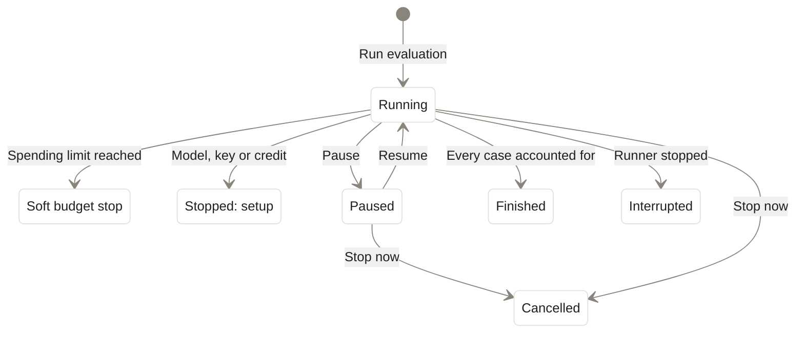

import { PromptCard } from '/snippets/prompt-card.jsx';

Running an evaluation sends every test case through your agent on its real model, grades each answer, and spends money on your model keys. This page covers **Run**, the second step of the **Evals** tab, and the live run that follows it. To write or change test cases first, see [Set up evals](/evals/set-up). To read what a finished run found, see [Read results and fix failures](/evals/results).

{/* screenshot to capture: /images/evals/evals-run-setup.png — The Run step: how each answer is graded on the left, and what the run costs on the right. */}

<Warning>
Every test case calls your agent's real model, and the AI reviewer calls a model too. Both are billed to your own keys. Working out the cost spends nothing. Nothing runs until you press **Run evaluation** or ask the agent for one.
</Warning>

## Choose how answers are graded

Click **Next: set up the run** on **Test cases**, or **Run** in the step control. **Set up the run** opens with **What's tested**: the agent, its framework and model, and how many steps, tools and test cases the run covers. Edits on this page save themselves.

| Section | What it does | What you can change |
| --- | --- | --- |
| **AI reviewer model** | Reads each answer and scores the quality metrics. Alpha picks a small OpenAI model by default. | Pick another of the session's OpenAI models. It's paid with your OpenAI key, or your OpenRouter key if that's all you have. |
| **Quality metrics** | Questions the AI reviewer scores every answer on, with a reason for each score. **Task completion** and **Hallucinations** are **Required**. Others are tagged **for this agent**, or listed under **Test-case questions**. | Remove a **for this agent** question. The required two stay. |
| **Fast AI checks** | Short yes/no questions a small, cheap model answers. Shown only when the eval has them. | Switch them on or off. |
| **Format checks** | Code checks the shape of every answer and the tools it used. Instant and free. | Nothing: they're **always on**. Expand the row to list them. |

If you see "AI review is graded by …, the model your agent runs on.", the reviewer is marking its own model's work. Pick another model, or click **ask Alpha to switch it**.

## Run each test case more than once

A model can answer the same question differently each time. One run per test case shows the agent *can* get it right; several show whether it does so *reliably*. Open **Advanced** and choose **Run each test case**: **once**, **2 times**, **3 times** or **5 times**. Each extra run multiplies the agent runs and AI review calls, and the cost card reprices once the change saves itself.

{/* screenshot to capture: /images/evals/evals-run-advanced.png — More runs catch answers that are right only some of the time, and cost more. */}

The evals Alpha writes run each test case once. Raise the count when a case passes one run and fails the next. **Edit suite.yaml** opens the setup file itself.

## Check the cost and set a spending limit

The **Estimated cost** card prices the run as soon as the saved test cases are ready. It shows "About" and a total, then one line per part:

| Line | What it counts |
| --- | --- |
| **… agent runs** | Test cases times runs per test case, on the agent's own model. |
| **AI review · … calls** | The AI reviewer scoring quality metrics. |
| **Fast AI checks · … calls** | The small yes/no model, when it's on. |
| **Format checks** | Always **free**. |

Type a dollar amount into **Spending limit**, or leave it empty for none. No new test case starts once the next one would pass it. The limit is soft: cases already running finish, so the total can end slightly over. If the estimate is already above it, the card warns "Over your spending limit: some test cases will not run." Alpha suggests one when the estimate is over a dollar.

## Start the run

<Steps>
  <Step title="Read the cost card">
    Wait for a total. The footer confirms the plan, for example "12 test cases, each run once". If **Run evaluation** stays off, see [Why a run can't start](#why-a-run-cant-start).
  </Step>
  <Step title="Set a spending limit">
    Type an amount into **Spending limit**, or leave it empty.
  </Step>
  <Step title="Click Run evaluation">
    The button reads "Starting…". Alpha first sends one tiny paid request to each model the run calls, a fraction of a cent, to confirm the model exists and the account has credit. Then the tab moves to **Results** and shows the run live.
  </Step>
</Steps>

You can also ask the agent. It never starts a run on its own, only when you ask.

<PromptCard label="Try this">

```text
Run the harbor-triage eval.
```

</PromptCard>

Alpha will:

1. Say in one line what runs and about what it costs.
2. Start the run, which appears in the **Evals** tab like any other.
3. Post an **Eval run started by Alpha** card with **Watch it in Evals**.
4. Post a result card in the session when the run ends.

"Run again" and "resume it" work too. A resumed run posts **Eval run resumed by Alpha**.

## Watch, pause or stop a run

**Results** shows **Running** and a line on what's happening now: "Starting the run…", then "Running test case 3 of 8", or "Running 4 test cases at once · 2 of 8 done". Test cases usually run four at a time; the agent sets one at a time when your agent's tools touch something runs would clash over, such as a real inbox. Below are a progress bar, one tile per test case, and **Passed so far**, **Spent so far**, **Time so far** and **Time left**.

{/* screenshot to capture: /images/evals/evals-running.png — A live run: what's running now, the progress bar, and the numbers so far. */}

| Control | What it does |
| --- | --- |
| **Pause** | Keeps finished test cases; the rest wait. The page reads "Paused after … test cases". |
| **Resume** | Runs the rest, with real model calls. |
| **Stop** | Asks **Stop now** or **Keep going**. **Stop now** cancels the run, and unfinished test cases count as not run. |

These buttons are the session owner's <Badge>Owner only</Badge>. A [viewer of a shared session](/sharing) can watch the run but not control it. If the page says "Nothing new for a while; the runner may have stopped.", click **Resume**.

<Note>
A run keeps going when you close the tab. The session's machine stays awake while it runs, so it doesn't [sleep](/sessions/machines) under the run.
</Note>

## Why a run can't start

**Run evaluation** stays off until the eval is ready, and the cost card says what's missing.

| What you see | Fix |
| --- | --- |
| "Add a test case before running." | Go back to **Test cases** and ask Alpha to write some. See [Set up evals](/evals/set-up). |
| "Give a test case a check that passes or fails it before running." | Add a check under **How it's graded**, or ask Alpha to. |
| "Add an OpenAI key under Secrets before running: the AI review needs it." | Add `OPENAI_API_KEY` or `OPENROUTER_API_KEY` as a [secret](/secrets). |
| "The AI review is being set up." | Wait. Alpha adds the reviewer and required metrics by itself. |
| "This session's models can't review answers here." | Click **Set up AI review**. |
| "No price for …, so the run can't start yet." | Click **Ask Alpha to price it**, or pick another model under **AI reviewer model**. |
| **Before you run**: "1 problem stops the run." | Fix what it names, then click **Check again**. |
| "The soft budget is a number of dollars above zero, or empty for none." | Correct the **Spending limit**, or clear it. |
| "The file changed in the sandbox while you edited" | The agent edited the eval's setup file too. Click **Take the file** or **Keep my edits**. |

{/* screenshot to capture: /images/evals/evals-run-unpriced.png — An unpriced model blocks the run until Alpha adds its price or you pick another reviewer. */}

Warnings that don't block the run show as one line in the cost card, with **Ask Alpha to fix it**.

## How a run ends

The run list on **Results** shows each run's state beside its start time.



| State | What it means | What to do |
| --- | --- | --- |
| **finished** | Every planned test case ran or is accounted for. The report is final. | [Read the results](/evals/results). |
| **paused** | Finished test cases are kept. The rest wait. | Click **Resume**. |
| **soft budget stop** | The spending limit was reached. Cases in flight could spend a little past it; the rest didn't run. | Raise the limit, then **Run again** or **Run those again**. |
| **stopped: setup** | A model, key or credit problem every later case would hit. | Fix it, then ask Alpha to resume it. |
| **cancelled** | You pressed **Stop now**. Unfinished cases didn't run. | **Run those again** or **Run again**. |
| **interrupted** | The runner stopped early, for example when the machine restarted. | Ask Alpha to resume it, or **Run those again**. |

**Run those again** appears on **Results** when nothing failed but some cases didn't run. It returns to the Run step with only those cases chosen; **Run every case** puts the rest back. Cases that never reached grading count as not run, never as failures.

## Next steps

<CardGroup cols={2}>
  <Card title="Read results and fix failures" icon="square-poll-vertical" href="/evals/results">
    Find out why each case failed, settle split grades, and let Alpha propose one fix for all of them.
  </Card>
  <Card title="Set up evals" icon="flask" href="/evals/set-up">
    Fill missing scenario and persona pairs, or mark the test cases that must pass.
  </Card>
  <Card title="Secrets" icon="key" href="/secrets">
    Add the OpenAI or OpenRouter key that pays for your agent's runs and the AI reviewer.
  </Card>
  <Card title="Try your agent" icon="comments" href="/agents/try-it">
    Send one input by hand before you spend on a full run.
  </Card>
</CardGroup>
