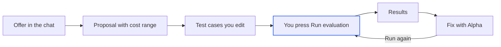

import { PromptCard } from '/snippets/prompt-card.jsx';

An eval runs your agent on a written set of test cases and grades every answer. Alpha writes the test cases and prices the run; you review them on the **Evals** tab, and nothing runs until you start it. To try a single input by hand while you build, use [Try it](/agents/try-it) instead.



<Note>
The agent never starts a paid run on its own. It drafts, checks and prices the test cases, then stops. A run starts only when you click **Run evaluation**, or ask the agent for a run in plain words, such as "run it".
</Note>

## How evals work

A test case is someone asking your agent something in a particular situation. The situation is a **scenario** and the someone is a **persona**. Alpha writes one test case for every scenario with every persona, so four scenarios and three personas give twelve test cases. For `harbor-triage`, a scenario might be a weather cancellation and a persona an upset customer.

Each test case carries an input and the checks that grade the answer, of two kinds:

| Check | Tag in the Evals tab | What decides it | Cost |
| --- | --- | --- | --- |
| Automatic checks | **Automatic** | Code: the output format, fields that match the expected answer, the right tools with the right arguments | Instant and free |
| AI review | **AI review** | An AI reviewer model reads the answer and passes or fails it with a reason. Two standard questions, did it complete the task and did it make anything up, apply to every test case. The Run step calls them the quality metrics **Task completion** and **Hallucinations**. | A model call on your key |

A test case marked **Must pass** decides the whole run: "If this test case fails, the whole evaluation fails." Checks marked **Diagnostic feedback** are reported in the results but never change whether the test case or the run passes. You pick the AI reviewer's model on the next step, [Run an evaluation](/evals/run).

## Start setting up evals

Evals test an agent Alpha has [built and proved](/agents/build-an-agent) in this session. There are four ways in, and each ends with the agent writing test cases in the transcript.

| Where | What you click or say |
| --- | --- |
| The transcript, after the agent is built | **Set up evals** on the "Test this agent with evals?" card. **Not now** folds the card away and sends nothing. |
| The [Agent tab](/agents/agent-tab) | The flask button in the canvas toolbar, whose tooltip reads "Not tested yet: set up evals". Once the Evals tab exists, the same button opens it instead. |
| The Evals tab, before any test cases exist | **Generate test cases** |
| The composer | A request such as "test this agent", "evaluate it" or "benchmark it" |

The buttons first open a **How evals work** dialog: setting up is free, and every test case in a run calls your agent's real model, which costs extra. Click **Set up evals** to send the request. The button reads "Asked the agent" for a moment, and the reply arrives in the transcript.

{/* screenshot to capture: /images/evals/evals-offer-card.png — Alpha offers evals as soon as the agent is proved. Nothing is sent until you click. */}

<PromptCard label="Try this">

```text
Set up evals for harbor-triage. Focus on refund requests after weather cancellations, and make every case that quotes a refund amount must-pass.
```

</PromptCard>

Alpha will:

1. Write the scenarios, personas and test cases into your agent's test cases file, with your focus cases marked **Must pass**.
2. Check the test cases and work out the cost of running them, without running your agent.
3. Post an **Eval proposal** card in the transcript, then stop and wait for you.

## Review the proposal

When the test cases are written, the agent posts an **Eval proposal** card tagged "not started". It lists what the test cases cover and how big a run is: "12 cases × 1 trials = 12 agent runs per target." A trial is one run of one test case; each runs once unless you ask for more. A target is one framework your agent was built for.

<Warning>
Running the evals costs real money. The card says so in its own words: "Costs real money. About \$L to \$H on your key." The range runs from your agent's share to the total with grading, and is an estimate, not a charge. Before posting the card, Alpha sends one tiny request to each model the run will call, a fraction of a cent on your key, to confirm the model exists and your account has credit.
</Warning>

{/* screenshot to capture: /images/evals/evals-proposal-card.png — The proposal states the run's size and its cost range before anything runs. */}

Click **Open eval setup** to open the Evals tab on its **Test cases** step, with the proposed test cases chosen for the run. **Not now** folds the card to "Eval proposal; not now. Nothing ran." The card says "press Start"; the button you press on the Evals tab is **Run evaluation**.

A card that proposes only some test cases, for example after "run it with these new inputs", names them: "Only harbor-refund-04: the other cases stay in the suite and do not run." If the setup is already open, click **Choose only these cases**.

## Shape the test cases

The Evals tab has three steps: **Test cases**, **Run** and **Results**. The first opens on a diagram of what the test cases cover: **Scenarios**, **What's being tested** and **Personas**. The middle card names your agent, its scope and its steps. The scope reads "The whole team, every step from input to output" for an agent with several steps, such as `harbor-triage`, and "The whole agent, from input to output" for a one-step agent. Until the agent has written any test cases, the step shows a single **Generate test cases** button instead.

{/* screenshot to capture: /images/evals/evals-empty-state.png — Before any test cases exist, one button asks Alpha to write them. */}

Click a scenario or persona to filter the table to its test cases; click it again, or **Show all**, to clear the filter. A "draft" tag marks test cases nobody has reviewed yet. When you're happy with them, tell the agent "these cases are right" and it marks them reviewed and locks them. If a locked test case changes later, the next run refuses to start.

{/* screenshot to capture: /images/evals/evals-test-cases-diagram.png — Every scenario meets every persona. Click either side to filter the table. */}

## Edit a test case

Click any row to open the test case in a side panel. Its tags at the top show the scenario, the persona, "★ Must pass" and "Draft" where they apply. Edits stay unsaved until you click **Save**.

| Field | What you change |
| --- | --- |
| **What the user asks** | The input your agent receives, one box per input. An input that isn't plain text shows read-only. |
| **What it checks** | One line on what this test case proves. |
| **A good answer** | The expected answer. If there is none, the panel says "No expected answer: the checks below decide." |
| **How it's graded** | Read-only. Each check is tagged **Automatic** or **AI review**. Questions asked of every test case say "every test case". "Nothing grades this test case yet." means it can't pass or fail. |
| **Must pass** | A switch. You can also click the star in the table's **Must pass** column. |

**Duplicate with new inputs** asks Alpha to write another test case like this one, in the same scenario and persona with the same kind of checks. **Remove** takes this test case out. Like every edit here, it waits for **Save**.

{/* screenshot to capture: /images/evals/evals-case-panel.png — Every field you can change, and every check that grades this test case. */}

## Add more test cases and save

These buttons ask the agent to write test cases. They appear on the tab once it saves the file. Writing them takes a turn, not an eval run.

| Control | What Alpha writes |
| --- | --- |
| **Write the N missing test cases** | One test case for each scenario and persona pair that has none. |
| **Write more** | Shown once every pair is covered: more test cases with your existing scenarios and personas. |
| **Scenario** (plus button) | Alpha adds a scenario the current ones miss, with a test case for every persona. |
| **Persona** (plus button) | Alpha adds a persona the current ones miss, with a test case in every scenario. |

Deleting a scenario or persona asks first, for example "Delete Refund request and its 3 test cases?". Nothing is saved until you press **Save**, and **Undo** brings it back.

<Steps>
  <Step title="Save your changes">
    Once you've edited something, the footer reads "You have unsaved changes." Click **Save** to write the test cases file, or **Undo** to drop every unsaved change.
  </Step>
  <Step title="Move on to the run">
    Click **Next: set up the run**. It saves anything still unsaved first, and stays off while there are no test cases. Continue with [Run an evaluation](/evals/run).
  </Step>
</Steps>

If the agent changes the test cases file while you edit, a banner reads "The file changed in the sandbox while you edited". **Take the file** drops your edits; **Keep my edits** keeps them, and saving replaces the agent's change. If the file is broken, the tab reads "The test cases file doesn't read": click **Ask Alpha to fix it**.

The **Test cases** and **Run** steps are <Badge>Owner only</Badge>. People you [share the session](/sharing) with see only **Results**.

## Next steps

<CardGroup cols={2}>
  <Card title="Run an evaluation" icon="play" href="/evals/run">
    Choose the AI reviewer's model, set a spending limit and press **Run evaluation**.
  </Card>
  <Card title="Read results and fix failures" icon="square-poll-vertical" href="/evals/results">
    See why each test case failed and let Alpha propose one fix for all of them.
  </Card>
  <Card title="The Agent tab" icon="diagram-project" href="/agents/agent-tab">
    The canvas carries your latest eval result on its flask button.
  </Card>
  <Card title="Build, try and test a support-triage agent" icon="book-open" href="/guides/ai-agent">
    Follow `harbor-triage` from first prompt to a passing eval.
  </Card>
</CardGroup>
