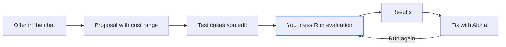

import { PromptCard } from '/snippets/prompt-card.jsx';

An eval runs your agent on a written set of test cases and grades every answer. Alpha writes the test cases and prices the run; you review them on the eval's own tab in the workspace, and nothing runs until you start it. An agent can have several evals, such as one broad check and one for refund requests, each with its own tab, runs and results. To try a single input by hand while you build, use [Try it](/agents/try-it) instead.



<Note>
The agent never starts a paid run on its own. It drafts, checks and prices the test cases, then stops. A run starts only when you click **Run evaluation**, or ask the agent for a run in plain words, such as "run it".
</Note>

## How evals work

A test case is someone asking your agent something in a particular situation. The situation is a **scenario** and the someone is a **persona**. Alpha writes one test case for every scenario with every persona, so four scenarios and three personas give twelve test cases. For `harbor-triage`, a scenario might be a weather cancellation and a persona an upset customer.

Every eval Alpha writes has at least two personas and two scenarios, and every test case names one of each, however you asked for the eval. That keeps the diagram on **Test cases** and the **By scenario** and **By persona** bars on [Results](/evals/results) filled in.

<Frame caption="Setting up is free; only a run calls the model.">
  
</Frame>

Each test case carries an input and the checks that grade the answer, of two kinds:

| Check | Tag on the eval's tab | What decides it | Cost |
| --- | --- | --- | --- |
| Automatic checks | **Automatic** | Code: the output format, fields that match the expected answer, the right tools with the right arguments | Instant and free |
| AI review | **AI review** | An AI reviewer model reads the answer and passes or fails it with a reason. Two standard questions, did it complete the task and did it make anything up, apply to every test case. The Run step calls them the quality metrics **Task completion** and **Hallucinations**. | A model call on your key |

A test case marked **Must pass** decides the whole run: "If this test case fails, the whole evaluation fails." Checks marked **Diagnostic feedback** are reported in the results but never change whether the test case or the run passes. You pick the AI reviewer's model on the next step, [Run an evaluation](/evals/run).

## Start setting up evals

Evals test an agent Alpha has [built and proved](/agents/build-an-agent) in this session. There are five ways in, and each ends with the agent writing test cases in the transcript.

| Where | What you click or say |
| --- | --- |
| The transcript, after the agent is built | **Set up evals** on the "Test this agent with evals?" card. **Not now** folds the card away and sends nothing. |
| The [Agent tab](/agents/agent-tab) | The flask button in the canvas toolbar, whose tooltip reads "Not tested yet: set up evals". Once the agent has evals, the same button opens its eval's tab instead. |
| An eval's tab, before it has test cases | **Generate test cases** for the agent's first eval, or **Ask Alpha to draft it** for any other. |
| **New eval**, on any eval's tab | Fill in the form and click **Set up eval**. See [Set up another eval](#set-up-another-eval). |
| The composer | A request such as "test this agent", "evaluate it" or "benchmark it", or "a separate eval for refunds" to add another |

The buttons in the first three rows open a **How evals work** dialog first: "Set up: Alpha writes test cases for this agent, one for every scenario with every persona, and proposes them in the chat like any other message. Free." and "Run: every test case calls the agent's real model, which costs extra." Click **Set up evals** to send the request, or **Cancel**. The button reads "Asked the agent" for a moment, and the reply arrives in the transcript. **Set up eval** on the **New eval** form asks at once, with no dialog.

<Frame caption="Once the agent is built, Alpha offers to test it.">
  
</Frame>

<PromptCard label="Try this">

```text
Set up evals for harbor-triage. Focus on refund requests after weather cancellations, and make every case that quotes a refund amount must-pass.
```

</PromptCard>

Alpha will:

1. Write the scenarios, personas and test cases into your agent's test cases file, with your focus cases marked **Must pass**.
2. Check the test cases and work out the cost of running them, without running your agent.
3. Post an **Eval proposal** card in the transcript, then stop and wait for you.

## Review the proposal

When the test cases are written, the agent posts an **Eval proposal** card tagged "not started". It names the eval Alpha drafted, lists what the test cases cover, and says how big a run is: "12 cases × 1 trials = 12 agent runs per target." A trial is one run of one test case; each runs once unless you ask for more. A target is one framework your agent was built for.

<Warning>
Running the evals costs real money. The card says so in its own words: "Costs real money. About \$L to \$H on your key." The range runs from your agent's share to the total with grading, and is an estimate, not a charge. Before posting the card, Alpha sends one tiny request to each model the run will call, a fraction of a cent on your key, to confirm the model exists and your account has credit.
</Warning>

{/* screenshot to capture: /images/evals/evals-proposal-card.png — The proposal states the run's size and its cost range before anything runs. */}

When the card arrives while you have the session open, the eval's tab opens by itself on its **Test cases** step, with the proposed test cases chosen for the run. Later, **Open eval setup** on the card opens it again the same way. While that eval's **Test cases** step is on screen, the card reads "Open in the Evals tab" instead. **Not now** folds the card to "Eval proposal; not now. Nothing ran." The card says "press Start"; the button you press on the eval's tab is **Run evaluation**.

A card that proposes only some test cases, for example after "run it with these new inputs", names them: "Only harbor-refund-04: the other cases stay in the suite and do not run." If the setup is already open, click **Choose only these cases**.

## One tab per eval

Each eval opens as its own tab in the workspace's tab strip, beside **Agent**, the other workspace tabs and your open files. The tab shows the eval's name followed by "eval". An agent's first eval takes the agent's name, such as **harbor-triage eval**; any other eval takes its own, such as **refunds eval**. Hover a tab to see the agent and the eval, for example "Eval harbor-triage / refunds".

| The tab shows | What it means |
| --- | --- |
| A flask and the name | Nothing is running. The tab's **×** shows on the tab on screen, and on any other when you hover it. |
| A spinner instead of the flask, and no **×** | A run of this eval is going. The tab can't be closed until the run ends, so a run that spends is never out of sight. |
| A small warning dot after the name | The eval's newest run stopped short and waits for you: it is **paused**, hit its spending limit (**soft budget stop**), stopped on a model, key or credit problem (**stopped: setup**), or was **interrupted**. See [How a run ends](/evals/run#how-a-run-ends). |

Click a tab to show that eval. Click its **×** ("Close refunds (the eval and its runs stay)") to close it: closing a tab never deletes the eval, its test cases or its runs. Closing the last eval tab closes the evals altogether; click **+** at the end of the tab strip and choose **Evals** to bring them back. With no eval tab open, one **Evals** tab stands for them all and shows the [New eval](#set-up-another-eval) page.

Which tabs are open is kept per session, in this browser, so a reload or coming back later shows the same ones. The first time you open evals in a session, every eval of every agent opens. If the agent has none yet, its first eval opens on a **Test cases** step that offers to draft it. An eval with a run going always gets its tab, even when the run was started from the transcript or another browser.

Each eval's tab has the same row along its top:

| Control | What it does |
| --- | --- |
| **Test cases**, **Run**, **Results** | This eval's three steps. Each eval keeps its own place, so switching tabs never loses your step or a half-made edit. |
| The run picker | On **Results**: this eval's runs, newest first, each with its start time and state, such as "Today, 9:15 AM · finished". |
| **New eval** | Opens the [New eval](#set-up-another-eval) page in a **New eval** tab. Close it with its **×** to go back. |
| **All evals** | A list of every eval in the session. Pick one to open or reopen its tab. |
| **Read again** (circular arrow) | Reads the session's evals and runs again. The tab also reads again by itself after each of the agent's turns. |

You can move between eval tabs from the keyboard once one has focus. Click a tab, or press <kbd>Tab</kbd> until one is outlined.

| Press | To |
| --- | --- |
| <kbd>←</kbd> or <kbd>→</kbd> | Show the previous or next tab. The ends wrap around. |
| <kbd>Home</kbd> or <kbd>End</kbd> | Show the first or last tab. |
| <kbd>Delete</kbd> | Close the focused tab. A tab whose eval is running can't be closed. |

While the session's machine wakes, the page reads "Getting your evals ready" and keeps trying by itself; **Try now** reads again at once. People you [share the session](/sharing) with see the eval tabs and each eval's **Results** only.

## Set up another eval

One eval rarely covers everything. Set up another to test one area on its own, such as refund requests or unusual inputs. Each eval has its own test cases, its own runs and its own [baseline](/evals/results#compare-runs-and-set-a-baseline); the agent's other evals stay as they are.

<Steps>
  <Step title="Open New eval">
    Click **New eval** on any eval's tab. With no eval tab open, the **Evals** tab shows the same page. **New eval** is <Badge>Owner only</Badge>.
  </Step>
  <Step title="Fill in the form">
    The form reads "Test your agent workflow on a new set of situations. Alpha drafts the test cases; nothing runs until you start it." It has three rows, described below.
  </Step>
  <Step title="Click Set up eval">
    The eval's tab opens on **Test cases**, and Alpha is asked to draft the test cases in the transcript straight away, with no dialog first. The step reads "Alpha is drafting the test cases" and "Follow along in the chat. They show up here as soon as Alpha saves them, and nothing runs until you start it.", with your focus under it. Then [review the proposal](#review-the-proposal) as for any eval.
  </Step>
</Steps>

| Row | What you enter | What to know |
| --- | --- | --- |
| **1 Workflow** | The agent this eval tests, end to end, from a list of the session's agents | Starts on the agent the **Agent** tab shows. |
| **2 Name** | The eval's name, such as `refunds` or `tough-candidates` | "Letters, digits, '.', '_' or '-'." It must start with a letter or digit, or the form says "Use letters, digits, '.', '_' or '-', starting with a letter or digit." A name the agent already has is refused: "harbor-triage already has an eval named refunds. Open it, or pick another name." |
| **3 Focus** (optional) | What Alpha should write the test cases around | Click an idea to write it into the field: **Edge cases** ("Odd, incomplete or contradictory inputs"), **Safety and fairness** ("What to refuse, and treating everyone alike") or **Long inputs** ("Long messages and documents"). Click it again to clear it, or write your own. Leave it empty for a broad check. |

**Set up eval** stays off until the name is valid. If Alpha's turn ends without saving the test cases, the tab shows "New eval: harbor-triage / refunds" with **Ask Alpha to draft it**, which asks again.

Beside the form, **Your previous evals** lists every eval in the session with its count. Each row names the eval and its agent, then how its newest run stands (such as **Finished** or **Running**), when it started and what it spent, or "No runs yet". Click a row to open its tab. **All evals** on an eval's tab drops down the same list.

You can also ask in the composer, for example "Set up a separate eval for harbor-triage called refunds, about refund requests after weather cancellations." Alpha writes the new eval beside the agent's others without touching them, and proposes it with a card that names it `harbor-triage / refunds`.

| You see | What to do |
| --- | --- |
| "No agent to test yet." | Evals test an agent Alpha has built and published. Click **Ask Alpha to build one**. |
| "Two evals of harbor-triage save their runs under one name" | Two evals are set to save their runs under the same name, so their runs would mix, and neither can run. Click **Ask Alpha to rename one**. |

## Shape the test cases

The **Test cases** step opens on a diagram of what the test cases cover: **Scenarios**, **What's being tested** and **Personas**. The middle card names your agent, its scope and its steps. The scope reads "The whole team, every step from input to output" for an agent with several steps, such as `harbor-triage`, and "The whole agent, from input to output" for a one-step agent.

Until Alpha has written any test cases, the step shows what evals are and one button. The agent's first eval reads "Test this agent before you ship it" with **Generate test cases**; any other eval reads "New eval: …" with **Ask Alpha to draft it**.

{/* screenshot to capture: /images/evals/evals-empty-state.png — Before any test cases exist, one button asks Alpha to write them. */}

Click a scenario or persona to filter the table to its test cases; click it again, or **Show all**, to clear the filter. A "draft" tag marks test cases nobody has reviewed yet. When you're happy with them, tell the agent "these cases are right" and it marks them reviewed and locks them. If a locked test case changes later, the next run refuses to start.

<Frame caption="Every scenario meets every persona: one test case for each pair.">
  
</Frame>

## Edit a test case

Click any row to open the test case in a side panel. Its tags at the top show the scenario, the persona, "★ Must pass" and "Draft" where they apply. Edits stay unsaved until you click **Save**.

| Field | What you change |
| --- | --- |
| **What the user asks** | The input your agent receives, one box per input. An input that isn't plain text shows read-only. |
| **What it checks** | One line on what this test case proves. |
| **A good answer** | The expected answer. If there is none, the panel says "No expected answer: the checks below decide." |
| **How it's graded** | Read-only. Each check is tagged **Automatic** or **AI review**. Questions asked of every test case say "every test case". "Nothing grades this test case yet." means it can't pass or fail. |
| **Must pass** | A switch. You can also click the star in the table's **Must pass** column. |

**Duplicate with new inputs** asks Alpha to write another test case like this one, in the same scenario and persona with the same kind of checks. **Remove** takes this test case out. Like every edit here, it waits for **Save**.

{/* screenshot to capture: /images/evals/evals-case-panel.png — Every field you can change, and every check that grades this test case. */}

## Add more test cases and save

These buttons ask the agent to write test cases into this eval. They appear on the tab once it has saved the test cases. Writing them takes a turn, not an eval run.

| Control | What Alpha writes |
| --- | --- |
| **Write the N missing test cases** | One test case for each scenario and persona pair that has none. |
| **Write more** | Shown once every pair is covered: more test cases with your existing scenarios and personas. |
| **Scenario** (plus button) | Alpha adds a scenario the current ones miss, with a test case for every persona. |
| **Persona** (plus button) | Alpha adds a persona the current ones miss, with a test case in every scenario. |

Deleting a scenario or persona asks first, for example "Delete Refund request and its 3 test cases?". Nothing is saved until you press **Save**, and **Undo** brings it back.

<Steps>
  <Step title="Save your changes">
    Once you've edited something, the footer reads "You have unsaved changes." Click **Save** to keep them, or **Undo** to drop every unsaved change.
  </Step>
  <Step title="Move on to the run">
    Click **Next: set up the run**. It saves anything still unsaved first, and stays off while there are no test cases. Continue with [Run an evaluation](/evals/run).
  </Step>
</Steps>

If the agent changes the test cases file while you edit, a banner reads "The file changed in the sandbox while you edited". **Take the file** drops your edits; **Keep my edits** keeps them, and saving replaces the agent's change. If the file is broken, the tab reads "The test cases file doesn't read": click **Ask Alpha to fix it**.

The **Test cases** and **Run** steps, and **New eval**, are <Badge>Owner only</Badge>. People you [share the session](/sharing) with see only **Results**.

## Next steps

<CardGroup cols={2}>
  <Card title="Run an evaluation" icon="play" href="/evals/run">
    Choose the AI reviewer's model, set a spending limit and press **Run evaluation**.
  </Card>
  <Card title="Read results and fix failures" icon="square-poll-vertical" href="/evals/results">
    See why each test case failed and let Alpha propose one fix for all of them.
  </Card>
  <Card title="The Agent tab" icon="diagram-project" href="/agents/agent-tab">
    The canvas carries your latest eval result on its flask button.
  </Card>
  <Card title="Build, try and test a support-triage agent" icon="book-open" href="/guides/ai-agent">
    Follow `harbor-triage` from first prompt to a passing eval.
  </Card>
</CardGroup>
