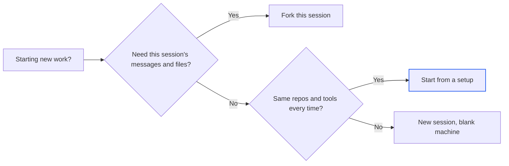

import { idlePark, queueMax, setupsMax } from '/snippets/limits.mdx';

Alpha often offers two or three ways to reach the same goal. This page compares them for the choices you make most, with a safe default for each. For how sessions, machines and turns fit together, read [How Alpha works](/get-started/how-alpha-works).

## Plan first or build straight away?

In plan mode, the agent reads the workspace, asks a few questions and proposes a plan. It changes no files until you press **Implement this plan** in the **Plan** tab. Switch it with the **plan** chip in the composer, `/plan`, or <kbd>⇧ Tab</kbd>.

<Info>
**Use plan mode when** the task is large or open-ended, or you want to agree on the approach first: "Add online payments to Harbor bookings."
</Info>

<Info>
**Build straight away when** the task is small and clear: a copy change, a known bug, one new page.
</Info>

<Tip>
**Not sure?** Plan first. A wrong plan costs one reply; a wrong build costs a rework. See [Plan mode](/chat/plan-mode).
</Tip>

## Queue or steer while the agent works?

<kbd>Enter</kbd> sends your default way and <kbd>⌘ Enter</kbd> the other (Ctrl on Windows and Linux). Set the default in **Account menu → Settings → New messages**. Until you do, Alpha queues.

| | Queue | Steer |
| --- | --- | --- |
| What happens | Runs as its own turn after the current one ends, in order | Joins the running turn without stopping it |
| Good for | The next task: "Now add a waitlist." | A correction: "Use Postgres, not SQLite." |
| Limit | [{queueMax}](/reference/limits) waiting | None. A steer the turn can't take, such as one during `/compact`, is queued instead |

To change course completely, press the stop button in the composer or <kbd>Esc</kbd>, then send a new message.

<Tip>
**Not sure?** Queue. It never disturbs work in progress, and **Send now** can still steer it in. See [Queue, steer or stop](/chat/queue-and-steer).
</Tip>

## New session, fork or setup?

Every session gets a machine of its own. The choice is what the new session starts with.

| | New session | Fork | Setup |
| --- | --- | --- | --- |
| Starts with | The blank machine and no messages | A copy of this session's messages, files and machine | The blank machine plus your repositories cloned, a setup script run and notes for the agent |
| How | Send a prompt from the home screen | `/fork`, then **Fork session** | The **blank machine** chip on the home screen |
| Good for | Unrelated work | A second direction without losing the first | Every session on the same codebase |

A fork takes about 15 seconds, can't start mid-turn and never copies sharing. You can own [{setupsMax}](/reference/limits) setups, managed in **Account menu → Setups**.

<Tip>
**Not sure?** Start a new session. Pasting the same setup steps every time? Ask the agent to "Save this as a setup." See [Setups](/sessions/setups) and [Fork or delete a session](/sessions/fork-and-delete).
</Tip>

## Codex or Claude Code?

You pick the agent with the first chip in the home screen's composer. A session keeps its agent for life, because the two can't read each other's history.

| | Codex | Claude Code |
| --- | --- | --- |
| Run on your own plan | ChatGPT | Claude |
| Mention a skill | `$name` | `/name` |
| A steer joins | At the next model call | At the next tool boundary |
| Suggested next prompts | No | Yes |
| **ultracode** effort | No | On models that offer xhigh |

The workspace, plan mode, skills, MCP servers and publishing work the same with either.

<Note>
If you don't see the agent chip, your Alpha offers only one agent.
</Note>

<Tip>
**Not sure?** Keep the agent marked **default**. See [Choose the agent and model](/chat/agents-and-models).
</Tip>

## Preview link, share or publish?

| | Preview link | Share | Publish |
| --- | --- | --- | --- |
| They see | The app, served from your session's machine | The session, live and read-only: transcript, files, **Preview** | Your app as a production service |
| How | **Open in new tab** in the **Preview** toolbar | **Share**, at the top right of the workspace | **Publish**, beside **Share** |
| Who | Anyone with the address | **Private**, **Anyone with the link** or **Specific people** | "Public · anyone with the URL" |
| Lasts | While your machine is awake. Once it sleeps, the page reads "Sandbox asleep" until you're back in Alpha | While sharing is on | Until you delete it |
| Changes | With every edit | As the session goes on | Only when you republish |

A preview address opens on other people's computers only if your Alpha serves previews publicly. Otherwise it works on your computer alone, so share the session instead.

Viewers don't keep your machine awake. It sleeps once you've been away for {idlePark}, unless the agent is working.

<Tip>
**Not sure?** Share for feedback on work in progress; publish when people need to use the app. See [Share a session](/sharing) and [Publish your app](/publish/publish-your-app).
</Tip>

## Global or session secret?

Both arrive as environment variables. New commands see a change at once; a running dev server keeps the old value until it restarts.

| | Global secret | Session secret |
| --- | --- | --- |
| Reaches | Every session you own | Only this session |
| Add it from | **Account menu → Global secrets** | **+** menu → **Secrets** → **Add secret**, with **Available in** set to **This session** |
| Same name in both | Overridden | Wins |

<Tip>
**Not sure?** Start with a session secret and make it global when a second session needs it. See [Secrets](/secrets).
</Tip>

## Connector, MCP server or plain secret?

Connections in **Integrations** act as you, in every session you own.

| | Connector | MCP server | Secret |
| --- | --- | --- | --- |
| What it is | A ready-made link to an app such as Gmail or Slack | A plug-in that gives the agent tools: hosted (**Remote**) or a command in each machine (**Local**) | An API key as an environment variable |
| Where | **Integrations → Connectors** | **Integrations → MCPs** | The **Secrets** tab, or **Account menu → Global secrets** |
| Good for | Apps the catalog lists | Services with an MCP server, such as Stripe or Linear | Services with neither |

Never paste a key into the composer. Alpha warns you if you try, because keys typed there land in the transcript.

<Tip>
**Not sure?** Describe the task. When the agent needs a service you haven't connected, it posts a card in the transcript whose **Connect** button opens the right way to connect it. See [Integrations](/integrations/overview).
</Tip>

## Next steps

<CardGroup cols={2}>
  <Card title="Prompt Alpha well" icon="message-pen" href="/get-started/prompting">
    How to describe what you want so the first turn lands closer to it.
  </Card>
  <Card title="Build your first app" icon="rocket" href="/quickstart">
    Make these choices for real, from the first prompt to a published app.
  </Card>
  <Card title="Setups: ready-made machines" icon="server" href="/sessions/setups">
    Build a machine once with your repositories, so new sessions start ready.
  </Card>
  <Card title="Limits" icon="gauge" href="/reference/limits">
    Queue, setup and publishing limits, including the ones your operator sets.
  </Card>
</CardGroup>
