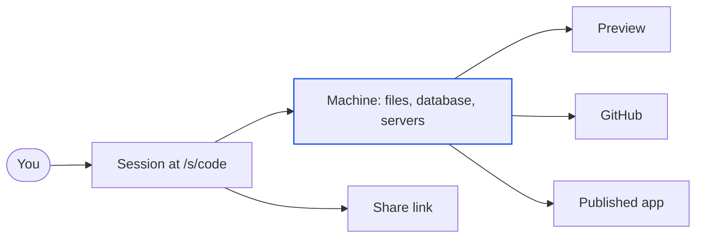
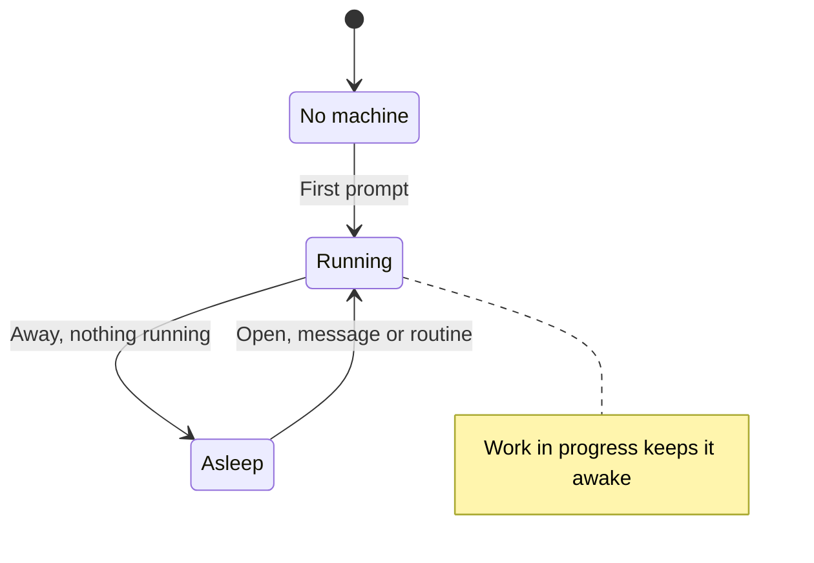

import { idlePark, turnMax, disk } from '/snippets/limits.mdx';

Alpha is an agent workbench: every session pairs a coding agent with a private cloud machine of its own. These few ideas explain most of what you'll see. To build something now, follow the [quickstart](/quickstart). To write better requests, see [Prompt Alpha well](/get-started/prompting).

## A session is one piece of work

A session is a conversation with the agent plus everything it built. Sending your first prompt from the [home screen](/sessions/home-screen) creates it. It lives at a permanent address, `/s/{code}`, which is also its share link.

Each session runs one agent, **Codex** or **Claude Code**, picked when you start it. The session keeps that agent for life, so to use the other one, start a new session. Sessions are isolated, so several can work at once.

<Card title="What happens when you start a session" icon="play" href="/sessions/start-a-session">
  Deep dive: the boot, the name, and what to do if the first send fails.
</Card>

## Every session has its own machine

The session's machine is a small Linux computer that belongs to that session alone. The agent installs packages and runs your app there.

| Part | On every new machine |
| --- | --- |
| Operating system | Ubuntu 24.04 |
| Languages | Node.js 22 and Python 3.12 |
| Database | PostgreSQL 16, switched off until your app needs it |
| Browser | A headless Chromium the agent uses to check its own pages |
| Disk | {disk} |
| Your project | `/workspace`, the folder the agent works in |

A [setup](/sessions/setups) starts the machine with your repositories already cloned and installed.

<Card title="Inside a session's machine" icon="microchip" href="/reference/machine-environment">
  Deep dive: the tools and folders the agent finds there.
</Card>

## A turn runs on Alpha's servers, not in your tab

A turn is one run of the agent on your message. Alpha runs it on its own servers and streams it to your tab, so closing the tab, or the laptop, never stops the work. Reopen the session and the transcript catches up. One turn can run for up to [{turnMax}](/reference/limits).

A message you send while a turn runs is queued for the end of the turn, or steered into the running turn. **Account menu → Settings → New messages** picks which; the default is **Queue**.

<Card title="Queue, steer or stop" icon="list-check" href="/chat/queue-and-steer">
  Deep dive: when to steer, when to queue, and what stopping keeps.
</Card>

## Machines sleep and wake

A machine sleeps when nobody needs it. Once no Alpha tab of yours has been visible for {idlePark}, each of your sessions with nothing running goes to sleep: Alpha saves its memory and disk, then lets the machine go. Opening the session wakes it in a few seconds, with every file, package and running server as you left it.

Work keeps its machine until the work ends: a turn (even one waiting on your answer), a publish, an eval run or a routine run. While you're away, only work wakes a machine. People you shared the session with don't wake it or keep it awake.

<Card title="Sleep, wake and reset" icon="moon" href="/sessions/machines">
  Deep dive: what to do if a machine won't come back.
</Card>

## The workspace shows the machine

The workspace is the panel beside the chat: your window into the machine. Nothing is switched on until it's needed. The **Preview** opens by itself when the agent starts a server, and **Database** and **Auth** arrive when the agent switches them on. To switch a service on yourself, or bring back a tab you closed, use the **+** menu.

The files belong to the agent, so the viewers are read-only. To change something, ask, or [point at it](/workspace/point-and-draw) in the Preview with **Select**.

<Card title="The workspace" icon="table-columns" href="/workspace/overview">
  Deep dive: every tab and how tabs are remembered.
</Card>

## What leaves the machine

The machine is private to its session. Work leaves it in these ways:

| Way out | Where it goes | Covered in |
| --- | --- | --- |
| Publish | A public `https://` address on Google Cloud Run, built fresh from your source. It never uses the session's own database. | [Publish your app](/publish/publish-your-app) |
| Push to GitHub | Branches, commits and pull requests in your repositories | [Branches, commits and pull requests](/github/branches-and-prs) |
| Share | A live, read-only view of the session for the people you choose | [Share a session](/sharing) |
| Skills | A skill the agent saves becomes yours, and every session of yours has it by its next message | [Skills](/skills/overview) |
| Routines | The timetable lives on Alpha's servers. Each run wakes the session's machine and works there. | [Routines](/routines) |

## Who can see what

Every session has one owner, who can share it with viewers. Admins can open any session as a viewer.

| | Owner | Viewer | Admin, in someone else's session |
| --- | --- | --- | --- |
| Chat | Read and send | Read only, no composer | Read only |
| Files | Browse and download | Browse, with the owner's secret values masked | Same as a viewer |
| Preview | Use it, including **Select** and **Draw** | View only | Same as a viewer |
| Shell | Yes | Not shown | Not shown |
| Database | Yes | Not shown | Not shown |
| Publish | Yes | Not shown | Not shown |

<Card title="Share a session" icon="share-nodes" href="/sharing">
  Deep dive: private, anyone with the link, or specific people.
</Card>

## Find your way around the workbench

<Frame caption="One session: the chat on the left, the workspace and its Preview on the right.">
  
</Frame>

- **Sidebar**: **New session**, **Search**, **Published**, **Skills**, **Routines**, **Integrations**, your sessions, and the account menu at the bottom. When it's collapsed, as in the picture, the menu button at the top left opens it.
- **Session header**: the session's title, its agent and its cost so far. In a narrow chat column, as here, the agent shows as its mark alone and the cost is hidden.
- **Transcript**: the agent's messages, commands and edits as they happen. See [Follow the agent's work](/chat/transcript).
- **Composer**: where you write; its chips set the model and plan mode. See [The composer](/chat/composer).
- **Workspace tabs**: the **Preview**, the services you've switched on, open files and the **+** menu.
- **Files panel**: the `/workspace` tree, opened with **Show files**.
- **Share** and **Publish**: at the top right, beside **GitHub**. Let others watch, or have the agent publish the app.

<Note>
  If you don't see **Publish**, or a choice between Codex and Claude Code on the home screen, it isn't turned on for your Alpha.
</Note>

## What the key terms mean

| Term | What it is | Page |
| --- | --- | --- |
| Session | A conversation with the agent plus everything it built, at its own `/s/{code}` address | [Start a session](/sessions/start-a-session) |
| Machine | The private Linux computer behind one session | [Inside a session's machine](/reference/machine-environment) |
| Turn | One run of the agent on your message | [Queue, steer or stop](/chat/queue-and-steer) |
| Workspace | The panel beside the chat that shows the machine | [The workspace](/workspace/overview) |
| Preview | The live view of the app running on the machine | [Preview your app](/workspace/preview) |
| Setup | A saved machine with repositories cloned and installed, ready for new sessions | [Setups](/sessions/setups) |
| Fork | A copy of a whole session, machine and transcript included, that then goes its own way | [Fork or delete a session](/sessions/fork-and-delete) |
| Routine | Work that runs on a timetable, even while the session sleeps | [Routines](/routines) |
| Published app | Your app running at a public address, outside the machine | [Publish your app](/publish/publish-your-app) |
| Skill | Saved instructions every session's agent can use | [Skills](/skills/overview) |
| Integration | An outside service, such as Slack or Google, that the agent and your app can use | [Integrations](/integrations/overview) |
| Secret | A key or password the agent gets as an environment variable, never in a message | [Secrets](/secrets) |

## Next steps

<CardGroup cols={2}>
  <Card title="Build your first app" icon="rocket" href="/quickstart">
    About 10 minutes from one prompt to a booking page at its own https address.
  </Card>
  <Card title="Prompt Alpha well" icon="comments" href="/get-started/prompting">
    What to put in a first message so the agent asks less and builds more.
  </Card>
  <Card title="Choose the right tool" icon="signs-post" href="/get-started/choose-the-right-tool">
    Plan or build, queue or steer, fork or new session, share or publish.
  </Card>
  <Card title="Sleep, wake and reset" icon="moon" href="/sessions/machines">
    What to do when a machine won't come back, without losing the transcript.
  </Card>
</CardGroup>
