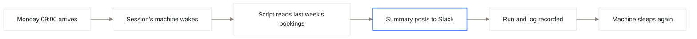

import { PromptCard } from '/snippets/prompt-card.jsx';
import { routineMinInterval, routinesMax } from '/snippets/limits.mdx';

<Badge>About 15 minutes</Badge>

A [routine](/routines) is work Alpha runs on a timetable, even while its session is closed and the session's machine is asleep. In this guide you connect Slack once, ask the agent for a weekly bookings summary, and let Alpha post it every Monday morning. If you want an app or an agent you build to call Slack instead, see [Use integrations in your app](/integrations/in-your-app).

By the end of this guide you will have a routine called `harbor-weekly-summary`. Every Monday at 09:00 in your time zone, Alpha wakes the Harbor bookings session and runs a tested script that counts last week's bookings. The script posts the summary to a Slack channel, and then the machine goes back to sleep. Nothing keeps running between Mondays.

{/* screenshot to capture: /images/guides/summary-00-result.png — The finished routine: active, scheduled for Monday, and its first run is ok. */}

## Before you start

- The Harbor bookings session, with bookings in its database. Step 1 of [Add a database and sign-in](/guides/data-app) moves Harbor's bookings into the session's own PostgreSQL, and the routine reads that database. A published app has a separate [production database](/publish/production-data), which this routine doesn't read.
- A Slack workspace you can post in, and a channel for the summary. This guide uses `#harbor-staff`.

You don't need a Slack app, a bot token or a server of your own. Alpha's server keeps the clock, and your Slack sign-in stays with Alpha.

<Note>
If Slack isn't listed under **Integrations**, or the **Routines** page says "Routines are not enabled on this Alpha", that feature isn't turned on for your Alpha. Ask your administrator.
</Note>

## Set it up

<Steps>
  <Step title="Connect Slack">
    Click **Integrations** in the sidebar. On the **Connectors** tab, search for `slack` and open the Slack card. Click **Sign in**. A window opens on Slack's consent page, where you approve the connection. That window then shows "Connected" and closes itself, and the card turns **Active**.

    In Slack's panel, click **Test connection**. A green line with a tick and the time it took means Alpha reached Slack with your account. As the panel says, the connection "acts as you, in every session you own". You connect once, and every session you own can use it. For other apps, see [Connect an app](/integrations/connect-apps).

    {/* screenshot to capture: /images/guides/summary-01-slack.png — A green Test connection line means the agent can use Slack from its next turn. */}
  </Step>

  <Step title="Ask for the routine in the Harbor bookings session">
    Open the Harbor bookings session and send the prompt below. Ask in this session because a routine runs in the session that made it, with that session's files, secrets and database. The prompt gives a day and a time but no time zone, so the agent asks for one.

    <PromptCard label="Try this">

    ```text
    Every Monday at 9:00, post a summary of last week's Harbor bookings to #harbor-staff in Slack: the total, bookings per class, and any class that is full or has fewer than two students. Write it as a script, run it once now so I can see the post, then save it as a routine called harbor-weekly-summary.
    ```

    </PromptCard>

    Alpha will:

    1. Write the summary as a script in the workspace, reading the session's database.
    2. Post through your Slack connection. The script never holds a Slack token.
    3. Ask for your time zone in a [question card](/chat/plan-mode#answer-the-agents-questions), because 9:00 falls at a different moment in each zone.

    <Tip>
    **New routine** on the **Routines** page starts a new session only for the routine, on its own machine, without this session's files or database. Use it for work that needs nothing from an existing session. Its **Weekly summary** starter is a Monday 9:00 prompt you can adapt.
    </Tip>
  </Step>

  <Step title="Check the test post, then let it save">
    The agent runs the script once by hand and shows you the result before it saves anything. Open `#harbor-staff` in Slack and read the post. If a number looks wrong, tell the agent, and it fixes the script and tests it again.

    When the routine is saved, the card **Routine harbor-weekly-summary saved** appears in the transcript:

    | Row | What it shows |
    | --- | --- |
    | **When** | The timetable as a cron expression, with its time zone |
    | **Runs** | The command |
    | **Next** | The first scheduled run |

    The session's **Routines** tab then opens beside the transcript.

    {/* screenshot to capture: /images/guides/summary-03-saved.png — The saved card states what runs and when. It runs whether or not the session is open. */}
  </Step>

  <Step title="Set Mondays at 09:00 in your time zone">
    You can check or change the timetable without asking the agent. In the **Routines** tab, click **Edit** (the pencil) on the routine's row.

    1. Under **How often**, pick **On certain days of the week**.
    2. Select **Mon** and set the time to 09:00.
    3. Leave **Months** empty. With nothing picked, it runs every month.
    4. Pick your zone under **Time zone**.

    The line under the form spells the timetable out, "At 09:00, only on Monday", and lists the next three runs. If the timetable is wrong, the line shows the reason in red. Click **Save**.

    {/* screenshot to capture: /images/guides/summary-04-timetable.png — The preview line confirms the next three Mondays before you save. */}
  </Step>

  <Step title="Run it now and read the log">
    You don't have to wait for Monday. On the routine's row, click **Run now** (the play button), and the row opens on its **Runs** list. The new run shows **queued**, then **running**. Until the script prints its first line, the run's log reads "Waking the session and starting…".

    When the run finishes, its chip turns **ok**, and the row shows how long the run took and that it was run **by hand**. Click the run to read its whole log, which is the script's own output. The transcript also gets a **Routine harbor-weekly-summary ran** card with the end of that log.

    {/* screenshot to capture: /images/guides/summary-05-run.png — Each run keeps its own log, which you can read while the machine sleeps. Illustrative values. */}

    <Check>
    A new summary is in `#harbor-staff`, and **Next runs** shows next Monday at 09:00. The routine is live.
    </Check>
  </Step>
</Steps>

## What happens every Monday

Alpha's server keeps the routine's clock, and nothing inside the machine does. At 09:00 the server wakes the session's machine, which takes about half a minute when it's asleep. It runs the script with the session's environment, records the run and its log, and lets the machine go back to sleep.



| If… | What Alpha does |
| --- | --- |
| The script exits with an error | It marks the run failed and posts "Routine harbor-weekly-summary: the run failed" in the session's transcript, with the error and the end of the log. Failed runs aren't retried. |
| Alpha itself wasn't running at 09:00 | A run that would start more than 10 minutes late is skipped, not caught up. The next Monday runs as usual. |
| You pause the routine | Nothing runs until you click **Resume**. A paused routine still counts toward your limit. |
| You delete the Harbor bookings session | The routine and its runs are deleted with it. |

A routine runs at most once every {routineMinInterval}, because each run wakes a machine. Routines are capped at {routinesMax}, paused ones included. Both limits are on [Limits](/reference/limits).

## Why a script and not the agent?

The agent saved this routine as a command because the summary follows the same steps every week. You can switch modes under **What it does** in the edit form.

| Mode | Each run | Use it for |
| --- | --- | --- |
| **Run a command** | Runs the tested script in the workspace. No agent turn and no tokens. | Work that follows the same steps each time, like this summary. |
| **Ask the agent** | Sends your instruction to the session's agent as a turn nobody watches. Each run costs a full turn. | Work that needs judgement every time, such as reading an inbox and picking out what's urgent. |

You connected Slack once, had the agent write and test a summary script, set it to run on Mondays at 09:00 in your zone, and checked a run by hand. From now on Alpha wakes the session each Monday, posts the summary and lets the machine sleep again.

## Next steps

<CardGroup cols={2}>
  <Card title="Routines" icon="calendar-clock" href="/routines">
    Pause, edit or remove a routine, and read every run's log on one page.
  </Card>
  <Card title="Connect an app" icon="plug" href="/integrations/connect-apps">
    Add Gmail, Calendar or Notion to a routine the same way you added Slack.
  </Card>
  <Card title="Use integrations in your app" icon="code" href="/integrations/in-your-app">
    Have Harbor itself post to Slack when a class fills up.
  </Card>
  <Card title="Sleep, wake and reset" icon="moon" href="/sessions/machines">
    Learn what a sleeping machine keeps, and how a routine's run wakes it.
  </Card>
</CardGroup>
