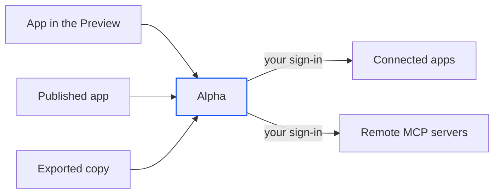

import { PromptCard } from '/snippets/prompt-card.jsx';

Every session has a key that lets the app it builds call the apps and remote MCP servers you connected, with no app token anywhere in your code. The agent uses it for you; you only handle it yourself when you run an exported copy somewhere else. To connect something first, see [Connect an app](/integrations/connect-apps) or [MCP servers](/integrations/mcp-servers). For your own API keys, use [Secrets](/secrets).

<Frame caption="The key sits at the top of the session's Secrets tab, masked until you click Reveal.">
  
</Frame>

<Note>
If the card says the tools service is off instead of showing the key, calling your connections from your app isn't turned on for your Alpha. Ask your administrator.
</Note>

## How does your app reach your connections?

Your app reads two values from its environment, an address and this session's key, and sends every call to Alpha. Alpha holds your sign-ins, attaches the right one and calls the app for you. Your app never sees the app's own token, so there is nothing to leak beyond the key itself.



The same code runs in all three places. Only the way the variables arrive changes:

| Where the app runs | How it gets the address and key |
| --- | --- |
| The session's machine: the [Preview](/workspace/preview), the [Shell](/workspace/shell) and every command the agent runs | Set for you. Nothing to do. |
| A [published app](/publish/publish-your-app) | Set for you on every publish. The log reads "tools: this session's Alpha tools key is set on the deployment". |
| An exported copy you run elsewhere | You paste them into its `.env`. See [Run your app outside Alpha](#run-your-app-outside-alpha). |

## Find this session's key

The key card appears in two places. Both show the same key for the open session.

<Tabs>
  <Tab title="Secrets tab">
    In a session, open the workspace's **+** menu and choose **Secrets**. The card **This session's key** sits at the top, under **This session**. The tab is for the session's owner <Badge>Owner only</Badge>. Viewers of a [shared session](/sharing) don't get it.
  </Tab>
  <Tab title="Integrations">
    Open **Integrations** in the sidebar, then **Connectors → Built in → Alpha tools**. The panel explains the built-in, shows the same card, and lists both variables under **What the agent gets**. With no session open, the card reads "Open a session to see the key its app and agents use."
  </Tab>
</Tabs>

{/* screenshot to capture: /images/integrations/alpha-tools-builtin-panel.png — Alpha tools is a built-in, so there is nothing to connect. Its panel carries the same key card. */}

| Control | What it does |
| --- | --- |
| Copy icon on a row | Copies that value, shown or not. The tooltips read "Copy the URL" and "Copy the key". |
| **Reveal** / **Hide** | Shows the start and end of the key, or masks it again. |
| **Copy .env lines** | Copies both variables as two `.env` lines. The button reads **Copied** afterwards. |
| **Rotate** | Replaces the key at once, with no confirmation. The new key is shown and the button reads **Rotated ✓** for a moment. See [Rotate the key](#rotate-the-key). |

## Run your app outside Alpha

When you download or push an app and run it on your own machine or host, it no longer gets the variables for free. Give it the two lines once.

<Steps>
  <Step title="Copy the lines">
    On the key card, click **Copy .env lines**.
  </Step>
  <Step title="Paste them into the app's .env">
    Add them, as they are, to the `.env` file the app loads at startup. The address points at your Alpha, so the place you run the app must be able to reach it.
  </Step>
  <Step title="Keep the key out of your repository">
    The agent never writes the key into a file. Instead, it lists both names in `.env.example` with empty values, so the code says what it needs without carrying the key. Keep `.env` out of version control.
  </Step>
</Steps>

{/* screenshot to capture: /images/integrations/tools-key-card-revealed.png — After Reveal, the key shows in part. Copy .env lines confirms with Copied. */}

## Rotate the key

**Rotate** issues a new key for this session and retires the old one at once. Every copy of the old key fails its next call, wherever it lives. It can't be undone, and the old key never works again.

<Warning>
Rotate as soon as the key leaks: pasted into a message, committed to a repository or sent to someone. Anyone holding it can call every app and MCP server you connected until you do.
</Warning>

| Where the old key was | What happens after **Rotate** |
| --- | --- |
| The session's machine | Alpha writes the new key into the machine and refreshes the agent's tools. If the agent is mid-turn, the refresh waits until the turn ends. A server already running in the Preview keeps the old key until it restarts. |
| A published app | Its calls fail until you [republish it](/publish/manage#republish-your-changes). Republishing sets the new key. |
| An exported copy | Its calls fail until you copy the new lines into its `.env`. |
| Your other sessions | Unaffected. Each session has its own key. |

Deleting the session retires its key the same way.

## How the agent calls your tools

You don't write any of this by hand. Ask for the feature in plain words and name the connection.

<PromptCard label="Try this">

```text
When someone books a class, post the booking to our #bookings channel using my connected Slack.
```

</PromptCard>

Alpha will:

1. Check which tools you've connected. If Slack isn't one of them, it posts a card in the transcript with a button to [connect it](/integrations/connect-apps).
2. Find the Slack tool it needs among your connections.
3. Write code that reads the address and key from the environment and calls that tool.
4. List both names, empty, in `.env.example`.

Every call comes back with the app's answer, or with an error that says what went wrong. When a call fails:

| What went wrong | What to do |
| --- | --- |
| The key is missing, wrong or rotated | Republish, or copy the new lines into an exported copy's `.env` |
| You removed that connection, or it needs a new sign-in | Reconnect it in **Integrations**. Retrying won't help. |
| The app failed or refused the call | Read the message. It comes from the app. |
| Alpha is unavailable | Retry after a pause |

The agent uses the same connections inside the session, as tools it can call. However many you connect, it finds the one it needs. You don't need to do anything.

## What can the key reach?

The key speaks for you, for this one session, and for nothing else.

| The key | |
| --- | --- |
| Reaches | Every app and remote MCP server you've connected, from any of your sessions. A connection added later works with the existing key. |
| Doesn't reach | Local MCP servers, which run inside each session's machine, and your [secrets](/secrets), which the app reads from its environment instead. |
| Never contains | An app's password or token. Those stay with Alpha. |
| Shows in the transcript as | `[redacted]`, so it never survives in the session's history. |
| Lasts | Until you rotate it or delete the session. It has no expiry date. |

Because the key reaches all your connections, treat it like a password for your whole set of integrations. Narrowing a key to some connections isn't possible.

## Next steps

<CardGroup cols={2}>
  <Card title="Connect an app" icon="plug" href="/integrations/connect-apps">
    Sign in to Gmail, Slack or Notion once, and every session's key can use it.
  </Card>
  <Card title="Republish after a rotate" icon="rotate" href="/publish/manage#republish-your-changes">
    A published app picks up the new key only on its next version.
  </Card>
  <Card title="Build an AI agent" icon="robot" href="/agents/build-an-agent">
    Agents you build call the same tools with the same key.
  </Card>
  <Card title="Secrets" icon="key" href="/secrets">
    For a service with no connector, hand the app your own API key instead.
  </Card>
</CardGroup>
