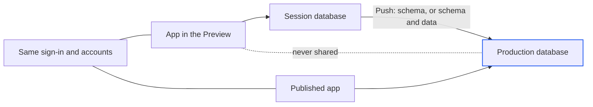

import { PromptCard } from '/snippets/prompt-card.jsx';

A published app takes your session's services with it, never the machine's copies of them. If the session has a database, production gets a PostgreSQL of its own. If the session has [app sign-in](/workspace/app-sign-in), production gets the same sign-in and the same user accounts. To get the app online first, see [Publish your app](/publish/publish-your-app). For the database you build against, see [Your session's database](/workspace/database).

<Warning>
The production database starts empty. Your session's tables and rows stay in the session. An app that queries its tables fails until production has them, so give it a schema before you send anyone the address.
</Warning>

{/* screenshot to capture: /images/publish/database-production-grid.png — Production's own database, browsed from the Database tab. The PROD tag says which one you're looking at. */}

## How production services work

The database has a session copy and a production copy, and the two never share data. Sign-in is shared: production uses the session's sign-in and the same accounts. A first publish takes whatever the session has on, and a republish keeps the app's earlier choice. To change it, use the **Database** and **Sign-in** switches under **Production services** in the **Publish** tab's **Edit settings**. [Manage a published app](/publish/manage) covers the rest of that form.

| | In the session | In production |
| --- | --- | --- |
| Database | PostgreSQL 16 inside the session's machine | A PostgreSQL of its own, run by Alpha and named after the app, such as `harbor_3f2a9c1e` |
| What's in it | Whatever you and the agent made | Nothing, until migrations run or you push |
| When the machine sleeps | Sleeps with it | Keeps serving. It never touches the session's machine. |
| Lifetime | Kept until the session's machine is reset | Made by the first version that needs it, kept across versions, deleted with the app |
| Sign-in | The session's sign-in, on its preview addresses | The same sign-in and accounts, on the app's own https addresses |



Deleting a published app deletes its production database too, and that can't be undone.

## Fill the production database

There are two ways to give production its tables. Both leave the session's database as it is.

<Tabs>
  <Tab title="Migrations in the start command">
    Use this when the project has migration files. Every version brings production's schema up to date as it starts, and production's rows are kept. Migrations belong in the start command, not the build: the build can't reach the database.

    | Stack | Start command |
    | --- | --- |
    | Prisma | `prisma migrate deploy && node server.js` |
    | Drizzle | `drizzle-kit migrate && node server.js` |
    | Alembic | `alembic upgrade head && gunicorn …` |
    | Django | `python manage.py migrate && gunicorn …` |

    A `CREATE TABLE IF NOT EXISTS` that runs when the app boots works too.

    <PromptCard label="Try this">

    ```text
    Run harbor's database migrations from its start command so production creates its own tables, then republish it.
    ```

    </PromptCard>

    Alpha will:

    1. Put the migration step in front of the app's start command.
    2. Republish harbor as a new version. The rollout shows in the **Publish** tab.
    3. Report the address once the new version is live.
  </Tab>
  <Tab title="Push from the session">
    Use this when the schema exists only in the session, such as tables the agent made by hand. The push copies the session's default database into production as the app's own role, and the app sees the tables at once, with no republish. It reads from the session's machine, so it wakes the machine if it's asleep.

    <Steps>
      <Step title="Open the Production database card">
        Open the **Publish** tab and pick the app. Under the version card, the **Production database** card says when the database was made and whether a schema has arrived, for example "Provisioned … · empty until the app's migrations run".

        {/* screenshot to capture: /images/publish/publish-prod-db-card.png — Choose what goes, and whether production's own tables may be replaced, before you push. */}
      </Step>
      <Step title="Choose what to push">
        **Schema only** copies the tables with no rows, so production's data stays its own. **Schema and data** copies every row as it is in the session. Pick **Schema only** for a live app: test rows rarely belong in production.
      </Step>
      <Step title="Decide about existing tables">
        Leave **Replace tables that already exist** off unless you mean to overwrite production. With it off, a push into a database that already has tables is refused. With it on, production's tables of the same name are dropped first.

        <Warning>
        **Replace tables that already exist** deletes production's rows in every table the push names. There is no confirmation and no undo. The switch turns itself off after each successful push, so you choose it again every time.
        </Warning>
      </Step>
      <Step title="Push">
        Click **Push schema**, or **Push schema and data**. The button reads **Pushing…** until the copy is done, and the card confirms with "Pushed … tables (…) into …". A push that fails part way changes nothing in production.

        {/* screenshot to capture: /images/publish/publish-prod-db-pushed.png — The success line names the tables copied and the database they went into. */}
      </Step>
    </Steps>

    You can also ask the agent: "Push the session's schema to harbor's production database." The agent is told not to replace production's tables when they hold real data, unless you ask for exactly that.
  </Tab>
</Tabs>

## What if a push is refused?

The card shows the reason under the button, in red.

| Message | What it means | What to do |
| --- | --- | --- |
| "the production database already has … tables — a push would fail on them; …" | Production has tables, usually from the app's migrations. | Leave them if the app's migrations made them. To overwrite them, turn on **Replace tables that already exist**. |
| "this deployment has no production database yet — deploy with the database on first" | The app was published without a database. | Turn on **Database** in **Edit settings** and republish, then push. |
| "this deployment is busy — wait for the rollout to finish" | A new version is rolling out. | Push again once the rollout is done. |
| "a push into this deployment's database is already running" | Another push into the same database hasn't finished. | Wait for it, then push again if you still need to. |
| "the session database's dump exceeds 64 MB — …" | A push is for a schema and seed rows, not a data migration. | Push **Schema only**. Load the rows from the app. |
| "the dump failed on the production database: … — a statement in the dump needs a privilege the app role … does not have — …" | Usually a PostgreSQL extension, which the app's role can't create. | Ask whoever runs your Alpha to create it in production, or drop it from the session's database. |
| "the dump failed on the production database: … — applying the dump did not finish within 10 minutes — …" | The copy was too large to apply in time. | Push **Schema only**. Load the rows from the app. |

{/* TODO confirm: the 64 MB dump cap (deploy_db.go ddbMaxDumpBytes) and the 10-minute apply timeout (ddbApplyTimeoutMs) are not in snippets/limits.mdx or on /reference/limits; consider adding them there. */}

More fixes for a published app are in [Troubleshooting](/reference/troubleshooting).

## Browse production data

The **Database** tab opens production's database in the same browser as the session's: the grid, **Structure** and **SQL**, explained in [Browse, edit and query data](/workspace/database-data). In the toolbar's database picker, the **Production** section lists each published app with a database. Pick one, and the pill shows the app's name with a **PROD** tag.

{/* screenshot to capture: /images/publish/database-production-picker.png — Session databases first, then each published app's production database. */}

You act as the app's own database role, so you can do exactly what the app can, nothing more:

| You can | You can't |
| --- | --- |
| Filter, sort and search rows | Export a dump or import a SQL file |
| Edit, add and delete rows, saved as one transaction | Reset or drop the database |
| Run SQL, including `CREATE TABLE` | See the database's password |
| Read each table's structure | Connect from your own computer |

The **⋯** menu has only **Refresh**, with the note "Production's schema comes from the app's migrations or the Publish tab's copy; the database goes with the published app."

Saves and SQL here change your live app's data at once. Browsing never wakes the session's machine, even while it's [asleep](/sessions/machines). If the tab says "The production database isn't reachable", click **Try again**.

## Keep sign-in working in production

With sign-in on, the published app gets the same issuer, client ID and client secret as the session's app. The accounts are the same too: people who sign up on the live app appear in the session's **Auth** tab. [Add sign-in to your app](/workspace/app-sign-in) explains the flow. The sign-in service sends people back only to addresses it knows:

| Where the app runs | Return addresses accepted |
| --- | --- |
| Preview | The session's preview addresses, for each port the app listens on |
| Published app | Its own addresses, https only: the `run.app` one, and the custom-domain one if your Alpha gives apps one |

So the app must build its callback URL from the request's host. A callback hard-coded to the preview fails in production with "Invalid parameter: redirect_uri". To fix it, send the agent:

```text
Sign-in on the published app fails with "Invalid parameter: redirect_uri". Build the callback URL from the incoming request's forwarded host instead of hard-coding it, then republish.
```

<Note>
If the **Database** switch under **Production services** reads "not offered on this Alpha — put a hosted PostgreSQL's DATABASE_URL in the environment", or the **Sign-in** switch reads "not offered on this Alpha — Alpha's sign-in issuer is not public", that service isn't turned on for your Alpha. Ask whoever runs it.
</Note>

## Connect from your code

Every version sets these on the published app. Read them from the environment, and never hard-code a connection string:

```env
DATABASE_URL=postgresql://harbor_3f2a9c1e:…@localhost/harbor_3f2a9c1e?host=/cloudsql/…
PGHOST=/cloudsql/…
PGPORT=5432
PGUSER=harbor_3f2a9c1e
PGPASSWORD=…
PGDATABASE=harbor_3f2a9c1e
```

The connection goes through a Unix socket under `/cloudsql/`, not the network. `pg` (and Drizzle or Knex over it), Prisma, psycopg and libpq take `DATABASE_URL` as it is. postgres.js reads only the URL's host name, so pass it the socket. This works in the session and in production:

```js
import postgres from "postgres";

const sql = postgres(
  process.env.DATABASE_URL,
  process.env.PGHOST?.startsWith("/") ? { host: process.env.PGHOST } : {}
);
```

To see these values for a production database, click **Connect** in the **Database** tab's toolbar. The password is never shown, and the database takes no connections from the internet.

{/* screenshot to capture: /images/publish/database-production-connect.png — Connect shows where the database lives. The password stays sealed. */}

To bring your own database or sign-in service, add `DATABASE_URL` or `FORGE_OIDC_ISSUER` to the app's environment in **Edit settings**, from a [secret](/secrets) or a typed value. Your value wins and Alpha provisions nothing. An existing production database is kept but not attached to the next version.

## Next steps

<CardGroup cols={2}>
  <Card title="Manage a published app" icon="sliders" href="/publish/manage">
    Turn production services on or off, republish, and roll back to an earlier version without a rebuild.
  </Card>
  <Card title="Monitor and troubleshoot production" icon="chart-line" href="/publish/monitor">
    Find the request that hit an empty table, and see what a migration in the start command logged.
  </Card>
  <Card title="Browse, edit and query data" icon="table" href="/workspace/database-data">
    Filters, staged edits and the SQL runner work the same on production's database.
  </Card>
  <Card title="Add a database and sign-in" icon="database" href="/guides/data-app">
    A worked example that takes Harbor's bookings and members all the way to production.
  </Card>
</CardGroup>
