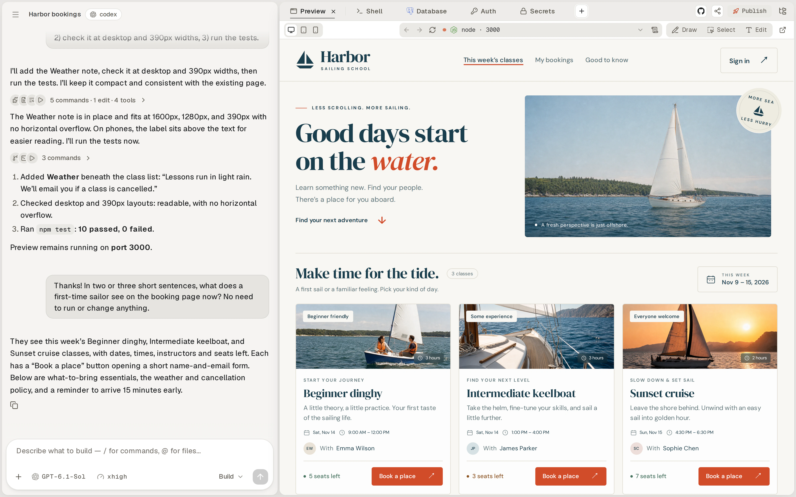
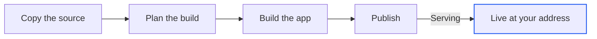
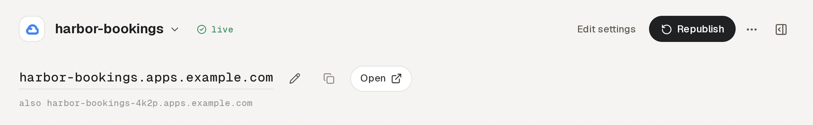

import { sourceMax, buildMax, listenMax, publishPerSession, publishPerAccount, memory, instances, versionsKept } from '/snippets/limits.mdx';
import { PromptCard } from '/snippets/prompt-card.jsx';

Publishing puts your app on the internet at a public `https://` address that starts with a name you choose. The agent asks for the name, then Alpha builds a fresh copy of your app and runs it on Alpha's cloud, so it stays up while the session's machine sleeps. To change or roll back an app that is already live, see [Manage a published app](/publish/manage). To show work in progress instead, [share the session](/sharing).

<Frame caption="Nothing is published yet, so the pill beside Share reads Publish.">
  
</Frame>

<Note>
Only the session's owner sees **Publish**. While a file's tab is in front, the same pill reads **Publish as artifact** and keeps that one file as an [artifact](/artifacts) instead; switch to any other tab to publish the app. If you don't see **Publish** beside **Share** in your own session, publishing isn't turned on for your Alpha. Ask whoever runs it.
</Note>

## How does publishing work?

Alpha takes one directory from the session, builds a fresh copy of the app and runs it on Alpha's cloud. Each publish is a new version. Visitors move to it only once it serves, so a failed build never takes down what is already live.



Alpha detects your stack automatically, and the agent picks the best way to build and run it.

| Stack | Frameworks Alpha recognises |
| --- | --- |
| Node, Bun, Deno | Next.js, Vite, Astro, Nuxt, Remix, Create React App, Express |
| Python, Ruby, PHP | Flask, FastAPI, Django, Rails, Laravel |
| Go, Rust, Java, Elixir, .NET, Gleam, C/C++ | Apps in these languages, with their usual project files |
| Static site | A plain `index.html`, or a built Vite, Astro or Create React App site |

If the app needs an extra system tool, such as `ffmpeg`, the agent sets that up for you.

| What ships | What it means |
| --- | --- |
| One app per directory | A top-level directory, or the workspace root, is one app. A front end and an API in two directories are two apps. |
| Only that directory | Nothing outside it ships, and neither do `.env` files, installed dependencies or build output. Your published app is set up fresh from your code. |
| The secrets you pick | The agent asks which of your [secrets](/secrets) production gets and passes them by name. Values never appear in the transcript. |
| Every name in the session's secret sets | When a [secret set](/secrets#secret-sets) is attached to the session, or to the setup it started from, all its names go to production too, each with your value, without being picked. If one has no value of yours, nothing is published: the version fails with "the attached secret set needs STRIPE_SECRET_KEY — nothing was deployed". Fill in the value on the **Secrets** page, then publish again. |
| The session's database and sign-in | With the database on, production gets [a database of its own](/publish/production-data). With sign-in on, it gets the same app sign-in. |

<Warning>
The production database starts empty. Rows in the session's database don't move across. Ask the agent to have the app create its own tables, or push the session's tables from the **Publish** tab. See [Production database and sign-in](/publish/production-data).
</Warning>

## Before you publish

The agent checks the project before a first publish and fixes what it finds. An app that already follows these rules goes live unchanged.

| Check | Why |
| --- | --- |
| It runs in the [Preview](/workspace/preview) | Production builds the same code fresh. |
| It listens on `0.0.0.0` and reads `PORT` | An app bound to `localhost`, or to a port other than the one it's given, never answers, and the version fails after {listenMax}. |
| It runs as a production app, not a dev server | Development servers are slower and can refuse your app's public address. The agent sets this up for you. |
| Keys are in [Secrets](/secrets) | Production gets keys only by name, from your secrets. |
| **Database** or **Sign-in** is on, if needed | Turn them on from the **+** menu. See [Your session's database](/workspace/database) and [Add sign-in to your app](/workspace/app-sign-in). |
| Data lives in the database, not in files | Files a published app saves aren't kept, so data in local files, such as a SQLite database or saved uploads, disappears. |

## Publish your app

Publishing is done by the agent, in the session, so you can see and answer everything it does.

<Steps>
  <Step title="Click Publish">
    With any tab but a file's in front, click **Publish** beside **Share** (tooltip "Publish this app to production"). The **Publish** dialog opens, headed "Not published". Under **Website URL** it shows the app's address with its name, usually one Alpha suggests from the project, then "Visible to anyone with the link". A line under it says where the app runs, its port, and whether it gets its own database and sign-in.
  </Step>
  <Step title="Name the app">
    The name is the first part of the address. Click the pencil (tooltip "Edit the name") or the name itself, and type. Alpha checks it as you type, and a line under it says what it found:

    | The line reads | It means |
    | --- | --- |
    | Nothing, or the address the app will get | The name is free. Where your Alpha has its own domain, that domain shows beside the name instead. |
    | "that name is taken" | Another app on your Alpha has it. Pick another. |
    | "Lowercase letters, digits and dashes, starting with a letter." | The name breaks the [rules](#choose-a-name). |
    | "Leave it empty and the agent asks you for a name." | You cleared the name. The agent asks for one in a question card. |
    | "Couldn't check the name. The agent checks it again." | Alpha couldn't check it now. You can still publish. |

    To serve the app at a domain you own, click **Add domain** beside **Website URL** and pick or add one. See [Custom domains](/publish/custom-domains#connect-a-domain).
  </Step>
  <Step title="Send the request">
    Click **Publish** in the dialog. It's off while the name is being checked, is taken, or breaks the rules. Alpha sends the agent "Deploy this as harbor.", as if you had typed it, or "Deploy this." when you left the name empty. With a domain picked, it adds the domain: "Deploy this as harbor and serve it at www.harbor-sailing.com." One click sends one message. While the agent is working, the button is held and the dialog reads "The agent is busy — ask once it is done", because a message then would [steer](/chat/queue-and-steer) the turn.
  </Step>
  <Step title="Answer the question card">
    The agent puts everything only you can decide into one [question card](/chat/plan-mode): the name, if you didn't give one, with a suggestion first; the directory, when there is more than one; and which secrets production gets, when the app reads keys. The agent settles the technical details itself.
  </Step>
  <Step title="Watch it go live">
    The **Publish** tab opens by itself and follows the build. The agent posts the address in the transcript when it is live. See [Watch the rollout](#watch-the-rollout).
  </Step>
</Steps>

You can also start from the **Publish** tab: open it from **+** → **Publish**. Before anything is published, it reads "Ship this app to production" and lists the three stages, **Name it**, **Build** and **Serve**. **Publish with the agent** sends "Deploy this.", and is held at the same times as the dialog's **Publish**.

You can also ask the agent in your own words.

<PromptCard label="Publish from the chat">

```text
Publish this as harbor. Production needs STRIPE_SECRET_KEY from my secrets.
```

</PromptCard>

Alpha will:

1. Check what would be built, and fix anything that would stop it.
2. Ask only what you haven't said. Here the name and the secret are given, so with one directory nothing is left to ask.
3. Publish the app and post its address.

### When does the agent publish?

The agent publishes only when you tell it to: to publish, "deploy" or "redeploy" the app, or to put it online. Anything else isn't a request to publish, even when it sounds close:

| Your message | Does the agent publish? |
| --- | --- |
| "Publish this", "deploy it", "redeploy harbor", "put it online" | Yes. |
| A goal, such as "we need to ship this by Friday" | No. It says a publish would ship it, and stops there. |
| A request for work or a fix, with no word about publishing | No. When the work is done, it says a publish would ship it, and stops there. |

One request covers one publish of one app, until the agent reports it live. If the rollout fails, or the app refuses its own address, the agent fixes the cause and publishes again under the same request. Publishing a second directory, or republishing after the agent has reported the app live, for example to ship a fix, waits for you to ask again.

## Choose a name

The name is the first part of the app's first address, so it can't be changed later. Republishing keeps it. Where your Alpha has its own domain, you can [rename the app's address there](/publish/custom-domains#rename-the-app’s-address) instead, or [connect a domain you own](/publish/custom-domains#connect-a-domain). Otherwise, for a new address, publish under a new name and [delete the old app](/publish/manage#delete-a-service).

| Rule | Allowed | Refused |
| --- | --- | --- |
| Lowercase letters, digits and dashes | `harbor-bookings` | `harbor_bookings` |
| Starts with a letter, ends with a letter or digit | `harbor2` | `2harbor`, `harbor-` |
| At most 40 characters | `harbor-sailing-school` | Anything longer |
| Unique across your Alpha, for every user | A name nobody has used | A name anyone has published |

A taken name is refused with "the name harbor is taken — pick another". When that happens, the agent picks another and tells you which.

## Where does my app live?

Every app gets its own public `https://` address that starts with the name you chose. Access is public and https is included, so anyone with the address can open it once it is live. On some Alphas a short prefix sits in front of the name.

Where your Alpha has its own domain, the app also answers at `https://<name>.<domain>`, such as `https://harbor-bookings.apps.example.com`, the moment it is live. That becomes the app's main address everywhere, with the first address under it after "also". You can rename it, and you can connect a domain you own, such as `www.harbor-sailing.com`, from the **Publish** dialog or the **Domains** page. See [Custom domains](/publish/custom-domains).

<Frame caption="The app's page shows its address on your Alpha's domain, with a pencil to rename it. The first address stays under it.">
  
</Frame>

## Watch the rollout

The build usually takes 2–6 minutes. The pill beside **Share** reads **Publishing…** meanwhile (tooltip "Publishing: where it stands"). Clicking it opens the **Publish** dialog with the app's name and the step it's on; **⋯** → **Open Publish tab** opens the tab. There, the service's state says which step it's on. On a first publish, "Your app's address appears here once it is live." holds the address's place; on a republish, the address stays, with "A new version is rolling out." under it. The new version sits at the top of **History**, marked **rolling out**, with its steps: **Export**, **Plan**, **Build**, **Publish** and **Live**, each marked **Done**, **In progress**, **Failed** or **Waiting**.

<Frame caption="The build is under way: the steps, Stop in the header, and the Log, opened with Show log, following the build.">
  
</Frame>

To read the build, click **Show log** at the end of the version's row. The version's **Log** opens under its steps. It shows the build's own output as it streams in, marked **live**, with a waiting line until the first line arrives. Secret values show as `[redacted]`. The **Details** button at the right of the header (tooltip "Show details") opens a rail with how the version is built and run.

| Log control | What it does |
| --- | --- |
| **follow** | Keeps the newest lines in view. Scrolling up lets go; scrolling back to the bottom picks it up again. |
| Copy button (tooltip "Copy the log") | Copies the whole log. |
| **Show log** / **Hide log** | Opens the log under the open version, or folds it away. The log starts folded each time you open the app's page. |

Every version has a log, not only a failed one. A version with nothing to show reads "no build output for this version".

The transcript gets a card when the publish starts and one when it ends, visible to anyone who can read the transcript. **Publish tab** in each card opens the tab.

| Card | It reads |
| --- | --- |
| Started | That harbor is being published, with a pointer to the **Publish** tab to follow the build. |
| Live | That harbor is published and how long it took, what went with it, and the address. The **Publish** pill gets a green dot. It opens the **Publish** dialog with the address and **Publish changes** (see [Republish your changes](/publish/manage#republish-your-changes)). |
| Live, in yellow | The same, plus a hint starting "The service is up, but …": the app refuses its own hostname. The agent fixes the config and republishes. |
| Failed | That publishing harbor failed and at which step, a hint and a foldable log tail. Fixes for each hint are in [Troubleshooting and FAQ](/reference/troubleshooting#a-publish-fails). |

A session publishes one app at a time; meanwhile the buttons are held with "A rollout is in progress". You can close the browser. The publish runs on Alpha's side, and the machine stays awake until it ends.

### Stop a rollout

While a version is queued, or in **Export**, **Plan** or **Build**, the service's header shows **Stop** (tooltip "Stop this rollout — the version serving, if any, stays as it is"). Click it to end the rollout at once. The version is marked **failed** with "the deployment was stopped", and if an earlier version was serving, it keeps serving.

**Stop** disappears once the version reaches **Publish**, because the switch to the new version finishes either way. Stopping the agent's turn in the transcript stops only the turn, never a rollout that has started.

## Limits

| Limit | Value |
| --- | --- |
| Published apps per session | {publishPerSession} |
| Published apps per account | {publishPerAccount} |
| Size of the source | {sourceMax} |
| Build time | {buildMax} |
| Time for the app to start listening | {listenMax} |
| Memory per copy of the app | {memory} |
| Copies running at once | {instances} |
| Versions kept | {versionsKept} |

An app with no visitors goes idle, so the first request after a quiet spell is a little slower. What happens at each limit is on [Limits](/reference/limits#publishing).

<Note>
Values marked "(default)" can be different on your Alpha. Ask your admin if one gets in your way.
</Note>

## Next steps

<CardGroup cols={2}>
  <Card title="Manage a published app" icon="clock-rotate-left" href="/publish/manage">
    Republish the latest changes, or put any earlier version back in seconds without a rebuild.
  </Card>
  <Card title="Production database and sign-in" icon="database" href="/publish/production-data">
    Give the empty production database its tables, then browse its rows from the Database tab.
  </Card>
  <Card title="Monitor and troubleshoot production" icon="chart-line" href="/publish/monitor">
    Read the live app's logs and request metrics, and hand an error line to the agent.
  </Card>
  <Card title="Build and publish a landing page" icon="flag-checkered" href="/guides/landing-page">
    Go from one message to a public page with a working signup form, step by step.
  </Card>
</CardGroup>
