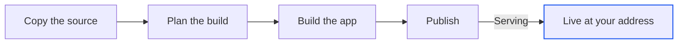

import { sourceMax, buildMax, listenMax, publishPerSession, publishPerAccount, memory, instances, versionsKept } from '/snippets/limits.mdx';
import { PromptCard } from '/snippets/prompt-card.jsx';

Publishing puts your app on the internet at a public `https://` address that starts with a name you choose. The agent asks for the name, then Alpha builds a fresh copy from your source and runs it outside the session's machine, so it stays up while the machine sleeps. To change or roll back an app that is already live, see [Manage a published app](/publish/manage). To show work in progress instead, [share the session](/sharing).

{/* screenshot to capture: /images/publish/publish-pill-idle.png — Nothing is published yet, so the pill beside Share reads Publish. */}

<Note>
Only the session's owner sees **Publish**. If you don't see it beside **Share** in your own session, publishing isn't turned on for your Alpha. Ask whoever runs it.
</Note>

## How does publishing work?

Alpha takes one directory from the session's machine, works out how to build it, builds it from scratch and runs it on Alpha's hosting. Each publish is a new version. Visitors move to it only once it serves, so a failed build never takes down what is already live.



Alpha recognises the stack from the project's files and picks the install, build and start commands. A project with its own `Dockerfile` is built from it as it is, and must listen on `$PORT`.

| Stack | Frameworks Alpha recognises |
| --- | --- |
| Node, Bun, Deno | Next.js, Vite, Astro, Nuxt, Remix, Create React App, Express |
| Python, Ruby, PHP | Flask, FastAPI, Django, Rails, Laravel |
| Go, Rust, Java, Elixir, .NET, Gleam, C/C++ | Detected from `go.mod`, `Cargo.toml` and the other usual manifests |
| Static site | A plain `index.html`, or a built Vite, Astro or Create React App site |

If the app needs a system package, such as `ffmpeg`, the agent adds it to the build for you.

| What ships | What it means |
| --- | --- |
| One app per directory | A top-level directory, or the workspace root, is one app. A front end and an API in two directories are two apps. |
| Only that directory | Nothing outside it, and never `node_modules`, `.git`, build outputs or `.env` files. Production installs and builds from scratch. |
| Only the secrets you pick | The agent asks which of your [secrets](/secrets) production gets and passes them by name. Values never appear in the transcript. |
| The session's services, not their copies | With the database on, production gets [a database of its own](/publish/production-data). With sign-in on, it gets the same app sign-in. |

<Warning>
The production database starts empty. Rows in the session's database don't move across. The agent migrates from the app's start command, or you push the session's tables from the **Publish** tab. See [Production database and sign-in](/publish/production-data).
</Warning>

## Before you publish

The agent checks the project before a first publish and fixes what it finds. An app that already follows these rules goes live unchanged.

| Check | Why |
| --- | --- |
| It runs in the [Preview](/workspace/preview) | Production builds the same code fresh. |
| It listens on `0.0.0.0` and reads `PORT` | An app bound to `localhost`, or to a port other than the one it's given, never answers, and the version fails after {listenMax}. |
| It starts with a production server | A dev server is unminified, and Vite's dev and preview servers refuse hostnames they weren't told about. A static site needs no start script. |
| Keys are in [Secrets](/secrets) | Production gets keys only by name, from your secrets. |
| **Database** or **Sign-in** is on, if needed | Turn them on from the **+** menu. See [Your session's database](/workspace/database) and [Add sign-in to your app](/workspace/app-sign-in). |
| Data lives in the database, not in files | Production's disk is wiped on restart and isn't shared between copies, so SQLite files and saved uploads vanish. |

## Publish your app

Publishing is done by the agent, in the session, so you can see and answer everything it does.

<Steps>
  <Step title="Click Publish">
    Click **Publish** beside **Share**. While the agent is working, the pill is held and its tooltip reads "The agent is busy — ask once it is done", because a message then would [steer](/chat/queue-and-steer) the turn. The **Publish to production** box shows what ships: **Serves** is the process and port serving a page in the Preview, or "detected from the code". **Database** reads "its own, in production" or "none", **Sign-in** reads "on" or "off", and **Access** is always "Public · anyone with the URL".

    <Frame caption="Check what goes with the app before the agent starts.">
      
    </Frame>
  </Step>
  <Step title="Send the request">
    Click **Publish** in the box. Alpha sends "Deploy this." to the agent, as if you had typed it. One click sends one message.
  </Step>
  <Step title="Answer the question card">
    The agent puts everything only you can decide into one [question card](/chat/plan-mode): the name, with a suggestion first; the directory, when there is more than one; and which secrets production gets, when the app reads keys. The port and start command are the agent's to settle.

    {/* screenshot to capture: /images/publish/publish-agent-asks-name.png — The suggested name comes from the project. Type another in the card's own field. */}
  </Step>
  <Step title="Watch it go live">
    The **Publish** tab opens by itself and follows the build. The agent posts the address in the transcript when it is live. See [Watch the rollout](#watch-the-rollout).
  </Step>
</Steps>

You can also start from the **Publish** tab: open it from **+** → **Publish**. Before anything is published, it reads "Ship this app to production" and lists the three stages, **Name it**, **Build** and **Serve**. **Publish with the agent** sends the same "Deploy this." as the pill, and is held at the same times.

You can also ask the agent: "deploy", "publish", "ship it", "go live" and "put it online" all count. The agent never publishes unasked.

<PromptCard label="Publish from the chat">

```text
Publish this as harbor. Production needs STRIPE_SECRET_KEY from my secrets.
```

</PromptCard>

Alpha will:

1. Check what would be built, and fix anything that would stop it.
2. Ask only what you haven't said. Here the name and the secret are given, so with one directory nothing is left to ask.
3. Publish the app and post its address.

## Choose a name

The name is the first part of the address, so it can't be changed later. Republishing keeps it. For a new address, publish under a new name and [delete the old app](/publish/manage#delete-a-service).

| Rule | Allowed | Refused |
| --- | --- | --- |
| Lowercase letters, digits and dashes | `harbor-bookings` | `harbor_bookings` |
| Starts with a letter, ends with a letter or digit | `harbor2` | `2harbor`, `harbor-` |
| At most 40 characters | `harbor-sailing-school` | Anything longer |
| Unique across your Alpha, for every user | A name nobody has used | A name anyone has published |

A taken name is refused with "the name harbor is taken — pick another". When that happens, the agent picks another and tells you which.

## Where does my app live?

Every app answers at an address of the form `https://<name>-<number>.<region>.run.app`. Access is public and https is included, so anyone with the address can open it once it is live. On some Alphas a short prefix sits in front of the name.

Where your Alpha has its own domain, the app is also at `https://<name>.<domain>`, mapped after the first successful publish:

| Domain state | What you see |
| --- | --- |
| Pending | "certificate being issued (minutes, sometimes an hour)". Alpha checks every 30 seconds while the **Publish** tab is open. |
| Ready | The domain becomes the main address everywhere, with "also …run.app" under it. |
| Failed | "could not be mapped" and the reason. The `run.app` address keeps working; a domain problem never fails the publish. |

{/* screenshot to capture: /images/publish/publish-domain-ready.png — Once the certificate is ready, the domain is the address you share. */}

You can't attach a domain you own. Where there is a domain, it is the same for every app on your Alpha.

## Watch the rollout

The build usually takes 2–6 minutes. The **Publish** tab tracks the version through **Export**, **Plan**, **Build**, **Publish** and **Live**, each marked **Done**, **In progress**, **Failed** or **Waiting**. The pill beside **Share** reads **Publishing…** meanwhile. Open the **Log** fold to read the build as it runs; secret values show as `[redacted]`.

{/* screenshot to capture: /images/publish/publish-rollout-in-progress.png — The build is under way. The address appears once it is live. */}

The transcript gets a card when the publish starts and one when it ends, visible to anyone who can read the transcript. **Publish tab** in each card opens the tab.

| Card | It reads |
| --- | --- |
| Started | That harbor is being published, with a pointer to the **Publish** tab to follow the build. |
| Live | That harbor is published and how long it took, what went with it, and the address. The pill becomes **Republish**, with a link icon that copies the address. |
| Live, in yellow | The same, plus a hint starting "The service is up, but …": the app refuses its own hostname. The agent fixes the config and republishes. |
| Failed | "Publishing harbor failed while building the image: …", a hint and a foldable log tail. Fixes for each hint are in [Troubleshooting and FAQ](/reference/troubleshooting#a-publish-fails). |

{/* screenshot to capture: /images/publish/publish-chat-card-live.png — The live card carries the address and what went with the app. */}

A session publishes one app at a time; meanwhile the buttons are held with "A rollout is in progress". You can close the browser. The publish runs on Alpha's side, and the machine stays awake until it ends.

## Limits

| Limit | Value |
| --- | --- |
| Published apps per session | {publishPerSession} |
| Published apps per account | {publishPerAccount} |
| Size of the source | {sourceMax} |
| Build time | {buildMax} |
| Time for the app to start listening | {listenMax} |
| Memory per copy of the app | {memory} |
| Copies running at once | {instances} |
| Versions kept | {versionsKept} |

An app with no visitors goes idle, so the first request after a quiet spell is a little slower. What happens at each limit is on [Limits](/reference/limits#publishing).

<Note>
Values marked "(default)" can be different on your Alpha. Ask your admin if one gets in your way.
</Note>

## Next steps

<CardGroup cols={2}>
  <Card title="Manage a published app" icon="clock-rotate-left" href="/publish/manage">
    Republish the latest changes, or put any earlier version back in seconds without a rebuild.
  </Card>
  <Card title="Production database and sign-in" icon="database" href="/publish/production-data">
    Give the empty production database its tables, then browse its rows from the Database tab.
  </Card>
  <Card title="Monitor and troubleshoot production" icon="chart-line" href="/publish/monitor">
    Read the live app's logs and request metrics, and hand an error line to the agent.
  </Card>
  <Card title="Build and publish a landing page" icon="flag-checkered" href="/guides/landing-page">
    Go from one message to a public page with a working signup form, step by step.
  </Card>
</CardGroup>
