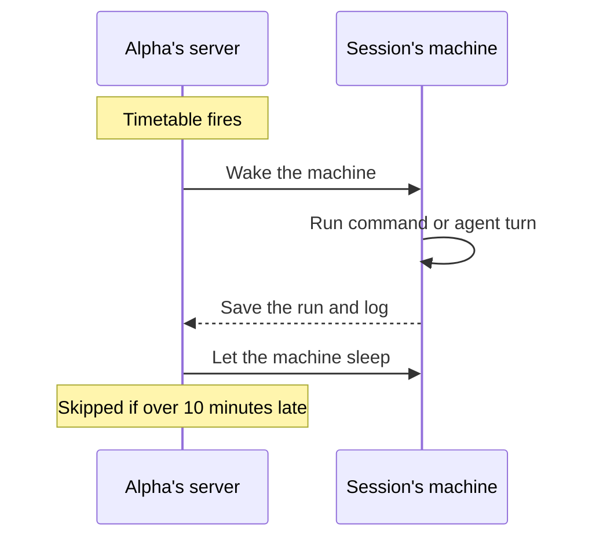

import { routinesMax, routineMinInterval } from '/snippets/limits.mdx';
import { PromptCard } from '/snippets/prompt-card.jsx';

A routine is work Alpha runs on a timetable, even while its session is closed and the session's machine is asleep. Alpha's server keeps the clock: for each run it wakes the session, runs the work there with that session's files, secrets and database, then lets the machine sleep again. For a worked example, follow [Post a weekly summary to Slack](/guides/weekly-summary). A [published app](/publish/publish-your-app) has no scheduler of its own, so its periodic jobs belong in a routine too.

<Frame caption="Each routine row shows its state, its timetable and when it runs next.">
  
</Frame>

<Note>
If the Routines page says "Routines are not enabled on this Alpha", routines aren't turned on for your Alpha. Ask your administrator.
</Note>



## Which kind of routine do you need?

A routine either runs a command or asks the agent. The agent picks one when it builds the routine, and you can switch under **What it does** in the edit form.

| | **Run a command** | **Ask the agent** |
| --- | --- | --- |
| What runs | A script the agent wrote and tested, in the workspace, with the session's secrets and `DATABASE_URL` | Your instruction, sent to the session's agent as a turn nobody watches |
| Cost per run | No agent turn and no tokens | A full agent turn |
| The run's log | The command's output. Exit 0 is **ok**; anything else fails the run. | The agent's closing report |
| In the transcript | A **Routine … ran** card, or **Routine …: the run failed** | A **Routine run · …** message, then the agent's work |
| Use it for | Work that follows the same steps every time | Work that needs judgement every time, such as triaging an inbox |

<Tip>
Not sure? Ask for a command. It's cheaper and does the same thing on every run, and the agent prefers it unless the work needs reasoning.
</Tip>

Routines belong to your account, not to the session that made them. Each one runs in its home session, the session that created it, and the Routines page lists every routine from all your sessions.

## Create a routine

You describe a routine, and the agent builds it, tests it once and saves it. Start from the Routines page when the work needs nothing from an existing session; it opens a fresh routine session with its own machine.

<Steps>
  <Step title="Open the Routines page">
    Click **Routines** in the sidebar. With no routines yet, the page opens on a composer with four starter cards: **Hacker News digest**, **Uptime check**, **Exchange rate log** and **Weekly summary**. A card fills the composer with its prompt for you to edit. Once you have routines, click **New routine** to bring the composer back above them; **Cancel** closes it.

    <Frame caption="Pick a starter, or say what should run and when in your own words.">
      
    </Frame>
  </Step>
  <Step title="Describe what runs and when">
    Say what to do, how often, and where the result goes. Click **Create routine** or press <kbd>Enter</kbd>; <kbd>Shift</kbd> + <kbd>Enter</kbd> adds a new line.

    <PromptCard label="Try this">

    ```text
    Every hour, check whether https://harbor.example.com is up and append the time, the status code and the response time to data/uptime.csv.
    ```

    </PromptCard>

    Alpha will:

    1. Open a new routine session and write the check as a script in its workspace.
    2. Run the script once by hand and show you the result.
    3. Ask for anything it still needs in a [question card](/chat/plan-mode), such as the timetable if you didn't give one, or your time zone when it names a time of day.
    4. Save the routine and tell you what runs and when.
  </Step>
  <Step title="Find the routine session in the sidebar">
    A routine session is an ordinary session marked with a clock in the sidebar. Any session that is home to a routine gets the clock too. The clock is green while a routine is scheduled and pulses while a run is going. It's grey while the routine is paused or nothing is saved yet. To list only routine sessions, open the sidebar's **Filter, group and sort** menu and set **Type** to **Routines**.

    {/* screenshot to capture: /images/routines/sidebar-routine-clocks.png — The clock tells you whether a routine session has anything scheduled. */}
  </Step>
  <Step title="Check the saved card">
    When the agent saves the routine, the card **Routine harbor-weekly-summary saved** appears with **When**, **Runs** (or **Asks the agent**) and **Next**. When it's the session's first routine, the session's **Routines** tab opens beside the chat.

    {/* screenshot to capture: /images/routines/routine-saved-card.png — The saved card states what runs, when, and the first run. */}
  </Step>
</Steps>

To give a routine an existing session's files, secrets or database, ask for it in that session instead: "every Monday at 9, post last week's bookings to #harbor-staff". The agent follows the same steps there, and the routine's home is that session.

## Set the timetable

The timetable lives under **How often** in the edit form. The line under it spells the timetable out in words and lists the next three runs, or shows in red why the server refused it. Every choice except **Once, at a set time** and **Custom (cron expression)** also shows its `cron:` expression.

| **How often** | You set |
| --- | --- |
| **Every few minutes** | Every *n* minutes, with optional **Only between** hours and **Only on** weekdays |
| **Every few hours** | Every *n* hours at a minute past the hour, with the same options |
| **Every day** | A time |
| **On certain days of the week** | Weekday chips and a time |
| **On certain days of the month** | Day chips (1–31) and a time. A month without that day skips it. |
| **Once, at a set time** | A date and time. The routine shows **Done** after it runs. |
| **Custom (cron expression)** | Five fields: minute, hour, day of month, month, day of week |

Daily, weekly and monthly timetables also take **Months**; none picked means every month. **Time zone** is the zone the routine's times are read in. It's hidden for a plain every-*n*-minutes or every-*n*-hours timetable, which runs the same in any zone. A routine runs at most once every {routineMinInterval}, because each run wakes a machine.

For a command, **More options** adds **Folder** (where the command runs, the workspace by default) and **Stop after (seconds)**, which defaults to 600 and goes up to 3600.

{/* screenshot to capture: /images/routines/routine-edit-form.png — The preview line confirms the next three runs before you save. */}

## Run, pause and edit a routine

Each row on the Routines page has the same buttons. The session's **Routines** tab shows only that session's routines, without **View session**. The tab edits routines but doesn't add them; to add one, ask the agent. Once all of a session's routines are removed, its tab shows **How a routine comes together** instead.

| Button | What it does |
| --- | --- |
| **View session** | Opens the routine's home session (Routines page only) |
| **Run now** | Starts a run at once and opens the row on it. The run is marked **by hand**. It's refused while a run is already going, or while an agent routine's session is in the middle of a turn. |
| **Pause** / **Resume** | Stops or restarts the timetable. A finished one-time routine has neither. |
| **Edit** | Opens the form inline. Saving posts "You changed the routine …" in the home session's transcript. |
| **Remove** | Deletes the routine after you confirm "Remove the routine harbor-weekly-summary? Its runs go with it." |
| **Expand** / **Collapse** | Shows the **Command** or **Instruction**, then **Runs in** (Routines page only), **Next runs**, **Last run**, **Folder** and **Stops after** (commands only), **Name**, **Added**, and **Runs** |

<Warning>
**Remove** deletes the routine and every run's log, and it can't be undone. To stop a routine you may want back, **Pause** it.
</Warning>

{/* screenshot to capture: /images/routines/routine-row-expanded.png — An expanded row: what runs, the facts, and the last runs. */}

## Read a routine's runs

The row's dot gives the routine's state. Each run under **Runs** gets a chip; click a run to read its whole log, even while the machine sleeps. Alpha keeps the last 50 runs of each routine.

| You see | It means |
| --- | --- |
| **Active** (green dot) | The routine runs on its timetable. |
| **Paused** (amber dot) | Nothing runs until you click **Resume**. |
| **Done** (grey dot) | A one-time routine that has run. |
| **Last run failed** (red dot) | Open the latest run to read why. |
| **ok** | The command exited 0, or the agent's turn finished with a report. |
| **failed** or **exit** + a code | The command failed, timed out ("stopped after 600 s") or couldn't start. |
| **skipped** | The run didn't start, for example "the previous run was still going". |
| **queued** / **running** | The log reads "Waiting for the routine service…" or "Waking the session and starting…". |

An agent run appears in its session's transcript as **Routine run · harbor-inbox-digest**. The agent works without asking questions and ends with a short report, which becomes the run's log. A failed command run posts **Routine harbor-uptime: the run failed** with **Error**, **Took** and the end of the log.

{/* screenshot to capture: /images/routines/routine-failed-card.png — A failed run posts its error and the end of its log in the chat. */}

### Why did a run fail or skip?

Open the run to read its reason. A failed or skipped run is never retried; the routine carries on at its next time.

| Reason | What happened | What to do |
| --- | --- | --- |
| "the previous run was still going" | The run before it hadn't finished, so this one was skipped. | Nothing, if it's rare. If it keeps happening, make the work faster or the timetable less frequent. |
| "the fire came more than 10m0s late (Alpha was not running) — skipped, not caught up" | Alpha was down or restarting when the run was due. | Nothing. Click **Run now** if you need this run. |
| "the run waited more than 10m0s for a worker — skipped, not caught up" | Alpha was too busy to start it in time. | Click **Run now** if you need this run. |
| "the session has no machine (and no checkpoint to restore it from)" | The routine's session has no machine to run on. | Open the session and send a message, so it gets a machine, then **Run now**. |
| "the session's machine could not be woken: …" | The session's machine wouldn't wake. Nothing was discarded. | See [What if a machine won't wake?](/sessions/machines#what-if-a-machine-wont-wake). |
| "the command could not be run: …" | The command never started, for example because its folder is missing. | Ask the agent in the routine's session to fix the command or its folder. |
| "stopped after 600 s" (or another number) | The command ran past its time limit. | Make it faster, or raise **Stop after (seconds)** under **Edit → More options**, up to 3600. |
| "the agent could not be started: …" | An agent routine couldn't begin its turn. | Open the session to see why, then **Run now**. |
| "the agent's turn failed" or "the agent's turn was stopped" | The agent's turn ended in an error, or was stopped. | Read the turn in the session's transcript. |
| "the agent's turn ended without reporting back" | The agent finished without its closing report. | Read the turn in the transcript, and make the instruction say what to report. |
| "the server running it stopped mid-run", "the run's job was lost before a worker took it", "stopped: the run outlived its limit" or "stopped: the routine service ended the run" | Alpha lost track of the run, usually during a restart. | Click **Run now** if you need this run. |
| "the session is gone" or "the session's owner is gone" | The routine's session, or its owner's account, was deleted. | Remove the routine, or ask the agent in another session to create it again. |

## What are the limits?

The account-wide numbers are also on [Limits](/reference/limits).

| Limit | Value |
| --- | --- |
| Routines per account | {routinesMax}, paused ones included |
| Shortest gap between runs | {routineMinInterval} |
| A run more than 10 minutes late | Skipped, not caught up |
| A failed command run | Not retried |
| An agent run while the agent is busy | Waits for the turn to end, and is skipped after 10 minutes |
| A command's running time | 600 seconds by default, 3600 at most |
| An agent instruction | 4,000 characters |
| One run's log | 256 KB; the rest is cut |
| Runs kept | The last 50 per routine |

## Who can see and change a routine?

Only you, the owner. People you [share a session](/sharing) with never see its **Routines** tab. The Routines page and the tab can change everything, including what runs.

The agent sees every routine on your account from any session. From outside a routine's home session it can change only the timetable, or pause and resume. For anything else it posts **Routine harbor-weekly-summary is changed in its own session** with an **Open Harbor bookings** button. The agent removes a routine only when you ask, and names it first.

[Deleting a session](/sessions/fork-and-delete) deletes the routines whose home it is, with their runs. Forking a session doesn't copy its routines.

## Next steps

<CardGroup cols={2}>
  <Card title="Post a weekly summary to Slack" icon="paper-plane" href="/guides/weekly-summary">
    Build harbor-weekly-summary end to end, from connecting Slack to the first run.
  </Card>
  <Card title="Connect an app" icon="plug" href="/integrations/connect-apps">
    Let a routine send email or post to Slack without a key ever appearing in the transcript.
  </Card>
  <Card title="Sleep, wake and reset" icon="moon" href="/sessions/machines">
    What a sleeping machine keeps, so a routine finds its files where it left them.
  </Card>
  <Card title="Secrets" icon="key" href="/secrets">
    Give a command routine the keys it reads, scoped to its session or your account.
  </Card>
</CardGroup>
