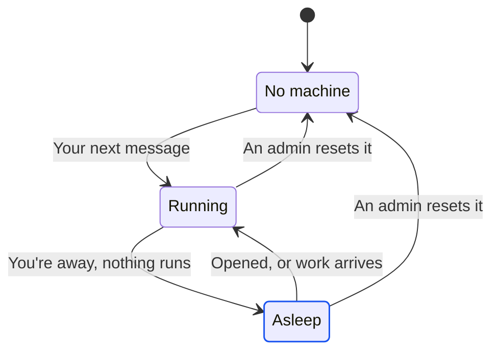

import { idlePark, turnMax, disk } from '/snippets/limits.mdx';

Every session runs on its own machine, and that machine sleeps when you're away and wakes when it's needed, with every file, package and running process as you left it. A turn never depends on your browser, so you can close the tab mid-task and come back to finished work. To copy a session's machine into a new session instead, [fork it](/sessions/fork-and-delete). To start sessions from a ready-made machine, use a [setup](/sessions/setups).

## What happens when I close the tab?

The turn keeps going. The agent runs on Alpha's servers, not in your browser, so closing the tab, the window or the laptop doesn't stop it. A turn can run for up to {turnMax}, and a server restart on Alpha's side doesn't end it either.

When you open the session again, Alpha replays the transcript and attaches you to the live stream, so you land on whatever the agent is doing now. If the agent stopped to ask you something, the session's row in the sidebar shows a question-mark icon (labelled "Needs your input"), and the machine stays awake until you [answer the question card](/chat/plan-mode).

## When does a machine go to sleep?

Once no Alpha page of yours has been visible for {idlePark}, each of your sessions with nothing running goes to sleep. Visible means the selected tab of a window that isn't minimised (on macOS and Windows, not fully covered by other windows either). It doesn't need focus, and any Alpha page counts: a session, the home screen, Usage or Skills. While one is on screen, none of your machines sleep.

Going to sleep saves a full copy of the machine's memory and disk, then shuts the machine down. Nothing is discarded.

| While you're away | Keeps the machine awake? |
| --- | --- |
| A turn running, or waiting on your answer | Yes, until it ends (up to {turnMax}) |
| An app being [published](/publish/publish-your-app) | Yes, until the publish ends |
| An [eval run](/evals/run) | Yes, until the run ends |
| A [routine](/routines) run | Yes. A routine also wakes an asleep machine when its time comes. |
| An Alpha tab in the background, or a minimised window | No |
| A Shell left open in a background tab | No |
| Someone opening one of your preview links | No. They see a "Sandbox asleep" page that reloads itself once you're back. |
| People you [shared the session](/sharing) with | No. Their sidebar says "Machine asleep · wakes when its owner is back". |

Only work wakes a machine while you're away. Background tabs, the Shell, preview links and viewers never do. A background tab reconnects often, and would otherwise undo every sleep.

A visible window counts even with nobody at it, such as Alpha left open on a second monitor. Alpha can also put an idle session to sleep sooner while it moves machines between its servers, but never one that's open in a visible tab.

## Wake a sleeping machine

You don't need to do anything. When you come back, the session on screen wakes by itself. Other sessions wake when you open them, or when something needs their machine: a message, a file, the Shell or the Preview. The sidebar's hover card shows "Machine asleep · wakes when you open it" until then. Waking takes a few seconds.

If you send a message to a sleeping session, the working line under it says what Alpha is doing:

| Working line | What's happening |
| --- | --- |
| "Restoring the session's machine from its checkpoint…" | The usual wake: the saved machine is starting again. |
| "Resuming sandbox…" | The machine slept on the server it ran on and is starting again there. |
| "Creating sandbox…" | The session has no machine, for example after a reset, and no setup. A fresh, blank one is starting. |
| "Starting a machine from the "…" setup…" | The session has no machine and was started from a [setup](/sessions/setups). A fresh one is starting from that setup. |
| "Couldn't start from the setup's snapshot — starting a blank machine (its repositories are cloned fresh)." | The setup's saved machine couldn't be started, so Alpha starts a blank machine and clones the session's repositories again. A similar line appears when the setup was deleted or has never been built. |

{/* screenshot to capture: /images/sessions/session-waking-status.png — A message sent to a sleeping session: the working line says the machine is being restored. */}

While the machine wakes, every workspace tab that reads from it shows grey placeholder bars: file tabs, file viewers, decks, **Preview**, **Shell**, **Database**, **GitHub**, **Agent** and **Evals**. They fill in by themselves once the machine is up, with no error and nothing to retry. The Shell reconnects on its own and can fill in a few seconds after the others. Tabs that don't read from the machine, such as **Plan**, **Auth**, **Routines** and **Secrets**, show at once.

{/* screenshot to capture: /images/sessions/machine-wake-skeletons.png — A session just reopened: its tabs hold placeholder bars until the machine is back. */}

The transcript loads its newest two turns first, so a long session opens quickly. Scroll up, or click the **Show earlier messages** button above them (it shows how many, as in **Show 12 earlier messages**), to load older ones.

The **Preview** can show the app before the machine is back. Alpha keeps a saved copy of the page and serves it while the machine wakes, with the line "The last saved copy of the app — the live page takes over on its own once the machine is back." The live app replaces it without a reload. See [Preview your app](/workspace/preview).

<Note>
If you don't see the saved copy while a machine wakes, it isn't turned on for your Alpha.
</Note>

## What if a machine won't wake?

Alpha never swaps a sleeping machine for a blank one behind your back. If it can't bring the machine back, it tells you and keeps the saved copy, so you can try again. Each of these messages says "Nothing was discarded" or asks you to try again, and means exactly that.

| Message | What to do |
| --- | --- |
| "The session's machine is paused and could not be resumed (…). Nothing was discarded — try again in a moment, or reset the machine to start over." | Send your message again in a minute. If it keeps failing, ask an admin to [reset the machine](#reset-the-sessions-machine). |
| "The session's machine could not be restored from its checkpoint (…). Nothing was discarded — try again in a moment." | Try again in a moment. The saved machine is kept. |
| "The session's machine cannot be reached right now." | The server holding it is briefly out of reach. Try again in a moment. |
| "The session's machine changed while this request was starting it — try again in a moment." | Something else woke or put the machine to sleep at the same instant. Send again. |
| "Sandbox didn't wake" (in a preview link) | Open the session in Alpha and send a message. The transcript says what went wrong. |
| "The paused machine could not be resumed." (in the **Shell**) | Send a message in the session to see the reason, then follow the rows above. |

More fixes are in [Troubleshooting and FAQ](/reference/troubleshooting#the-machine-wont-wake-or-the-chat-stops-updating).

## Reset the session's machine

A reset throws the session's machine away, along with its saved copy, and gives the session a fresh one on its next message. It's the fix for a machine that is broken beyond repair, or won't wake after several tries. A session that has slept and woken dozens of times can also start to wake more slowly, and a reset clears that too.

Only an admin can reset a machine. Ask your Alpha's admin, and tell them which session it is.

<Steps>
  <Step title="The admin finds the session">
    In **Admin → Sessions**, the admin searches for the session by its title or its owner's email. The reset is greyed out while a turn is running or the session is publishing.
  </Step>
  <Step title="The admin resets it">
    They click **Reset the machine (fresh VM, history forgotten)** on the session's row and confirm. See [Step in on a session](/admin#step-in-on-a-session).
  </Step>
  <Step title="Send a message">
    Alpha starts a fresh machine and clones the session's repositories again. The working line says "Creating sandbox…", or, for a session started from a setup, "Starting a machine from the "…" setup…".
  </Step>
</Steps>

<Warning>
A reset can't be undone. Every file on the machine goes, including uncommitted or unpushed changes in your repositories, installed packages and the session's database with its data. The transcript stays on screen, but the agent starts afresh and doesn't remember earlier turns, so restate what it needs. Push your work to GitHub, or export the database, before you ask for a reset.
</Warning>

What a reset keeps: the transcript, the session's settings, repositories, secrets and setup, and every app you published from it. Services such as the database start switched off on the new machine, and come back when you or the agent turn them on.

## What survives what

| | Files | Session database | Installed packages | Transcript and agent memory | Published apps |
| --- | --- | --- | --- | --- | --- |
| **Sleep** | Kept | Kept | Kept, with running processes | Kept | Kept |
| **[Fork](/sessions/fork-and-delete)** | Copied to the fork | Copied to the fork | Copied to the fork | Copied, and the fork's agent remembers it | Stay with the original only |
| **Reset** | Deleted. Repositories are cloned again. | Deleted | Deleted. A setup's come back. | Transcript kept. The agent starts over. | Kept |
| **[Delete](/sessions/fork-and-delete)** | Deleted | Deleted | Deleted | Deleted | Deleted, with their production databases |

The session's machine has {disk} of disk. Other limits are in [Limits](/reference/limits).

## Next steps

<CardGroup cols={2}>
  <Card title="Fork or delete a session" icon="code-fork" href="/sessions/fork-and-delete">
    Keep the old machine and try a different direction in a copy.
  </Card>
  <Card title="Setups: ready-made machines" icon="box" href="/sessions/setups">
    A reset or a new session starts with your repositories cloned and installed.
  </Card>
  <Card title="Queue, steer or stop" icon="forward" href="/chat/queue-and-steer">
    Line up long work before you close the tab.
  </Card>
  <Card title="Limits" icon="gauge" href="/reference/limits">
    Turn length, disk size and the idle time before a machine sleeps.
  </Card>
</CardGroup>
