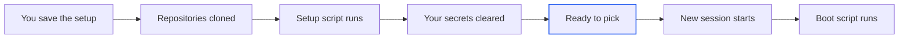

import { setupsMax, reposMax } from '/snippets/limits.mdx';
import { PromptCard } from '/snippets/prompt-card.jsx';

A setup is a saved machine that new sessions start on. It holds your repositories, already cloned, and whatever your setup script installed, so a session is ready in about a second. To copy one session, transcript included, [fork it](/sessions/fork-and-delete) instead. To add a repository to a single session, use **+ → GitHub repos** on the [home screen](/sessions/home-screen).

<Frame caption="Your setups, each with its status and buttons.">
  
</Frame>

## Which machine should a session start on?

Every session gets its own machine. You choose what's on it when you start the session.

| Start from | What's on the machine | Transcript | Ready to work | Use it when |
| --- | --- | --- | --- | --- |
| **Blank machine** | The agent, Node, Python, git and PostgreSQL | New | After your repositories clone and you install what you need | A new project, or a one-off look at a repository |
| A setup | The same, plus your repositories cloned and your setup script already run | New | About a second | You start many sessions on the same codebase |
| A [fork](/sessions/fork-and-delete) | A copy of one session's machine and files | Copied | About 15 seconds | You want to take one session in another direction |

<Tip>
Not sure? If you've installed the same dependencies in more than two sessions, save them as a setup.
</Tip>

## Find your setups

Setups have a page of their own. Open it with **Account menu → Setups** (the account menu opens from your account badge at the bottom of the sidebar), or from the home screen with **+ → Machine → Manage setups →**. The page lists your own setups and the ones shared with you, one row each. With none yet, it reads "No setups yet. Add your repository and an install script once, and every session from it starts ready."

Each row shows the setup's name with a status badge, its description, its repositories, when it was last built and by whom, and "Shared by" with the owner's name on a setup someone shared with you. If the last build failed, the error shows under the row.

| Badge | Meaning |
| --- | --- |
| **Ready** | Built. Sessions can start from it. |
| **Building** | A build is running. |
| **Queued** | Waiting for another build to finish. It starts on its own. |
| **Failed** | The build failed and there's no earlier build to start from. |
| **Not built** | Saved without a build. |

The buttons at the right of a row depend on its state and on whether it's yours:

| Button | When it shows | What it does |
| --- | --- | --- |
| **Add N secrets** or **Secrets** | The setup has a [secret set](#add-a-secret-set) | Opens the set to fill in your values. It reads **Add N secrets** while some of yours are missing. |
| **View build** | A build is running | Opens the build log, which follows the build live |
| **Build** | Your setup, not built yet or failed | Starts a build and opens its log |
| **Edit** | Your setup, not building | Opens the setup's form |
| **⋯** ("More actions for …") | Always | **Cancel build** while yours is building, **Rebuild** once yours is ready, **Build log**, and **Delete setup** for your own |

## Create a setup

Fill in the form yourself, or ask the agent to save the session you're in. Either way the setup is yours alone until you share it. Your own setups are limited to [{setupsMax}](/reference/limits).

<Tabs>
  <Tab title="On the Setups page">
    <Steps>
      <Step title="Click New setup">
        On the **Setups** page, click **New setup**. The form opens in sections: **Basics**, **Repositories**, **Scripts**, **Secrets & sharing** and a folded **Advanced**.
      </Step>
      <Step title="Name it and add your repositories">
        Under **Basics**, give the setup a **Name** your team will recognise, such as `harbor dev`, and a one-line **Description**. Under **Repositories**, type `owner/repo` or paste a github.com URL, add a branch if you don't want the default, and click **Add**. Private repositories need [GitHub connected](/github/connect).

        <Frame caption="Name the setup, add repositories and scripts, then save or build.">
  
</Frame>
      </Step>
      <Step title="Write the scripts">
        Under **Scripts**, put the commands you'd otherwise run at the start of every session in **Setup script**: installs, builds, migrations, seed data. It runs once, at build time, in `/workspace`. The first command that fails stops the build. **How the script runs** unfolds the details. The optional **Boot script** catches each new machine up with your repository, usually with a `git pull`.
      </Step>
      <Step title="Add secrets, sharing and notes">
        All optional. Under **Secrets & sharing**, pick a **Secret set** ([below](#add-a-secret-set)) and add emails under **Shared with**. Unfold **Advanced** to write **Notes for the agent**, which tell it how the project runs.
      </Step>
      <Step title="Click Save & build">
        Alpha opens the build log and streams it live. **Save without building** keeps the setup without building it. When the build finishes, a check mark appears under the log: "Ready — pick it on the home screen with the chip." The machine icon sits before the word "chip". On the home screen, that's **+ → Machine**.

        {/* screenshot to capture: /images/sessions/setups-build-log.png — The log follows the build live. Scroll up to stop following it. */}
      </Step>
    </Steps>
  </Tab>
  <Tab title="Ask the agent">
    Once a session's machine works the way you want, ask the agent to save it. It writes the setup script from the commands that actually worked here.

    <PromptCard label="Try this">

    ```text
    Save this as a setup called "harbor dev" so new sessions start like this one: both repos cloned, dependencies installed and the test database migrated and seeded.
    ```

    </PromptCard>

    Alpha will:

    1. Collect the install, migrate and seed commands this session needed, in dependency order.
    2. If the setup needs keys, put their names in one of your [secret sets](#add-a-secret-set) and attach it in the same save, so the build already has your values. It never writes a key into the setup or its scripts.
    3. Save the setup under your account and build it on a fresh machine, not this one.
    4. Tell you when it's ready to pick on the home screen, or that it's still building.

    The agent never sees or types a secret's value. If it made a new set for the setup, add your values on the [**Secrets**](/secrets#secret-sets) page, then rebuild. The agent can't share a setup, and it replaces an existing setup of the same name only when you ask for exactly that.
  </Tab>
</Tabs>

| Field | Section | What it does | Limit |
| --- | --- | --- | --- |
| **Name** | **Basics** | Shown on the **Setups** page, in the machine picker, the tray under the home composer and session headers | 60 characters, unique across your Alpha |
| **Description** | **Basics** | One line under the name on the **Setups** page | 300 characters |
| **Repositories** | **Repositories** | Cloned into `/workspace/<name>`, on the branch you give or the default | 5, which count toward the {reposMax} limit |
| **Setup script** | **Scripts** | Runs once at build time, as root, with `bash -e` and no prompts. Your secrets and `GITHUB_TOKEN` are in its environment. | 32 KB |
| **Boot script** | **Scripts** | Runs on each fresh machine from the setup, before the agent starts. Edits apply without a rebuild. | 32 KB; 5 minutes (default) per run |
| **Secret set** | **Secrets & sharing** | The secrets every session from the setup gets. See [Add a secret set](#add-a-secret-set). | One set per setup |
| **Shared with** | **Secrets & sharing** | Accounts that can see the setup and start sessions from it | 20 emails |
| **Notes for the agent** | **Advanced** | Handed to the agent with your messages in every session from the setup. They never appear in the transcript. | 4,000 characters |

<Note>
If you don't see **Shared with**, sharing isn't turned on for your Alpha. It needs everyone to sign in with their own account.
</Note>

## Add a secret set

A [secret set](/secrets#secret-sets) is a named list of secrets. Attach one to a setup, and every session started from it gets those secrets, without anyone pasting keys into the setup script.

Under **Secrets & sharing**, pick a set from **Secret set**, or choose **No secret set**. A set that's missing values shows how many, such as "· 2 required". **Add keys** creates a new set named after the setup and opens it, so you can add names and values; once a set is attached, the button reads **Edit keys**. The set's names show under the picker. The field's hint says how sharing works: "Sessions from this setup get these secrets. People you share with fill in their own values."

| Who | Which values their sessions get |
| --- | --- |
| You, the owner | Your values in the set. The setup's build gets them too. |
| Someone you share the setup with | Their own values. They see the set's names but never yours, and the setup's row on their **Setups** page reads **Add N secrets** until they've filled theirs in. |

A change to a setup's set, or to who it's shared with, reaches every session started from the setup shortly, with no restart. A session's own secrets win over the setup's set. The full order is on [Secrets](/secrets#secret-sets).

You can also ask the agent to do this for you, by name: create a set, attach it to one of your setups, swap it for another or detach it. It never sees or types a value, and it works only on your own sets and setups.

<PromptCard label="Try this">

```text
Attach my "Harbor keys" secret set to the harbor dev setup.
```

</PromptCard>

The agent can't delete a set while a setup uses it: it's told "setups still use this set (harbor dev) — detach it from each first". See [Ask the agent to manage your sets](/secrets#ask-the-agent-to-manage-your-sets).

## Start a session from a setup

On the home screen, the machine is part of the **+** menu. Every new session starts on the blank machine unless you pick a setup for it, and the pick lasts for that one session.

<Steps>
  <Step title="Pick the setup">
    Click **+**, then **Machine**, and choose a setup in the **Setup** popover. **Blank machine** is marked **default**. Setups marked **building** or **not built** can't be picked yet. The setup you pick shows as a chip in the tray under the composer; its **×** takes it off. The **Repositories** popover then lists the setup's repositories marked "from the setup", so you don't add them twice.

    <Frame caption="Blank machine is the default; your setups follow it.">
      
    </Frame>
  </Step>
  <Step title="Send your first prompt">
    While the machine starts, the status line reads "Starting a machine from harbor dev".
  </Step>
  <Step title="Check the header">
    The session header names the setup beside the title for the life of the session. If the setup is later deleted, the badge reads **deleted setup**.

    {/* screenshot to capture: /images/sessions/session-setup-badge.png — The badge names the setup this session's machine came from. */}
  </Step>
</Steps>

Each session starts on its own copy, so nothing you do in one session reaches the setup or other sessions.

## Keep a setup current

A setup's repositories are frozen at the moment it was built. There are two ways to bring them forward.

| Change | How | Who gets it |
| --- | --- | --- |
| The latest code, or a quick install | Edit the **Boot script**. No rebuild needed. | Every machine created after the edit |
| New dependencies, repositories or setup script | **Edit** the setup and click **Save & rebuild**, or choose **⋯ → Rebuild** on its row | Sessions started after the rebuild |

A rebuild never touches existing sessions; they keep their machines. If a rebuild fails, the previous build stays in use. [Resetting a session's machine](/sessions/machines#reset-the-session’s-machine) started from the setup gives it the latest build.

The boot script runs on a fresh machine only, never when a sleeping session wakes. Your first message waits for it, so keep it to seconds. If it fails, Alpha notes it in the transcript, continues on the machine as built, and keeps the script's output in a log on the machine for the agent to read.

To stop a build, choose **⋯ → Cancel build** on its row, or click **Cancel build** in its log. **⋯ → Delete setup** asks first, and reminds you that sessions started from it keep their machines. A setup can't be deleted while it builds.

## Share a setup

**Edit** the setup, add an account's email under **Shared with** ("They can start sessions from it; only you can change it."), and click **Save without building**. The setup appears on that person's **Setups** page, marked "Shared by" and your name, and in their machine picker. Alpha doesn't notify them. If the setup has a [secret set](#add-a-secret-set), they fill in their own values.

| | Owner | Someone it's shared with | Anyone else, admins included |
| --- | --- | --- | --- |
| Sees it and starts sessions from it | Yes | Yes | No |
| Reads its build log | Yes | Yes | No |
| Sees the names in its secret set | Yes, with your values | Yes, with their own values | No |
| Edits, builds, cancels, deletes or shares it | Yes | No | No |

Removing an email takes effect at once. Sessions already started keep their machines, but their next fresh machine starts blank, with the repositories cloned again. Setups shared with you don't count toward your limit of {setupsMax}.

<Warning>
Starting from someone else's setup means trusting them. Its boot script runs as root on your new machines with **your** GitHub token and secrets in its environment, and its owner can change that script at any time without a rebuild.
</Warning>

## What a build keeps and what it removes

A build never touches your sessions. Your setup script runs with your secrets and GitHub access, and they're cleared before the setup is saved.



| Kept in the setup | Removed before it's saved |
| --- | --- |
| Your repositories, dependencies and build outputs | Your secrets and `GITHUB_TOKEN` |
| A database the setup script started and seeded | Your git name and email |
| Every file the script wrote, keys included | The agent's history and sign-ins from the build |

Only the environment is cleaned, not files. A token your script writes into `.npmrc` or `.env` ships to everyone you share the setup with. Keep keys in [secrets](/secrets) and read them from the environment.

## What do the statuses and messages mean?

Builds are limited to 30 minutes (default), and two run at a time across your Alpha. The build log's header shows the setup's status in these words, and so does each row's badge in short.

| Status | Meaning |
| --- | --- |
| "not built yet" | Saved without a build. Click **Build** on its row. |
| "queued…" | Waiting for another build to finish. It starts on its own. |
| "building · 2m ago…" | Running. Click **View build** to follow it. |
| "ready · built 3h ago by Dana Reyes" | Sessions can start from it |
| "ready · built … · last rebuild failed" | The previous build is still in use. The error shows under the row. |
| "build failed" | Nothing to start from yet. Fix the script, then click **Build**. |

| Message | Cause and fix |
| --- | --- |
| "the setup script exited with status 1" | A command failed. Find it in the build log, and try the script in a session first. |
| "timed out after 30 minutes" | Move slow, optional steps out of the setup script |
| "a setup with this name already exists" | Names are unique across your Alpha, even for setups you can't see. Choose another. |
| "at most 5 setups per account" | Delete one of your own first |
| "missing from the secret set: RESEND_API_KEY", in the build log | The build ran without your value for those names. Add them on the [**Secrets**](/secrets#when-a-value-is-missing) page, then rebuild. |
| "This session's setup no longer exists — starting a blank machine (its repositories are cloned fresh)." | The setup was deleted or unshared. The session carries on without its installs. |
| A line saying the setup's boot script failed and Alpha is continuing | Ask the agent to read the boot script's output on the machine, then fix the boot script |

Other start-up errors are in [Troubleshooting](/reference/troubleshooting).

## Next steps

<CardGroup cols={2}>
  <Card title="Connect GitHub and add repositories" icon="github" href="/github/connect">
    Connect an account so setups can clone your private repositories.
  </Card>
  <Card title="Secrets" icon="key" href="/secrets">
    Store the keys your setup script needs, so they never land in a file.
  </Card>
  <Card title="Sleep, wake and reset" icon="power-off" href="/sessions/machines">
    What a reset does to a session that started from a setup.
  </Card>
  <Card title="Fork or delete a session" icon="code-branch" href="/sessions/fork-and-delete">
    Copy one session, transcript and all, when a setup is more than you need.
  </Card>
</CardGroup>
