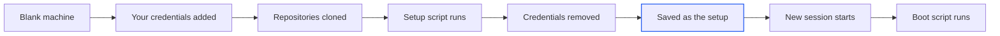

import { setupsMax, reposMax } from '/snippets/limits.mdx';
import { PromptCard } from '/snippets/prompt-card.jsx';

A setup is a saved machine that new sessions start on. It holds your repositories, already cloned, and whatever your setup script installed, so a session is ready in about a second. To copy one session, transcript included, [fork it](/sessions/fork-and-delete) instead. To add a repository to a single session, use the repos chip on the [home screen](/sessions/home-screen).

{/* screenshot to capture: /images/sessions/setups-manager-list.png — Your own setups and the ones shared with you, each with its build status. */}

## Which machine should a session start on?

Every session gets its own machine. You choose what's on it when you start the session.

| Start from | What's on the machine | Transcript | Ready to work | Use it when |
| --- | --- | --- | --- | --- |
| **Blank machine** | The agent, Node, Python, git and PostgreSQL | New | After your repositories clone and you install what you need | A new project, or a one-off look at a repository |
| A setup | The same, plus your repositories cloned and your setup script already run | New | About a second | You start many sessions on the same codebase |
| A [fork](/sessions/fork-and-delete) | A copy of one session's machine and files | Copied | About 15 seconds | You want to take one session in another direction |

<Tip>
Not sure? If you've installed the same dependencies in more than two sessions, save them as a setup.
</Tip>

## Create a setup

Fill in the form yourself, or ask the agent to save the session you're in. Either way the setup is yours alone until you share it. Your own setups are limited to [{setupsMax}](/reference/limits).

<Tabs>
  <Tab title="In the Setups manager">
    <Steps>
      <Step title="Open the Setups manager">
        Choose **Account menu → Setups** (the account menu opens from your account badge at the bottom of the sidebar), or click **Manage setups →** in the home screen's setup chip. Then click **New setup**.
      </Step>
      <Step title="Name it and add your repositories">
        Give the setup a name your team will recognise, such as `harbor dev`. Under **Repositories**, type `owner/repo` or paste a github.com URL, add a branch if you don't want the default, and click **Add**. Private repositories need [GitHub connected](/github/connect).

        {/* screenshot to capture: /images/sessions/setups-new-form.png — Repositories are cloned first, then the setup script runs once over them. */}
      </Step>
      <Step title="Write the setup script">
        Put the commands you'd otherwise run at the start of every session in **Setup script**: installs, builds, migrations, seed data. It runs once, at build time, in `/workspace`. The first command that fails stops the build.
      </Step>
      <Step title="Add a boot script and notes">
        Both are optional. A **Boot script** catches each new machine up with your repository, usually with a `git pull`. **Notes for the agent** tell it how the project runs. To share the setup, add emails under **Shared with**.
      </Step>
      <Step title="Click Save & build">
        Alpha opens the build log and streams it live. **Save** keeps the setup without building it. When the build finishes, a check mark appears under the log: "Ready — pick it on the home screen with the chip." The setup chip's icon sits before the word "chip".

        {/* screenshot to capture: /images/sessions/setups-build-log.png — The log follows the build live. Scroll up to stop following it. */}
      </Step>
    </Steps>
  </Tab>
  <Tab title="Ask the agent">
    Once a session's machine works the way you want, ask the agent to save it. It writes the setup script from the commands that actually worked here.

    <PromptCard label="Try this">

    ```text
    Save this as a setup called "harbor dev" so new sessions start like this one: both repos cloned, dependencies installed and the test database migrated and seeded.
    ```

    </PromptCard>

    Alpha will:

    1. Collect the install, migrate and seed commands this session needed, in dependency order.
    2. Save the setup under your account and build it on a fresh machine, not this one.
    3. Tell you when it's ready to pick on the home screen, or that it's still building.

    The agent can't share a setup, and it replaces an existing setup of the same name only when you ask for exactly that.
  </Tab>
</Tabs>

| Field | What it does | Limit |
| --- | --- | --- |
| **Name** | Shown in the setup chip, the manager and session headers | 60 characters, unique across your Alpha |
| **Description** | One line under the name in the manager | 300 characters |
| **Repositories** | Cloned into `/workspace/<name>`, on the branch you give or the default | 5, which count toward the {reposMax} limit |
| **Setup script** | Runs once at build time, as root, with `bash -e` and no prompts. Your secrets and `GITHUB_TOKEN` are in its environment. | 32 KB |
| **Boot script** | Runs on each fresh machine from the setup, before the agent starts. Edits apply without a rebuild. | 32 KB; 5 minutes (default) per run |
| **Notes for the agent** | Handed to the agent with your messages in every session from the setup. They never appear in the transcript. | 4,000 characters |
| **Shared with** | Accounts that can see the setup and start sessions from it | 20 emails |

<Note>
If you don't see **Shared with**, sharing isn't turned on for your Alpha. It needs everyone to sign in with their own account.
</Note>

## Start a session from a setup

The setup chip sits in the home composer's bottom row, beside the repos chip. It reads **blank machine** until you pick a setup. This browser remembers your pick for later sessions.

<Steps>
  <Step title="Pick the setup">
    Click the setup chip and choose a setup. Setups marked **building** or **not built** can't be picked yet. Once you've picked one, the repos chip lists the setup's repositories marked "from the setup", so you don't add them twice.

    <Frame caption="With no setups yet, Blank machine is the only choice.">
      
    </Frame>
  </Step>
  <Step title="Send your first prompt">
    While the machine starts, the status line reads "Starting a machine from harbor dev".
  </Step>
  <Step title="Check the header">
    The session header names the setup beside the title for the life of the session. If the setup is later deleted, the badge reads **deleted setup**.

    {/* screenshot to capture: /images/sessions/session-setup-badge.png — The badge names the setup this session's machine came from. */}
  </Step>
</Steps>

Each session starts on its own copy, so nothing you do in one session reaches the setup or other sessions.

## Keep a setup current

A setup's repositories are frozen at the moment it was built. There are two ways to bring them forward.

| Change | How | Who gets it |
| --- | --- | --- |
| The latest code, or a quick install | Edit the **Boot script**. No rebuild needed. | Every machine created after the edit |
| New dependencies, repositories or setup script | Edit the setup, then **Rebuild** or **Save & rebuild** | Sessions started after the rebuild |

A rebuild never touches existing sessions; they keep their machines. If a rebuild fails, the previous build stays in use. [Resetting a session](/sessions/machines) started from the setup gives it the latest build.

The boot script runs on a fresh machine only, never when a sleeping session wakes. Your first message waits for it, so keep it to seconds. If it fails, Alpha notes it in the transcript, continues on the machine as built, and leaves the output in `/var/log/forge-boot.log`.

To stop a build, click **Cancel** on its row or **Cancel build** in its log. Deleting a setup asks "Delete the "harbor dev" setup and its snapshot? Sessions started from it keep their machines."

## Share a setup

Add an account's email under **Shared with** and click **Save**. The setup appears in that person's manager and setup chip, marked "Shared by" and your name. Alpha doesn't notify them.

| | Owner | Someone it's shared with | Anyone else, admins included |
| --- | --- | --- | --- |
| Sees it and starts sessions from it | Yes | Yes | No |
| Reads its build log | Yes | Yes | No |
| Edits, builds, cancels, deletes or shares it | Yes | No | No |

Removing an email takes effect at once. Sessions already started keep their machines, but their next fresh machine starts blank, with the repositories cloned again. Setups shared with you don't count toward your limit of {setupsMax}.

<Warning>
Starting from someone else's setup means trusting them. Its boot script runs as root on your new machines with **your** GitHub token and secrets in its environment, and its owner can change that script at any time without a rebuild.
</Warning>

## What a build keeps and what it removes

A build never touches your sessions. Alpha starts a separate, temporary machine, lends it your credentials, runs your setup, removes the credentials and saves the result.



| Kept in the setup | Removed before it's saved |
| --- | --- |
| Your repositories, dependencies and build outputs | Your secrets and `GITHUB_TOKEN` |
| A database the setup script started and seeded | Your git name and email |
| Every file the script wrote, keys included | The agent's history and sign-ins from the build |

Only the environment is cleaned, not files. A token your script writes into `.npmrc` or `.env` ships to everyone you share the setup with. Keep keys in [secrets](/secrets) and read them from the environment.

## What do the statuses and messages mean?

Builds are limited to 30 minutes (default), and two run at a time across your Alpha.

| Status | Meaning |
| --- | --- |
| "not built yet" | Saved without a build. Click **Build**. |
| "queued…" | Waiting for another build to finish. It starts on its own. |
| "building · 2m ago…" | Running. Open the build log to follow it. |
| "ready · built 3h ago by Dana Reyes" | Sessions can start from it |
| "ready · built … · last rebuild failed" | The previous build is still in use. The error shows under the row. |
| "build failed" | Nothing to start from yet. Fix the script and click **Build**. |

| Message | Cause and fix |
| --- | --- |
| "the setup script exited with status 1" | A command failed. Find it in the build log, and try the script in a session first. |
| "timed out after 30 minutes" | Move slow, optional steps out of the setup script |
| "a setup with this name already exists" | Names are unique across your Alpha, even for setups you can't see. Choose another. |
| "at most 5 setups per account" | Delete one of your own first |
| "This session's setup no longer exists — starting a blank machine (its repositories are cloned fresh)." | The setup was deleted or unshared. The session carries on without its installs. |
| "The setup's boot script failed (exit 1) — continuing; its output is in /var/log/forge-boot.log on the machine." | Ask the agent to read that file, then fix the boot script |

Other start-up errors are in [Troubleshooting](/reference/troubleshooting).

## Next steps

<CardGroup cols={2}>
  <Card title="Connect GitHub and add repositories" icon="github" href="/github/connect">
    Connect an account so setups can clone your private repositories.
  </Card>
  <Card title="Secrets" icon="key" href="/secrets">
    Store the keys your setup script needs, so they never land in a file.
  </Card>
  <Card title="Sleep, wake and reset" icon="power-off" href="/sessions/machines">
    What a reset does to a session that started from a setup.
  </Card>
  <Card title="Fork or delete a session" icon="code-branch" href="/sessions/fork-and-delete">
    Copy one session, transcript and all, when a setup is more than you need.
  </Card>
</CardGroup>
