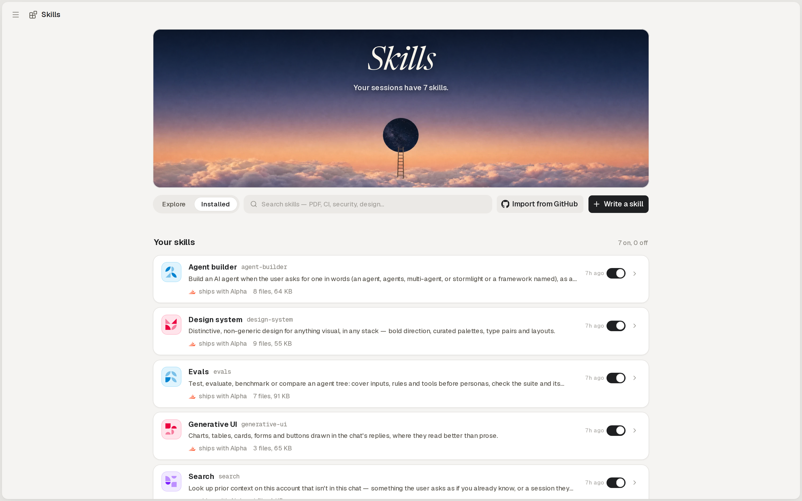
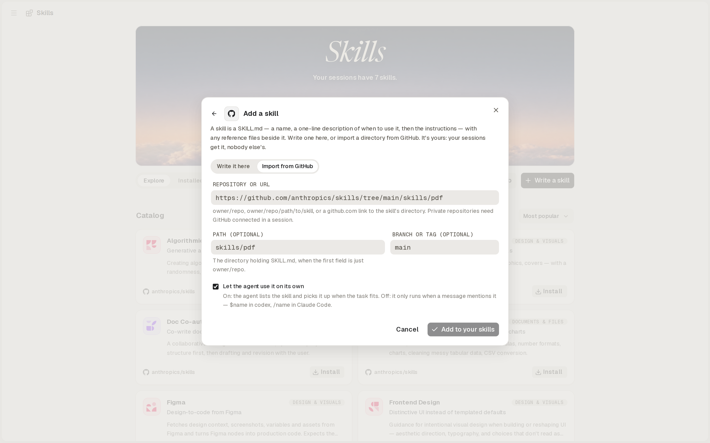

import { PromptCard } from '/snippets/prompt-card.jsx';

A skill is a set of instructions the agent loads when a request fits: a release checklist, how your team writes emails, how to handle PDFs. Each skill is a folder with a `SKILL.md` file, and every skill you add reaches all of your sessions from their next message. For the skills Alpha already includes, see [Skills that ship with Alpha](/skills/built-in-skills). To give the agent new tools rather than new know-how, add an [MCP server](/integrations/mcp-servers).

<Frame caption="Explore opens first, on the catalog of skills you can install.">
  
</Frame>

## How should you add a skill?

There are four ways in. Whichever you pick, the skill is yours: it reaches your sessions only, never another account's.

| Way in | Where | Use it when |
| --- | --- | --- |
| Install from the catalog | **Explore → Catalog → Install** | A well-known skill already covers it, such as PDF, Word or Web App Testing |
| Write it here | **Write a skill** | You can describe the way of working in a page of Markdown |
| Import from GitHub | **Import from GitHub** | The skill already lives in a repository, yours or someone else's |
| Ask the agent | Any session | You've worked something out in a session and want every session to repeat it |

<Tip>
Not sure? Do the work once in a session, then ask the agent to make it a skill. It writes the instructions from what actually worked.
</Tip>

## Install a skill from the catalog

Click **Skills** in the sidebar. The row's badge counts the skills your sessions have. The page opens on **Explore**, where the **Catalog** shelf lists public skills from GitHub. Type in the search box to filter by name, description or keyword, and use the order menu to sort.

| Order | What it shows |
| --- | --- |
| **Most popular** | The default. Skills with the most installs across your Alpha come first. |
| **Newest** | The most recently added first |
| **A–Z** | Alphabetical by display name |
| **By category** | Grouped under **From Alpha** (skills an admin shared that you haven't installed), then **Engineering**, **Workflow & GitHub**, **Documents & files** and **Design & visuals** |

Each card shows the skill's category as a small label beside its name, such as **Engineering**, except under **By category**, where the heading already says it. Each skill's icon is a pattern of four shapes that is its own, on a tile tinted by category: sky for Engineering, violet for Workflow & GitHub, emerald for Documents & files and rose for Design & visuals. Skills that ship with Alpha take their category's colour too. Skills an admin shared take Alpha's accent colour, and your own skills that didn't come from the catalog are amber. The footer links to the skill's source on GitHub, with the GitHub mark, and shows an install count such as "12+ installs".

The skills that ship with Alpha sit in these categories:

| Category | Skills |
| --- | --- |
| **Engineering** | Agent builder, Evals and Voice agent |
| **Design & visuals** | Design system and Generative UI |
| **Documents & files** | Slides |
| **Workflow & GitHub** | Search |

A skill's dialog names its category above its title: the category of the catalog entry it came from, **From Alpha** for another skill Alpha or an admin shares, or **Yours** for one you added yourself.

Click **Install**. Alpha fetches the skill's folder from GitHub, the button becomes a green check with **Installed**, and a banner confirms: "pdf installed — your sessions have it from their next message." The skill appears under **Your skills**. The **Installed** tab lists those alone, as full-width rows with their size and file count.

<Frame caption="Installed lists every skill you have, with where it came from and a switch on each row.">
  
</Frame>

## Add your own skill

Click **Write a skill** or **Import from GitHub**. Both open the **Add a skill** dialog, and its toggle switches between **Write it here** and **Import from GitHub**.

<Tabs>
  <Tab title="Write it here">
    <Steps>
      <Step title="Name it">
        **Name** is what calls the skill: `$name` in Codex, `/name` in Claude Code. Use letters, digits, `-` and `_`, up to 64 characters and starting with a letter or digit, such as `booking-emails`.
      </Step>
      <Step title="Say when to use it">
        **When to use it** is the description the agent reads to decide whether the skill fits. Be concrete about the trigger: "Use when writing or changing the emails Harbor sends to students."
      </Step>
      <Step title="Write the instructions">
        **Instructions (SKILL.md)** opens with a short template. Replace it with the steps, conventions and things to avoid. To keep a `SKILL.md` you already have, paste the whole file, frontmatter included, and Alpha keeps that frontmatter instead of the two fields above.

        <Frame caption="Name it, say when to use it, and write the instructions.">
          
        </Frame>
      </Step>
      <Step title="Click Add to your skills">
        Leave **Let the agent use it on its own** on so the agent picks the skill up whenever the task fits. Turn it off to run the skill only when a message mentions it.
      </Step>
    </Steps>

    The saved file looks like this:

    ```markdown
    ---
    name: booking-emails
    description: "Use when writing or changing the emails Harbor sends to students."
    ---

    # Booking emails

    - Sign off as "The Harbor Sailing School team", never as a person.
    - Every confirmation names the class, the date in the student's time zone and the meeting point.
    - Keep templates in `emails/` and preview each one before you finish.
    - Never put a payment amount in the subject line.
    ```
  </Tab>
  <Tab title="Import from GitHub">
    Paste `owner/repo`, `owner/repo/path/to/skill` or a github.com link to the skill's folder into **Repository or URL**. When you give only `owner/repo`, put the folder holding `SKILL.md` in **Path (optional)**. **Branch or tag (optional)** pins a version. Click **Add to your skills**; the button reads "Fetching…" while Alpha downloads the folder, reference files and scripts included.

    Private repositories need [GitHub connected](/github/connect) in a session. There is no limit on the number of files. Files over 1 MB are skipped, and the banner says how many. If the folder adds up to more than 4 MB, the import stops with "the skill is over 4 MB".

    <Frame caption="A link to the skill’s folder is enough; Path and Branch or tag are optional.">
      
    </Frame>

    A skill imported from GitHub keeps its link. Open it later and choose **⋯ → Refresh from GitHub** to pull the latest version.
  </Tab>
</Tabs>

## Turn session work into a skill

Ask for it in plain words, in any session. The agent writes the skill, a `SKILL.md` with any scripts beside it. When the turn ends, Alpha adds it to your skills.

<PromptCard label="Try this">

```text
We just shipped harbor-api by hand. Make a skill called release-steps from exactly what worked: the version bump, the changelog entry, the tag and the publish.
```

</PromptCard>

Alpha will:

1. Have the agent write `release-steps` from the commands this session ran.
2. Install it under your skills when the turn ends.
3. Add a line to the transcript, and give every session the skill from its next message.

{/* screenshot to capture: /images/skills/chat-skill-published-log.png — The transcript says when a skill has left the session and joined your skills. */}

On the Skills page its source reads "written by the agent in “Harbor bookings”", and in its dialog that line links back to the session. It stays in step with that session: when the agent changes the skill there, your copy follows at the end of that turn. If the transcript instead says "The skill $release-steps in this sandbox was not published", the reason follows it, usually a name that's already taken.

## Switch, edit and mention a skill

A row's switch takes the skill in or out of your sessions. Click elsewhere on the row to open its dialog.

{/* screenshot to capture: /images/skills/skills-dialog-own.png — Your own skill is yours to switch, edit and remove. */}

| Control | What it does |
| --- | --- |
| **Installed in your sessions** | Off keeps the skill on the page but out of every session |
| **Let the agent use it on its own** | Off makes it mention only: it runs when a message names it, and the row gets a **mention only** chip |
| **SKILL.md** | Edit in place, then **Save**. **Expand** opens a full-screen editor. |
| **Remove** | Deletes the skill after you confirm. Your sessions lose it on their next message. |

To use a skill on purpose, mention it in the [composer](/chat/composer).

| Agent | How to mention a skill |
| --- | --- |
| Codex | Type `$` and pick from the list. The skill goes in as `$booking-emails`. |
| Claude Code | Type `/`, at the start of the message or in the middle of it, and pick from the list, where skills sit with the other commands. Tab or Enter types `/booking-emails ` into the message rather than running it, so you can add your request after it and send them together. |
| Either | Click **+** in the composer, on the home screen or in a session, and choose **Skills**. It types `$` or `/` for you and opens the same list. |

Type `/skills` in any session to see what the agent can use there.

{/* screenshot to capture: /images/skills/composer-dollar-skill-picker.png — In a Codex session, $ lists every skill the agent can load. */}

<Warning>
Removing a skill you wrote here deletes its only copy, and it can't be undone. Switch it off instead if you might want it back. A skill imported from GitHub can be imported again.
</Warning>

## Who can change a shared skill?

Alpha's own skills, such as Design system and Slides, read **ships with Alpha** and are on for everyone. An admin can share one of their own skills the same way, or put it in the catalog under **From Alpha** for each account to install.

Your switch on a shared skill is yours alone. Turning it off takes the skill out of your sessions, and other accounts keep theirs. If you have a skill of your own with the same name, the shared one shows **yours instead** and your version is the one your sessions get.

<Badge>Admins only</Badge> Only an admin edits a shared skill. Everyone else sees its `SKILL.md` as read-only. Alpha's own skills are read-only for admins too. An admin shares or takes back a skill from the **⋯** menu in its dialog, and each action asks first:

| Action | What happens |
| --- | --- |
| **Ship with Alpha** | Every account's sessions get it from their next message |
| **Add to catalog** | It appears under **From Alpha** for each account to install |
| **Unpublish** (on a shared skill) | It leaves every other account's sessions and goes back to the account that added it |

Alpha's own skills can never be removed. A skill an admin shipped can be removed only once an admin switches off **Ships with Alpha** in its dialog, which moves it to the catalog.

## Fix a skill that won't add or save

These limits are fixed, so no setting changes them.

| Limit or message | What it means |
| --- | --- |
| 64 skills per account | "at most 64 skills". Remove one before adding another. |
| 4 MB per skill, 1 MB per file | "a skill may total at most 4 MB", or "the skill is over 4 MB" when Alpha fetches it from GitHub: a catalog install, an import or a refresh. Larger single files are skipped on import and refresh. There is no limit on the number of files. |
| 256 KB for `SKILL.md` | "the skill is too long" when you write or edit one, "SKILL.md must be under 256 KB" on import. Move detail into reference files beside it. |
| Name already taken | "a skill named … already exists". Pick another name. |
| "no SKILL.md in … — point at the skill's own directory" | The link doesn't point at a skill's own folder. Add the path to the folder that holds `SKILL.md`. |
| "… is already installed" | You already have that catalog skill |
| "… is shared with everyone — only an admin changes it" | You tried to edit a shared skill. Write your own under another name. |

## Next steps

<CardGroup cols={2}>
  <Card title="Skills that ship with Alpha" icon="box-open" href="/skills/built-in-skills">
    Seven skills every session starts with, from slides to voice agents, and what to ask for.
  </Card>
  <Card title="MCP servers" icon="server" href="/integrations/mcp-servers">
    Give the agent new tools. Figma and Linear skills work best paired with their servers.
  </Card>
  <Card title="Prompt Alpha well" icon="message" href="/get-started/prompting">
    Mention a skill with `$name` to make sure a prompt follows it.
  </Card>
  <Card title="Connect GitHub" icon="github" href="/github/connect">
    Needed before you import a skill from a private repository.
  </Card>
</CardGroup>
