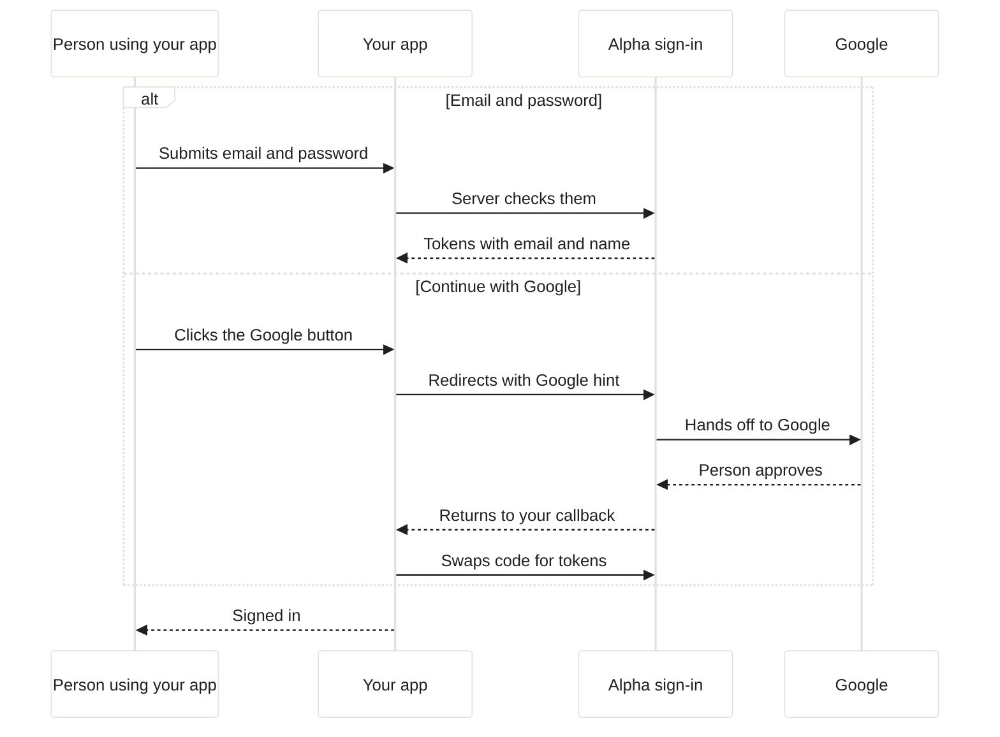

import { PromptCard } from '/snippets/prompt-card.jsx';

App sign-in gives the app you're building real user accounts, with Google or email and password, sign-up and password reset. Alpha runs the sign-in service, so you don't register an OAuth app, create a Google Cloud project or paste any keys. The **+** menu calls it **Sign-in** and the tab is called **Auth**. To sign in to Alpha itself, see [Your account and settings](/account/your-account).

{/* screenshot to capture: /images/workspace/auth-setup-hero.png — Before anyone has signed in, the Auth tab offers one thing to do: have the agent add the login. */}

## Turn on sign-in

The quickest way is to ask for it. The agent switches sign-in on for the session, then writes the sign-in, sign-up and forgot-password screens into your app.

<PromptCard label="Try this">

```text
Add user sign-in to my app.
```

</PromptCard>

Alpha will:

1. Register your app for sign-in and give the session's machine its connection details. The **Auth** tab slides into the workspace and opens.
2. Build sign-in, sign-up and forgot-password pages in your app's own design, with email and password and a Google button.
3. Key each user's data on the stable account id that sign-in returns, not on their email.
4. Start the app so you can try the flow in the [Preview](/workspace/preview).

You can also start from the workspace:

| Where | What happens |
| --- | --- |
| **+** → **Sign-in** | Alpha registers the app. A starting **Auth** tab, with the tooltip "Registering the app for sign-in…", shows until it's done, then the tab opens. Your app has no login screens yet. |
| **Set up with agent** in the **Auth** tab | Sends "Add user sign-in to my app." to the agent. The button shows until the first person signs in. While a turn is running, it's greyed out with "The agent is busy — ask once it is done". |

Ask for sign-in only in apps that need accounts. Once it's on, sign-in has no off switch. Closing the tab ("Close the Auth tab (sign-in stays on)") only hides it, and your users can still sign in.

## How does sign-in work?

Your app never stores passwords. It asks Alpha's sign-in service who someone is, and gets back standard tokens with their id, email and name. Because this is ordinary OpenID Connect, the agent uses well-known libraries such as `openid-client`, Auth.js or Passport.



Where people sign in depends on what you're building:

| Your app | Where people sign in |
| --- | --- |
| Has its own screens, such as a website | On your app's own pages, in its own design. The one sign-in service page they can still meet is the set-new-password page a reset email links to. |
| Has no screens, such as an API or a bot's back end | On the sign-in service's hosted pages, with Google or email and password, plus sign-up and password reset. |

The agent reads the connection details from the session's machine. You rarely need them, but they're in the **Auth** tab under **Connection details**.

{/* screenshot to capture: /images/workspace/auth-connection-details.png — The secret stays masked until you click Reveal. The agent already has all three values. */}

| In the tab | What your app reads | What it is |
| --- | --- | --- |
| **Issuer** | `FORGE_OIDC_ISSUER` | The sign-in service's address. Libraries discover everything else from it. |
| **Client ID** | `FORGE_OIDC_CLIENT_ID` | Your app's id with the sign-in service. One per session. |
| **Client secret** | `FORGE_OIDC_CLIENT_SECRET` | Proves the request comes from your app's server. A front end that can't keep a secret uses PKCE without it. |
| Not shown | `FORGE_AUTH_URL`, `FORGE_SANDBOX_TOKEN` | What your app's own sign-up and forgot-password forms call to create accounts and send reset emails. |

Every command on the session's machine sees these values, your running app included. Sign-in returns are accepted on the app's preview addresses, on `localhost` and, once published, on its own https addresses. The agent builds the return address from each request rather than hard-coding it, because the same app is reached at all of them.

<Warning>
The client secret works like a password for your app. Don't paste it into a message, a repository or a front end. Your app's server reads it from the machine, so nobody has to copy it.
</Warning>

## Test sign-in in the Preview

Sign up in the [Preview](/workspace/preview) the way your users would. Email and password stay inside the frame. Google's page refuses to be framed, so the Preview opens it in a window of its own, and the app picks up when you finish there. See [Sign in through another site](/workspace/preview#sign-in-through-another-site).

{/* screenshot to capture: /images/workspace/auth-preview-login.png — Harbor's sign-in page is the app's own, framed in the Preview. */}

If sign-in loops back to the sign-in page, or you're signed out on every reload, open the app with the Preview's **Open in new tab** button ("Open in new tab (login cookies work there)"). Cookies there behave as in any browser tab.

Each person appears in the **Auth** tab after their first sign-in. The list refreshes by itself while the tab is on screen. Click **Refresh** to read it now.

## Manage your app's users

The **Users** list shows everyone who has signed in to this app, most recent sign-in first. The **Auth** tab reads it from Alpha's server, so opening it never wakes a sleeping machine.

{/* screenshot to capture: /images/workspace/auth-users.png — A Google user and an email user. The amber chip marks an address nobody has confirmed. */}

| In a row | What it means |
| --- | --- |
| **google**, **password** or **google · password** chip | How the person signs in. The last means they have used both. |
| **unverified** chip | "Signed up with email + password — the address is unverified". Whether new accounts must confirm their email first is set by whoever runs your Alpha. |
| "first … · last …" | Their first and most recent sign-in to this app. |

To find someone, type in **Filter by name or email**. The filter searches the rows the list holds. To take someone out of your app:

<Steps>
  <Step title="Click the remove icon">
    Hover the icon at the end of their row. The tooltip reads "Remove from this app (their account survives; they can sign in to it again)".
  </Step>
  <Step title="Confirm with Remove">
    The row offers **Remove** and **Keep**. **Remove** revokes this app's access to their account, signs them out of Alpha's sign-in service and takes them off the list. If it fails, the row comes back with "Couldn't remove this app user".
  </Step>
</Steps>

Removing isn't a ban. The person's account survives, and if they sign in again they reappear. To keep someone out for good, ask the agent to add a rule to your app, such as an allow-list of emails.

{/* TODO confirm: whether an app's own session cookie keeps a removed user signed in until it expires, or the app notices at its next token refresh. */}

## Are app users Alpha accounts?

No. The people who use your apps are a separate pool from the people who build with Alpha.

| | App users | Alpha accounts |
| --- | --- | --- |
| Who | People who sign in to apps built on your Alpha | You and your team, building in Alpha |
| Managed in | Each session's **Auth** tab | [Your account](/account/your-account), and the [Admin dashboard](/admin) |
| Can open Alpha | No | Yes |

One app account works in every app built on the same Alpha, so someone who signed up for Harbor can sign in to another of your apps with the same email and password. Each app's **Auth** tab lists only the people who signed in to that app. People you [share the session](/sharing) with don't see the **Auth** tab.

## Take sign-in to production

When you [publish](/publish/publish-your-app) an app with sign-in on, the published app gets the same sign-in: the same three values, the same user accounts and the same **Auth** tab. Its own https addresses are accepted for sign-in returns. In the **Publish** tab's **Edit settings**, the **Production services** group has a **Sign-in** switch for this, described as "The same accounts and Auth tab — FORGE_OIDC_* set, callbacks on this address accepted." See [Production database and sign-in](/publish/production-data).

<Note>
If the **Auth** tab says "Sign-in isn't set up on this forge", or the publish **Sign-in** switch says "not offered on this Alpha — Alpha's sign-in issuer is not public", that part isn't turned on for your Alpha. Ask whoever runs it.
</Note>

## Limits and fixes

| What | Detail |
| --- | --- |
| Users listed | The 100 most recent. A line below the list, "Showing the 100 most recent — … total.", gives the full count. |
| History | The list comes from the sign-in service's record of sign-ins, which it keeps for a period set by whoever runs your Alpha (90 days in Alpha's standard setup). Someone whose last sign-in is older drops off the list. |
| Passwords | 8 to 256 characters, for accounts your app's own sign-up form creates. |
| Sign-ups and reset emails | 20 calls a minute per session, shared by the preview and the published app. Past that, calls are refused with "too many sign-up or reset calls from this app — retry shortly" until the allowance refills, one call every few seconds. |
| Turning it off | Not possible. [Deleting the session](/sessions/fork-and-delete#delete-a-session) removes its sign-in registration, together with its published apps. |

If sign-in fails with "Invalid parameter: redirect_uri", the app sent people back to an address Alpha doesn't accept, usually a hard-coded one. Send the agent:

```text
Sign-in fails with "Invalid parameter: redirect_uri". Build the callback URL from the incoming request's forwarded host instead of hard-coding it.
```

## Next steps

<CardGroup cols={2}>
  <Card title="Add a database and sign-in" icon="database" href="/guides/data-app">
    A worked example: Harbor members sign up, book classes and see only their own bookings.
  </Card>
  <Card title="Production database and sign-in" icon="server" href="/publish/production-data">
    Which services a published app takes with it, and how to switch each one.
  </Card>
  <Card title="Your session's database" icon="table" href="/workspace/database">
    Keep each user's data in PostgreSQL, keyed on the id sign-in gives you.
  </Card>
  <Card title="Preview your app" icon="browser" href="/workspace/preview">
    Why Google opens in its own window, and when to test in a new tab.
  </Card>
</CardGroup>
