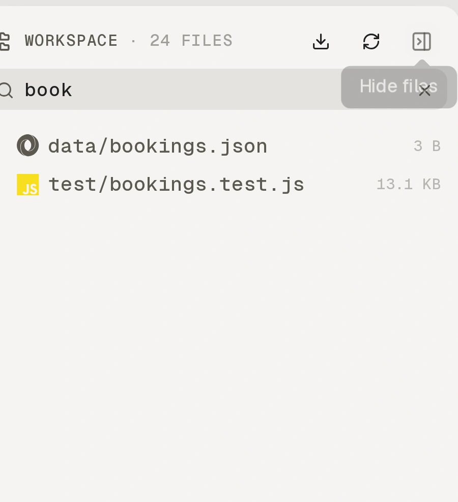
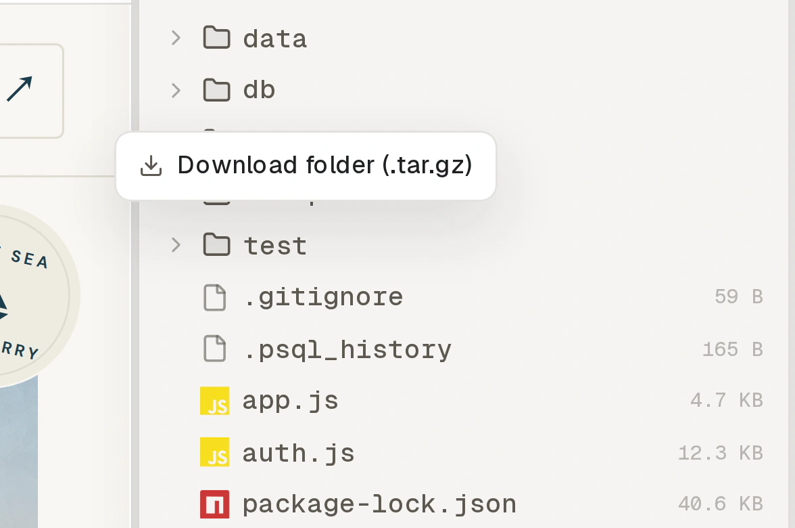
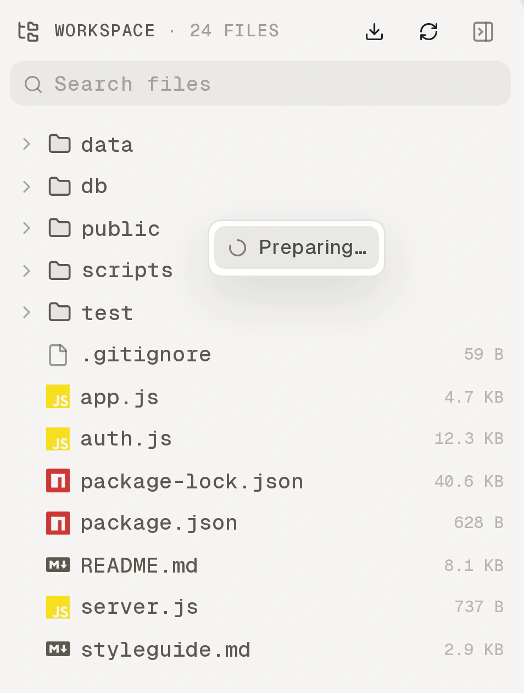

import { uploadMax, imageMax, fileDownloadMax, folderDownloadMax } from '/snippets/limits.mdx';

The files panel lists everything in your session's workspace, the `/workspace` folder on the session's machine: the code the agent writes, the files you upload and the documents it makes for you. Click any file to open it as a tab. How each kind of file looks once it's open is on [File viewers](/workspace/file-viewers), and attaching files to a message is on [The composer](/chat/composer#attach-files).

<Frame caption="The files panel opens along the right edge. Sizes sit at the end of each file's row.">
  
</Frame>

## Open the files panel

Click the folder button (**Show files**) at the top right of the workspace, or in the chat header while there's no workspace yet. The panel's header reads **Workspace · N files**, with buttons to download the workspace, **Refresh files** and **Hide files**. Drag the panel's divider to widen it, and click **Hide files** to put it away. On a tablet the panel covers the workspace, and on a phone the whole screen. It closes once you open a file. See [Phones and tablets](/account/phones-and-tablets).

The tree keeps up with the agent by itself while a turn runs. **Refresh files** re-reads it at once.

| The panel says | Why | What to do |
| --- | --- | --- |
| "No sandbox yet. Send a message to boot one." | The session has no machine yet | Send your first message. |
| "Sandbox is loading… Files appear as soon as it's up." | The machine is starting, or waking from sleep | Wait. The tree fills in by itself. |
| "Couldn't read the files." | The read failed | Click **Retry**. |
| "workspace is empty" | The machine is up but `/workspace` holds nothing yet | Ask the agent to start building. |

Opening the panel on a sleeping session [wakes its machine](/sessions/machines). The tree hides dependency and build folders: `.git`, `node_modules`, `.venv`, `.venvs`, `__pycache__`, `.next`, `dist`, `.cache` and `.npm`. Other hidden files, such as `.env`, do show. Below the top level, the tree lists at most 5,000 entries.

## Find a file

Type part of a name or path into **Search files**, and the tree turns into a list of matching files by full path, best match first.

<Frame caption="Typing in Search files swaps the tree for a list of matching files.">
  
</Frame>

| You do | What happens |
| --- | --- |
| Type a few letters | Words match in any order, with one typo allowed per word. Failing that, letters in order match, so `bkng` finds `booking`. |
| Press <kbd>Enter</kbd> | Opens the first result |
| Press <kbd>Esc</kbd>, or click the X (**Clear search**) | Clears the query and brings the tree back |
| Get "no files match" | Nothing in the tree fits. Hidden folders such as `node_modules` aren't searched. |

Search shows at most 200 results, so add a folder name to narrow a long list. Searching never wakes the machine.

## Open a file or mention it

Click a file to open it as a tab in the [viewer that fits it](/workspace/file-viewers). The row's icon tells you which: slides for decks, a grid for spreadsheets, a ruler and pencil for drawings.

Hover a tab for the file's full path. Close it with its X or a middle-click.

To point the agent at a file, drag its row into the composer. Alpha inserts `@path` where you drop it, and a folder arrives as `@path/`. Typing `@` in the composer [finds the same files](/chat/composer#mention-files-sessions-and-skills).

{/* screenshot to capture: /images/workspace/pointing-drag-mention.png — Drop a file anywhere in your text, and the mention lands where you let go. */}

## Which files open by themselves?

| What opens | When |
| --- | --- |
| The files you asked for, such as a drawing, spreadsheet, PDF, document or slide deck. Ask for a report and a diagram, and both open. | While a turn you started runs, as soon as the file exists, even while the agent is still writing it |
| A slide deck | When the agent shows it to you, or when it's the file you asked for. Decks already in the workspace, such as those in an attached repository, stay closed. A turn that revises a deck opens the deck, not its PowerPoint copy. |

Your app's code never opens by itself: the [Preview](/workspace/preview) is where you see an app. However many files a turn writes, Alpha keeps looking for the ones you asked for. If a turn ends while you're in another session, its files are open when you come back. If you close a file Alpha opened by itself, it doesn't open by itself again in that session, on any device.

{/* screenshot to capture: /images/workspace/files-auto-open.png — Asked for a spreadsheet, the tab opened while the agent was still filling it in. */}

<Note>
If files you ask for never open by themselves, that feature isn't turned on for your Alpha. Everything else on this page works without it.
</Note>

Files the agent names in its replies are links, and clicking one opens it at the line given. See [Open files from the chat](/chat/transcript#open-files-from-the-chat).

## Bring your own files in

Click **+** → **Add files** in the composer, or drag files from your computer onto it. Each file uploads as soon as you attach it, not when you send, into `/workspace/uploads/`, where it shows in the tree and the agent can read it. Alpha cleans up each name first:

| You attach | It's saved as | Why |
| --- | --- | --- |
| `report.md` when `uploads/report.md` exists | `uploads/report-1.md` | An upload never replaces an earlier one. |
| `Harbor Q3 (final).pdf` | `uploads/Harbor Q3 _final_.pdf` | Each run of characters other than unaccented letters, digits, spaces, `.`, `-` and `_` becomes one `_`. A folder path is dropped, and a name is cut to 100 characters. |
| `.env` | `uploads/env` | Leading dots are dropped, so an upload is never hidden. |

Each file can be up to [{uploadMax}](/reference/limits), and images up to {imageMax} also reach the model as pictures. Removing an attachment before you send deletes it from the machine. [Attach files](/chat/composer#attach-files) covers progress and upload errors.

## Download what the agent made

Right-click a row: a file offers **Download**, a folder **Download folder (.tar.gz)**. Downloads save straight to your disk, with your browser's own progress in its downloads list, so you can keep working while a large one arrives.

| You download | What you see |
| --- | --- |
| A file | Click **Download** and the menu closes. The browser saves the file under its own name. If the connection drops, resume it from the browser's downloads list. |
| A folder | The item reads "Preparing…" while Alpha checks the folder, then the browser saves `<folder>.tar.gz`. If the folder can't be downloaded, the menu stays open with the reason, such as "the folder is over 500 MB, not counting dependency folders". |
| The whole workspace | Click the download button in the files panel's header, **Download the workspace (.zip)**. Its tooltip reads "Preparing the workspace…" while Alpha checks it, then the browser saves `workspace.zip`. If it can't be downloaded, the button turns red and its tooltip gives the reason, such as "Download failed: the folder is over 500 MB, not counting dependency folders". |

<Frame caption="Right-click a folder to download it as one .tar.gz archive.">
  
</Frame>

| What you download | Limit | Notes |
| --- | --- | --- |
| A file | None | Any size downloads, including large videos and datasets. |
| A folder | [{folderDownloadMax}](/reference/limits) before compression | Leaves out `node_modules`, `.venv`, `.venvs`, `venv`, `__pycache__` and `.cache`, which don't count. Larger folders are refused with "the folder is over 500 MB, not counting dependency folders". |
| The whole workspace (`.zip`) | [{folderDownloadMax}](/reference/limits) before compression | The same as a folder: dependency folders are left out and don't count. |

An archive keeps `.git` and `dist`, which the tree hides. To keep the code somewhere for good, [push it to GitHub](/github/branches-and-prs). An open PDF, image, video or audio file, drawing or Office document also has a **Download the file** button. To give someone one file with a link of its own, [publish it as an artifact](/artifacts).

Viewers of a [shared session](/sharing) can download files but not folders or the whole workspace. Their copy of a text file has the owner's secret values replaced with `[redacted]`, which an archive can't do, and a text file over [{fileDownloadMax}](/reference/limits) doesn't download for them. While the owner is away, a viewer can't wake a sleeping machine, so their downloads fail in the browser until the owner is back.

<Frame caption="While Alpha checks a folder, its download reads Preparing….">
  
</Frame>

## Why can't I edit files here?

The workspace is the agent's, so every file opens read-only. A file tab's header carries a **read-only** chip ("The agent owns the workspace files — the editor is read-only"), and typing in the editor shows "Read-only — ask the agent to change files".

| You want to | Do this |
| --- | --- |
| Describe the change | Ask the agent, and name the file with `@path`. |
| Show exactly which lines or element | Select text and choose **Add to prompt**, or pick an element. See [Point at and draw on your app](/workspace/point-and-draw). |
| Make the change yourself | Open the [Shell](/workspace/shell). It runs as the same account as the agent, so the agent can keep working on what you change. |

## Next steps

<CardGroup cols={2}>
  <Card title="File viewers" icon="eye" href="/workspace/file-viewers">
    What PDFs, spreadsheets, decks, drawings and code look like once a tab is open.
  </Card>
  <Card title="Point at and draw on your app" icon="arrow-pointer" href="/workspace/point-and-draw">
    Turn a selection, an element or a sketch into context for your next message.
  </Card>
  <Card title="Slides, drawings and diagrams" icon="presentation-screen" href="/workspace/decks-and-drawings">
    Ask for a deck or a diagram and export it as PowerPoint, PDF or PNG.
  </Card>
  <Card title="Limits" icon="gauge" href="/reference/limits">
    Every upload, download and session limit in one table.
  </Card>
</CardGroup>
