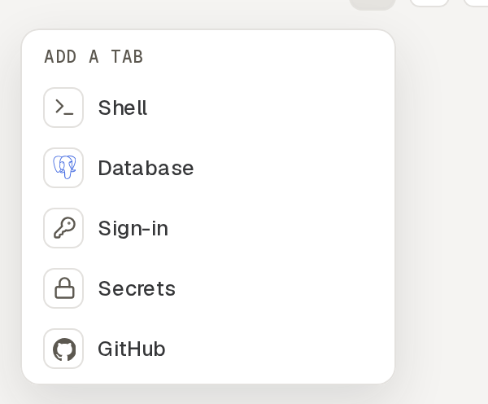
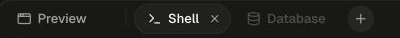

import { idlePark } from '/snippets/limits.mdx';

The workspace is the panel to the right of the chat. It shows your session's machine: the app the agent is running, the files it wrote, a terminal, the database and the services you've switched on. Each of those is a tab in one strip across the top, and new tabs appear only when there's something to put in them. To look at your app, go straight to [Preview your app](/workspace/preview). To find a file, see [Files and uploads](/workspace/files).

<Frame caption="The chat sits on the left and the workspace on the right, with the Preview in front.">
  
</Frame>

## What each tab shows

Most tabs arrive by themselves when the agent starts using something. The rest you open from the **+** menu.

| Tab | What it shows | How it appears | Viewers see it? |
| --- | --- | --- | --- |
| **[Plan](/chat/plan-mode)** | The plan the agent proposed in plan mode | By itself when the agent proposes a plan | Yes |
| **[Preview](/workspace/preview)** | Your running app | By itself when the agent starts your app. It comes to the front once there's a page to show. | Yes, without **Select**, **Draw** and **Edit** |
| **[Shell](/workspace/shell)** | A terminal on the machine | **+** → **Shell**. The agent never opens it for you. | No |
| **[Agent](/agents/agent-tab)** | The flow of the AI agent you're building, and the tools each step uses | By itself when the agent publishes an AI agent | Yes |
| **[Evals](/evals/set-up)** | That AI agent's evals. Each eval you open gets a tab of its own, named after it, such as **booking-flow eval**, and **New eval** opens a tab with the form for another. | By itself when the agent publishes its evals | Yes, results only |
| **[Database](/workspace/database)** | The session's PostgreSQL, and your published apps' production databases | By itself when the agent starts the database, or **+** → **Database** | No |
| **[Auth](/workspace/app-sign-in)** | Your app's sign-in settings and its users | By itself when the agent adds sign-in, or **+** → **Sign-in** | No |
| **[Routines](/routines)** | Work that runs on a timetable | By itself once a routine is saved in the session | No |
| **[Publish](/publish/publish-your-app)** | The session's published apps and their versions | **+** → **Publish**, or by itself when a publish starts | No |
| **[Production Logs](/publish/monitor)**, **Production Metrics** | A live app's log and its traffic | **+** → **Production Logs** or **Production Metrics**, once an app from this session is live. They never open by themselves, even when the agent reads them. | No |
| **[Secrets](/secrets)** | This session's tools key and secrets | **+** → **Secrets**, or by itself when the agent saves a secret for the session | No |
| **[GitHub](/github/branches-and-prs)** | Branches, changes, commits and pull requests | The **GitHub** button at the right of the strip, or **+** → **GitHub** | No |
| [File tabs](/workspace/file-viewers) | One file each, in the viewer that fits it | Click a file in the files panel or a file link in the chat. Some files you asked for open themselves. | Yes, read-only |

Every file in the workspace is the agent's, so every file tab is read-only. To change a file, ask the agent, or [point at the part you mean](/workspace/point-and-draw).

[People you share the session with](/sharing) get the tabs marked Yes, and never the **+** menu.

## Use the buttons beside the tabs

At the right end of the tab strip sit the session's own buttons. People you share the session with see only the files button and, where it's on, **Report a bug**.

| Button | What it does |
| --- | --- |
| **GitHub** | Opens the [GitHub](/github/branches-and-prs) tab. |
| **Share** | Shares the session. See [Share a session](/sharing). |
| **Publish** | Publishes your app, or shows the published one. See [Publish your app](/publish/publish-your-app). |
| **Publish as artifact** | Takes the place of **Publish** while a file tab is in front. It asks the agent to keep the file as an [artifact](/artifacts), with a link of its own. Once the file is an artifact, the pill reads **Artifact** and opens its menu. |
| **Report a bug** (bug icon) | Opens a panel to describe a problem and attach screenshots or files, and send them to the Alpha team. **Send feedback** in the account menu opens the same panel. |
| Files (folder icon) | Shows or hides the [files panel](/workspace/files). |

## Why is there no workspace yet?

Alpha switches nothing on until the work needs it, so a new session has no workspace panel and the chat takes its place. The **+** button, **GitHub**, **Share**, **Report a bug** and the files button sit in the chat header instead. A pulsing dot on **+** means a service is starting.

<Frame caption="A new session: the chat and the files panel, with + in the header and no workspace yet.">
  
</Frame>

The panel slides in the first time there's something to show: usually the Preview, once the agent starts your app.

## Turn on a service

The agent switches services on when the work calls for them, such as the database when your app needs one. Each new tab folds into the strip and comes to the front. The **Shell** is the exception: only you can open it.

To switch one on yourself, click **+** at the end of the tab strip (tooltip "Open a tab, or turn on a service"). The menu has two parts: **Closed tabs** lists the tabs you hid with their **×**, and **Add a tab** lists the services that aren't on yet, plus **GitHub** when its tab isn't open. A part with nothing in it doesn't show.

<Frame caption="With Shell, Database and Secrets already open as tabs, the + menu offers only the services that aren't.">
  
</Frame>

| Menu item | What happens |
| --- | --- |
| **Shell**, **Publish**, **Secrets**, **GitHub** | The tab opens at once. |
| **Database** | PostgreSQL starts inside the machine. Until it's ready, the tab shows dimmed, and hovering it shows "Starting PostgreSQL in this session's machine…". |
| **Sign-in** | Alpha registers your app for sign-in. Until it's done, an **Auth** tab shows dimmed, and hovering it shows "Registering the app for sign-in…". |
| **Production Logs**, **Production Metrics** | The tab opens on your live app. Offered only once an app from this session is live. |

<Frame caption="A service the machine has to start shows as a dimmed tab until it's ready.">
  
</Frame>

If a service can't start, Alpha shows the error and the starting tab goes away. The Preview is in the menu only after you close it: to get one, ask the agent to run your app.

<Note>
If you don't see **Publish** in the **+** menu or the workspace header, publishing isn't turned on for your Alpha. If you don't see **Report a bug**, it isn't turned on for your Alpha.
</Note>

## Close a tab or switch a service off

The **×** on most tabs only hides the tab, and the service keeps running. Only the Shell's **×** ends something. The tooltip on each **×** says what it does, such as "Close the Database tab (the database keeps running)".

| Tab | What **×** does | Afterwards |
| --- | --- | --- |
| **Preview** | Hides the tab | The app keeps running. The tab comes back the next time you load the page. |
| **Database** | Hides the tab | The agent and your app still use the database. |
| **Auth** | Hides the tab | Your app's users can still sign in. |
| **Plan**, **Agent**, **GitHub** | Hides the tab | Nothing changes. |
| An eval's tab, such as **booking-flow eval** | Closes the tab | The eval and its runs stay. While the eval runs, its tab shows a spinner and has no **×**. A warning dot on the tab means its last run stopped short. |
| **Shell** | Switches the Shell off | The terminal, its scrollback and anything running in it end. Typing `exit` does the same. The next **Shell** starts fresh. |
| **Publish** | Removes the tab | Your apps stay live, and the tab comes back with the next publish. While a publish runs, the tab stays: "publishing is in progress — the tab stays until it is done". |
| **Secrets** | Removes the tab | Your secrets are kept and still reach the session. |
| **Production Logs**, **Production Metrics** | Removes the tab | Your live app is unaffected. Open it again from **+** → **Add a tab**. |
| **Routines** | Has no **×** | |

To bring back a hidden tab, pick it under **Closed tabs** in the **+** menu. A tab whose **×** removed it, such as **Shell**, **Publish** or **Secrets**, is under **Add a tab** instead. A new plan brings **Plan** back by itself, and the agent publishing its AI agent or evals again brings back **Agent** or **Evals**.

Close a file tab with its **×** or by middle-clicking it. If you close every tab, the workspace folds away, and **Show workspace** in the chat header brings your closed tabs back.

## Arrange the workspace

| To | Do this |
| --- | --- |
| Resize the chat and the workspace | Drag the divider between them. Double-click it to return to the default split. |
| Give the workspace the whole window | Press <kbd>⌘</kbd><kbd>⇧</kbd><kbd>B</kbd>, or drag the divider past the chat's narrowest width. Press the shortcut again, or click **Show chat · ⌘⇧B**, to bring the chat back. |
| Give the chat the whole window | Drag the divider all the way to the right. Click **Show workspace** in the chat header to bring it back. |
| Show or hide the files | Click the folder button at the top right ("Show files"). The files panel opens along the right edge. |
| Reach tabs that don't fit | Scroll the strip with the mouse wheel, or click the arrow on the side with hidden tabs. |

Use Ctrl instead of ⌘ on Windows and Linux. Every shortcut is listed in [Keyboard shortcuts](/reference/keyboard-shortcuts).

Alpha saves each session's tabs with the session, so they're the same in every browser and on every device: the open files, the **GitHub** tab, the tab in front and the tabs you closed. Switch sessions, reload or open the session somewhere else, and they return as you left them, except a closed Preview, which comes back on reload, behind the tab in front. Files a turn opened while you were away are open when you come back. What a tab shows inside, such as the Preview's port or the Database table, isn't kept.

If you have the same session open in two places, the last change in either wins. People you share the session with start on its Preview, or on its first tab when it has no Preview, each time they open it.

## What do the tabs show while the machine wakes?

A session's machine sleeps once you've been away for {idlePark} and nothing is running. When you open the session again, tabs that read from the machine show grey placeholder bars for a few seconds, then fill in by themselves, with nothing to retry. **Plan**, **Auth**, **Routines** and **Secrets** don't read from the machine and show at once. See [Sleep, wake and reset](/sessions/machines) for what keeps a machine awake, and [Limits](/reference/limits) for the idle time.

## Next steps

<CardGroup cols={2}>
  <Card title="Preview your app" icon="window-maximize" href="/workspace/preview">
    Switch device sizes, read the app's console and open it in its own tab.
  </Card>
  <Card title="Point at and draw on your app" icon="pen" href="/workspace/point-and-draw">
    Pick an element or mark up the page, and send it with your next message.
  </Card>
  <Card title="Files and uploads" icon="folder-open" href="/workspace/files">
    Search the machine's files, download a folder and attach your own.
  </Card>
  <Card title="Your session's database" icon="database" href="/workspace/database">
    Browse tables, edit rows and run SQL without leaving the session.
  </Card>
</CardGroup>
