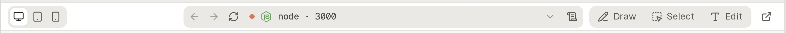
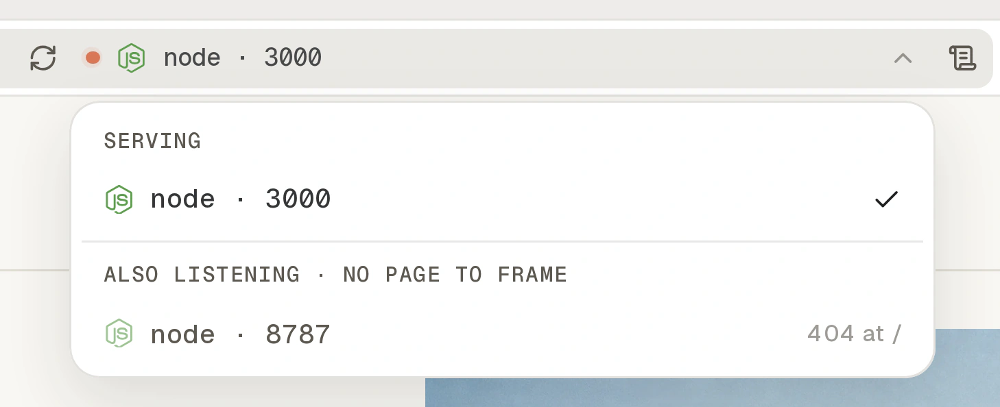
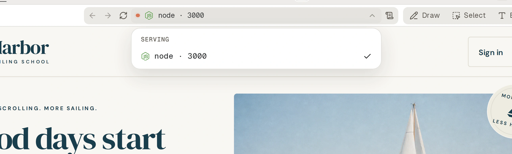

import { idlePark } from '/snippets/limits.mdx';

The **Preview** is your app, live, running on the session's machine and framed in the workspace next to the chat. It opens by itself the moment the agent starts a server that serves a page, and it reloads at the end of every turn so you always see the finished work. To show the agent a part of the page or draw on it, see [Point at and draw on your app](/workspace/point-and-draw). For the other tabs around it, see [The workspace](/workspace/overview).

<Frame caption="The Preview's toolbar: the device switch on the left, the app's own navigation and port in the middle, and the tools on the right.">
  
</Frame>

## How does my app get here?

When the agent starts your app, a **Preview** tab joins the workspace. Once the app's home page answers with a web page, the tab opens on it. You never switch the Preview on yourself, because it follows what the agent has running.

Four rules decide what you see:

| Rule | Why it matters |
| --- | --- |
| The agent must start the server | The Preview shows only servers the agent started. A server you start in the [Shell](/workspace/shell), or one started any other way, isn't listed, and its address answers "Port not previewable". To see an app, ask the agent to start it. |
| The app must be reachable from the Preview | An app that only answers inside its own machine can't be shown. The agent sets this up for you. |
| The home page must be a web page | An API, a file listing or a slide deck is listed in the port menu but not framed. |
| The frame reloads when a turn ends | Less than a second after the agent finishes, the Preview reloads on the app's home page, so the latest version is on screen. |

If the app stops for more than a few seconds, the tab goes away until it runs again. A restart doesn't make it blink. Closing the tab with its × only hides it, and the app keeps running. While the app runs, the **+** menu brings the tab back.

### Which server does the Preview open on?

Many apps run more than one server, such as a web front end, an API and a background helper. The Preview opens on the app's front end, the server the agent started for you to look at. An API or another server that comes up later joins the [port menu](#switch-ports) and doesn't take over the frame. A port you pick from the menu stays on screen.

If the Preview shows an API or a helper instead of your app, pick the front end from the port menu, or ask the agent: "Start the front end as the app I look at in the Preview."

<Frame caption="The front end stays on screen; an API that also runs waits in the menu.">
  
</Frame>

## Use the toolbar

The toolbar works like a small browser for your app. Its controls sit in three groups: the device switch on the left, the address bar in the middle, and the tools on the right, followed by **Open in new tab**. **Back** and **Forward** move through the app's own history, single-page routes included, and never move Alpha's own address bar.

| Group | Control | What it does |
| --- | --- | --- |
| Device switch | **Desktop**, **Tablet · 834px**, **Mobile · 390px** | Resizes the frame in place. Hidden when the workspace is narrow. |
| Address bar | **Back**, **Forward** | Greyed out when there's nowhere to go, or in a browser older than Chrome 102, Firefox 147 or Safari 26.2. |
| Address bar | **Reload preview** | Reloads the app's home page. |
| Address bar | Port, such as **node · 3000** | Shows the process and port on screen, with a dot that pulses while it serves. Click it to [switch ports](#switch-ports). Reads "no page yet" or "no ports" when there's nothing to frame. |
| Address bar | **Logs** | Opens the [logs panel](#read-the-logs). A red dot and a tooltip such as "Logs · 2 errors" mean the app logged errors. |
| Tools | **Draw**, **Select**, **Edit** | Mark up the page, point at an element, or retype text on the page and send the changes to the agent. The one that is on is highlighted. See [Point at and draw on your app](/workspace/point-and-draw). |
| — | **Open in new tab** | Opens the app at its own address, where its sign-in cookies work normally. |

When the workspace is narrow, the device switch is hidden first, then the tools show their icons without their names, and a long port name is cut short. People you [share the session](/sharing) with see the same Preview, without **Draw**, **Select** or **Edit**.

## Switch ports

When your app runs more than one server, such as a web front end and an API, click the port to list them all. The Preview opens on the front end, and the others wait here (see [Which server does the Preview open on?](#which-server-does-the-preview-open-on)). The menu opens under the port. Ports that serve a page come first, under **Serving**, with a check on the one on screen. The rest sit under **Also listening · no page to frame**, each with its reason. Only servers the agent started appear here.

<Frame caption="With one server running, the menu holds one port, checked as the one on screen.">
  
</Frame>

| Reason in the menu | What is on that port |
| --- | --- |
| "404 at /" (or another status), "no page at /" | A server with no page at `/`, usually an API |
| "a file listing at /" | A static file server pointed at a folder, never the app |
| "a deck — open its file instead" | A slide deck. Decks open in [their own viewer](/workspace/decks-and-drawings). |
| "not HTTP" | A server that doesn't speak HTTP |

Click a row ("Open it anyway") to frame that port regardless.

## Test other widths

Pick **Tablet · 834px** or **Mobile · 390px** to narrow the frame to that width. The app's own layout rules apply, so you see its real phone layout, not a scaled-down desktop. **Desktop** fills the workspace again.

<Frame caption="Mobile narrows the frame, and the app’s phone layout takes over.">
  
</Frame>

To check a width the switch doesn't offer, use **Open in new tab** and resize that browser window.

## Sign in through another site

Sign-in pages such as Google's refuse to be shown inside another page. So when your app sends the frame to another site, such as a sign-in or a checkout, Alpha opens that site in a window of its own. If you clicked something in the app, the window opens by itself. Otherwise click **Continue to** that site. Finish there, and the app picks up in the Preview.

{/* screenshot to capture: /images/workspace/preview-signin-escape.png — A Google sign-in opens in its own window. The app picks up in the frame when you finish there. */}

If the frame ends up on another site's page anyway, a pill along the bottom says so, such as "weather.example.com is outside the app.", with **Open in new tab** and **Back to the app**. If sign-in keeps looping in the frame, use **Open in new tab**, where cookies behave as in any browser tab. To add sign-in to your app, see [App sign-in](/workspace/app-sign-in).

<Warning>
Each port has its own preview address, and that address is the only key. Anyone you give it to can use your app while the machine is awake, including any data the app shows without sign-in. Share the address only with people you'd show the app to.
</Warning>

## Read the logs

Click **Logs** to open a panel under the frame. **Console** shows the app's browser console and uncaught errors, with a "Page loaded" divider at each load. Beside it is one tab per server the agent started, showing that server's log.

{/* screenshot to capture: /images/workspace/preview-logs-console.png — The console shows the error the page hit. The web tab holds the server's own log. */}

| Button | What it does |
| --- | --- |
| Paperclip ("Attach the last lines to your next message") | Adds the last 50 lines of the tab you're on to the composer as a chip named "Preview console" or after the server, such as "web log". Owner only. |
| "Clear the console" | Empties the **Console** tab. |
| "Close logs" | Hides the panel. |

Drag the panel's top edge to resize it, up to 70% of the Preview's height. With the edge focused, <kbd>↑</kbd> and <kbd>↓</kbd> resize it too. People you share the session with see **Console** only.

## What happens while the machine wakes?

A machine sleeps once you've been away for {idlePark}, and opening the session wakes it. See [Sleep, wake and reset](/sessions/machines). Grey placeholder bars cover the frame until the app is back, usually within seconds.

The Preview may not wait at all. It can show the last version of your app at once, with a note along the bottom, while the machine wakes. When the live app is ready, it fades in at the same address and scroll position, without a reload. **Edit** waits for the live app, with the tooltip "Editing waits for the live app, a moment away".

{/* screenshot to capture: /images/workspace/preview-cached-copy.png — The last version is on screen at once. The live app replaces it by itself. */}

Only pages a signed-out visitor would see are shown this way, so a signed-in page never reaches anyone else. If you're signed in to your app, you see the signed-out version until the live app takes over.

<Note>
If the Preview always waits for the live app, showing the last version isn't turned on for your Alpha. Ask your admin.
</Note>

## Why does the Preview show a message?

The frame, or a preview address opened in its own tab, says why there's no app. Most fixes are one sentence to the agent. More are in [Troubleshooting and FAQ](/reference/troubleshooting).

{/* screenshot to capture: /images/workspace/preview-loopback.png — The app is running, but it only answers inside the machine, so the Preview can't show it. */}

| Message | What it means | What to do |
| --- | --- | --- |
| "… is bound to 127.0.0.1 …" | The app only answers inside the machine, so the Preview can't reach it. | Ask the agent: "Make the dev server reachable from the Preview." |
| "Nothing is listening right now — the app's server stopped." | The server crashed or was stopped. | Check **Logs**, then ask the agent to run it again. |
| "… listening, but nothing to frame at /." | Every port is an API, a file listing or a deck. | Pick a port from the port menu, or ask the agent to start the web front end. |
| "Blocked request. This host is not allowed" | The dev server (Vite, for example) refused the preview address. | Ask the agent to allow the preview host in its config. |
| "Sandbox asleep" | You opened a preview address while the owner is away from Alpha. | Open the session in Alpha. The page reloads itself once the machine is back. |
| "Sandbox didn't wake" | The machine couldn't be brought back. Nothing was discarded. | Open the session. The transcript says what went wrong. See [Sleep, wake and reset](/sessions/machines#what-if-a-machine-won’t-wake). |
| "Nothing on this port" | The machine is up, but nothing answered on that port. | Ask the agent to start the app. |
| "No live sandbox" | The session has no machine yet. | Open the session and ask the agent to run the app. |
| "Port not previewable", with a line saying Alpha hasn't seen a server the agent started on this port | Nothing the agent started is listening on that port. A server you started in the Shell, or one started any other way, is never shown. | Ask the agent to start the app: "Run the app so I can see it in the Preview." |
| "Unknown session" | No session matches the address. It may have been deleted. | Open the Preview from the session itself. |

<Tip>
The agent tells you an app is running only once it shows in the Preview. Apps it starts keep running between turns, and are still running when the machine wakes from sleep. See [Inside a session's machine](/reference/machine-environment).
</Tip>

## Next steps

<CardGroup cols={2}>
  <Card title="Point at and draw on your app" icon="arrow-pointer" href="/workspace/point-and-draw">
    Click a button in the Preview and the agent gets its selector, its styles and, where it can tell, its source file.
  </Card>
  <Card title="Add sign-in to your app" icon="right-to-bracket" href="/workspace/app-sign-in">
    Turn on sign-in for your app and see who has signed up in the Auth tab.
  </Card>
  <Card title="Sleep, wake and reset" icon="moon" href="/sessions/machines">
    What keeps the machine awake, and what to do if it won't come back.
  </Card>
  <Card title="Publish your app" icon="rocket" href="/publish/publish-your-app">
    Give the app a permanent address that doesn't depend on the session's machine.
  </Card>
</CardGroup>
